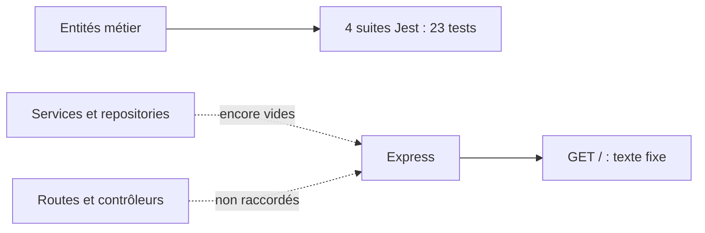

# Workout API — revue du projet TypeScript

> [!info] Périmètre
> Dépôt public [`Maxirrx/workout-api`](https://github.com/Maxirrx/workout-api), **commit examiné** `7e63a47d46c70188ea456a03d43ab582eca9f1f0` (`main`). C'est un projet distinct de [[TypeScript hexagonal]]. Cette fiche évalue le code à ce commit, **pas** un déploiement ni les modifications futures.

## Mon avis en une phrase

**Bon début pour construire le domaine par petites règles testées ; pas encore une API de workout utilisable.** La séparation des dossiers donne une direction, mais la plupart des couches HTTP et dépôt ne sont pas implémentées.

## Points forts observés

- **Un vocabulaire métier existe.** `User`, `Exercice`, `Performance`, `WorkoutTemplate` et `WorkoutSession` sont séparés du fichier Express ; des règles sont vérifiées à la construction (e-mail, muscle dupliqué, durée entière, séance terminée dans le futur). Voir [entités](https://github.com/Maxirrx/workout-api/tree/7e63a47d46c70188ea456a03d43ab582eca9f1f0/src/Domain/Entity) et [tests](https://github.com/Maxirrx/workout-api/tree/7e63a47d46c70188ea456a03d43ab582eca9f1f0/src/test/domainTest/entity).
- **Un retour rapide existe.** Sur une copie isolée, `npm ci --ignore-scripts`, `npm test -- --runInBand --ci` et `npm run build` réussissent : **4 suites, 23 tests**, compilation TypeScript réussie. Le [workflow Jest](https://github.com/Maxirrx/workout-api/blob/7e63a47d46c70188ea456a03d43ab582eca9f1f0/.github/workflows/jest.yml#L1-L22) a aussi terminé avec succès pour ce commit ([exécution GitHub](https://github.com/Maxirrx/workout-api/actions/runs/44552579360)). Ce signal porte sur les tests configurés, pas sur une API complète.
- **La progression par entités facilite l'apprentissage.** On peut ajouter un comportement et son test avant de brancher l'HTTP ; c'est une base plus claire qu'une seule grosse route. Voir [[Tests - pyramide et TDD]] et [[Architecture hexagonale - Domaine, ports et limites]].

## Points faibles, par priorité

1. **P1 — L'API métier n'est pas encore branchée.** [`src/index.ts:3-13`](https://github.com/Maxirrx/workout-api/blob/7e63a47d46c70188ea456a03d43ab582eca9f1f0/src/index.ts#L3-L13) expose seulement `GET /` avec un texte fixe. Les fichiers de [routes](https://github.com/Maxirrx/workout-api/tree/7e63a47d46c70188ea456a03d43ab582eca9f1f0/src/Infra/Http/Route), [contrôleurs](https://github.com/Maxirrx/workout-api/tree/7e63a47d46c70188ea456a03d43ab582eca9f1f0/src/Infra/Http/Controller) et [repositories](https://github.com/Maxirrx/workout-api/tree/7e63a47d46c70188ea456a03d43ab582eca9f1f0/src/Infra/Repository) sont vides. On ne peut pas créer/lire un workout par HTTP dans ce commit. La structure annoncée n'est pas une implémentation.
2. **P1 — Un exercice avec un seul muscle est rejeté à tort.** Dans [`Exercice.ts:27-30`](https://github.com/Maxirrx/workout-api/blob/7e63a47d46c70188ea456a03d43ab582eca9f1f0/src/Domain/Entity/Exercice.ts#L27-L30), deux muscles facultatifs absents conduisent à `undefined === undefined`, donc à l'erreur « muscle dupliqué ». Reproduit localement avec un muscle principal et deux valeurs `undefined`. Les [tests d'exercice](https://github.com/Maxirrx/workout-api/blob/7e63a47d46c70188ea456a03d43ab582eca9f1f0/src/test/domainTest/entity/exercice.test.ts#L10-L32) n'exercent pas ce cas.
3. **P2 — Les invariants ne tiennent pas tous.** [`WorkoutSession.ts:23-26`](https://github.com/Maxirrx/workout-api/blob/7e63a47d46c70188ea456a03d43ab582eca9f1f0/src/Domain/Entity/WorkoutSession.ts#L23-L26) accepte une séance terminée avec `Invalid Date` (`NaN` échappe à la comparaison). [`Performance.ts:23-30`](https://github.com/Maxirrx/workout-api/blob/7e63a47d46c70188ea456a03d43ab582eca9f1f0/src/Domain/Entity/Performance.ts#L23-L30) accepte une durée entière négative ; poids et répétitions ne sont pas contrôlés. Ces deux cas ont été reproduits localement. Les champs publics restent mutables après validation : changer `is_end` après construction contourne la règle de date.
4. **P2 — Sécurité et contrôle qualité restent à construire.** [`User.ts:2-12`](https://github.com/Maxirrx/workout-api/blob/7e63a47d46c70188ea456a03d43ab582eca9f1f0/src/Domain/Entity/User.ts#L2-L12) conserve le mot de passe fourni dans un champ public ; **aucune persistance ni route de compte n'existe encore**, donc je ne prétends pas à une fuite HTTP actuelle. Avant stockage ou exposition, séparer les données publiques et protéger les mots de passe selon un mécanisme adapté. Le [workflow](https://github.com/Maxirrx/workout-api/blob/7e63a47d46c70188ea456a03d43ab582eca9f1f0/.github/workflows/jest.yml#L18-L22) lance Jest, pas `tsc` ; le [`tsconfig`](https://github.com/Maxirrx/workout-api/blob/7e63a47d46c70188ea456a03d43ab582eca9f1f0/tsconfig.json#L2-L11) n'active pas `strict`. Le **100 % de couverture affiché localement** ne porte que sur *six entités importées* : aucun contrôleur, route ou repository n'est inclus dans ce calcul. Il n'y a pas de README au commit examiné.

## Étapes utiles, sans réécrire tout le projet

1. Ajouter les tests « un seul muscle », date invalide, durée négative et mutation après construction ; corriger les validations qui échouent.
2. Choisir **une seule tranche verticale** (par exemple création/lecture d'exercice) : contrat HTTP → validation des entrées → service métier → dépôt → test d'intégration. Éviter de créer sept services vides à la fois.
3. Activer progressivement les vérifications de types (`strict`) et faire tourner `npm run build` en CI ; définir la portée de la couverture (`collectCoverageFrom`) avant d'en interpréter le pourcentage.
4. Documenter dans un README ce qui fonctionne *maintenant*, les commandes de test et les limites. Avant toute donnée utilisateur réelle : règles d'accès et stratégie de mot de passe, voir [[Sécurité applicative - identité autorisation et sessions]].

**Pour réviser :** [[TypeScript - types et frontieres runtime]] · [[Tests - pyramide et TDD]] · [[Concurrence - Consistance et isolation]] · [[Contrats API - HTTP, idempotence et pagination]].

**Limite de la revue :** copie du `main` à ce commit, tests et build locaux, vérifications ciblées des invariants. Aucune base de données ni déploiement réel n'a été testé ; la réussite Jest ne prouve ni sécurité ni disponibilité d'une API métier.
