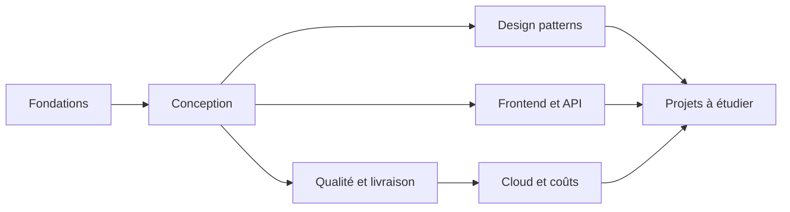

# Obsidienne — comprendre, choisir, appliquer

> [!abstract] Pour un développeur bac+5
> Des cours de **concepts transférables**, pas la récitation de TP. Chaque cours part d'un problème, montre un mécanisme, ses compromis et quelques questions. Les fiches [[Projets - index|Projets]] restent disponibles pour relier la théorie à chacun des huit dépôts.

## Trois entrées, selon ton besoin

- **Apprendre dans l'ordre** → [[Cours - index|Parcours des notions concrètes]].
- **Décider si un pattern aide** → [[Patterns - index|23 design patterns : intention, schéma, code et limites]].
- **Comprendre un dépôt précis** → [[Projets - index|Huit projets expliqués, conservés]].

## Retrouver une réponse rapidement

[[Recherche - index|Index par question]] : idempotence, transaction, outbox, effet React, provider, budget, sécurité… Cherche aussi directement un terme dans Obsidian.

> [!tip] Méthode de travail
> Lis le **problème**, explique le schéma sans regarder, puis vérifie la section « quand ne pas utiliser » ou « piège ». Les projets donnent ensuite un terrain de lecture : leur statut réel est distinct des exemples théoriques.
