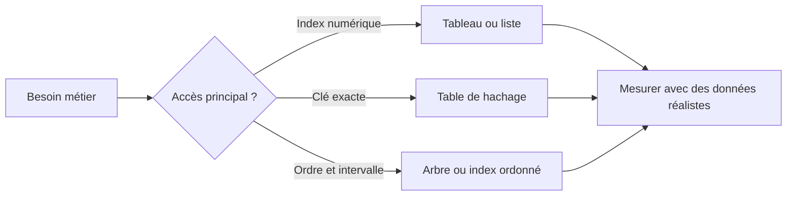

# Algorithmes — coût et structures de données

## Le vrai problème

Une liste de quelques éléments fonctionne avec n'importe quelle recherche. Avec beaucoup de données ou une boucle fréquente, le choix d'une structure change le temps et la mémoire consommés. La complexité décrit **comment un coût évolue avec la taille de l'entrée** ; elle n'est ni une durée exacte, ni un verdict indépendant des données et de la machine.



## Raisonner avant de mesurer

Pour `n` éléments, parcourir une liste jusqu'à trouver une clé prend **O(n)** dans le pire cas ; utiliser un dictionnaire haché vise une recherche **O(1) en moyenne**, mais le hachage, les collisions et la mémoire ont un coût. Dans un ensemble trié à accès aléatoire, une recherche dichotomique prend **O(log n)** comparaisons ; insérer dans un tableau reste souvent **O(n)** à cause des décalages. Un arbre équilibré peut garder des opérations logarithmiques mais demande davantage de structure et de pointeurs. Ces notations ne disent rien, seules, sur le cache CPU, la taille des objets ou le coût des entrées/sorties.

```text
index = construire_dictionnaire(enregistrements, cle = identifiant)
pour chaque demande:
    resultat = index.get(demande.identifiant)
```

Construire l'index coûte du temps et de la mémoire ; si une seule demande existe, un balayage peut être plus simple. Si des enregistrements changent, il faut maintenir l'index en cohérence. Une requête SQL est différente d'une boucle en mémoire : le moteur choisit un plan, et un index peut accélérer une lecture mais ralentir des écritures. Voir [[SQL - Modéliser, transiger et indexer]].

## Compromis pratique

Distingue **pire cas**, **moyenne**, **coût amorti** et **consommation mémoire**. Un tableau dynamique peut occasionnellement se réallouer ; amortir ces opérations sur de nombreux ajouts donne un autre coût qu'un ajout isolé. Une mesure utile inclut génération d'entrées représentatives, échauffement éventuel, contrôle de la variance et comparaison d'une version simple. Optimiser une recherche peu fréquente en sacrifiant la lisibilité est généralement une mauvaise affaire. À l'inverse, un traitement quadratique à l'intérieur d'une requête très fréquentée mérite une investigation avant d'ajouter du matériel.

## Questions

1. Pourquoi une recherche en `O(1)` moyen peut-elle perdre face à une petite liste ?
2. Pourquoi `O(log n)` pour trouver une position n'implique-t-il pas `O(log n)` pour insérer dans un tableau ?
3. Quelles entrées choisirais-tu pour vérifier une dégradation quadratique ?

[Référence : documentation Python, bisect et coût de l'insertion](https://docs.python.org/3/library/bisect.html). Suite : [[Concurrence - Consistance et isolation]].
