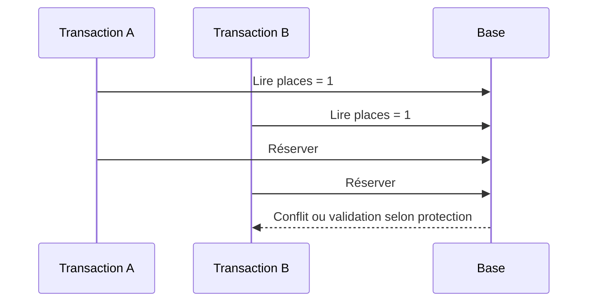

# Concurrence — Consistance et isolation

## Le problème

Deux personnes réservent la dernière place disponible presque simultanément. Chaque requête lit « une place », puis écrit « zéro place ». Si l'on traite ces requêtes comme des opérations indépendantes, deux confirmations peuvent partir pour une seule place. Le bogue n'est pas une lecture incorrecte isolée : c'est l'entrelacement de plusieurs opérations pourtant correctes lorsqu'elles s'exécutent seules.

## Nommer l'invariant avant le mécanisme

L'invariant est « le nombre de réservations confirmées ne dépasse pas la capacité ». La **consistance métier** signifie que cet invariant reste vrai après toute opération validée. L'atomicité évite une demi-réservation ; l'isolation détermine quels effets concurrents une transaction peut observer. Ces garanties sont liées, mais non synonymes. La disponibilité du service ou la cohérence entre plusieurs copies distribuées sont encore d'autres questions : voir [[Systèmes distribués - Fiabilité et reprise]].



Le diagramme n'affirme pas que tous les SGBD valident B. Le résultat dépend du modèle de données, du niveau d'isolation, de la requête et des contraintes. Une mise à jour conditionnelle peut rendre la compétition explicite :

```sql
UPDATE seance
SET places = places - 1
WHERE id = :id AND places > 0;
-- Confirmer seulement si exactement une ligne a été modifiée.
```

Dans une même base, cette forme évite de séparer la décision « reste-t-il une place ? » de la modification de la ligne concernée. Si une réservation écrit aussi d'autres tables, regrouper les écritures dans une transaction. Une contrainte qui empêche un stock négatif sert de filet supplémentaire ; elle ne remplace pas la décision fonctionnelle sur le message renvoyé à la personne perdante.

## Choisir l'isolation en connaissance de cause

Les niveaux d'isolation du SQL décrivent des comportements possibles, mais une implémentation concrète peut fournir des garanties plus fortes ou différentes. Dans PostgreSQL, `READ COMMITTED` attribue notamment un instantané propre à chaque commande ; une seconde lecture dans la même transaction peut donc voir des changements nouvellement validés. Le niveau `SERIALIZABLE` vise un effet équivalent à un ordre séquentiel des transactions, mais une transaction peut échouer et devoir être relancée. Il faut relancer **l'unité complète** de travail, pas seulement la dernière requête SQL. [1]

Un verrou explicite peut être approprié pour protéger une ressource particulière, au prix de contention et d'un risque de blocage si plusieurs transactions prennent des verrous dans des ordres incompatibles. Une vérification optimiste avec numéro de version convient lorsque les collisions sont rares ; elle doit traiter proprement l'échec de mise à jour. Le verrou et la version sont des moyens, non des invariants : partir d'une règle testable évite de surprotéger tout le système.

Contre-exemple : entourer d'un `BEGIN` une lecture puis un appel réseau lent avant l'écriture. La transaction reste ouverte longtemps et peut retenir des ressources sans garantir l'atomicité de l'appel externe. Il faut réduire la portée de la transaction et traiter séparément les effets hors base, comme dans [[Événements - Outbox, inbox et reprises]].

## Questions d'autoévaluation

1. Quel invariant précis est violé par deux confirmations pour une place ?
2. Pourquoi une transaction ouverte n'implique-t-elle pas automatiquement l'absence de course ?
3. Que doit recommencer une application après un échec de sérialisation ?

Voir aussi [[SQL - Modéliser, transiger et indexer]].

## Sources

- [1] [PostgreSQL, niveaux d'isolation transactionnelle](https://www.postgresql.org/docs/current/transaction-iso.html)
