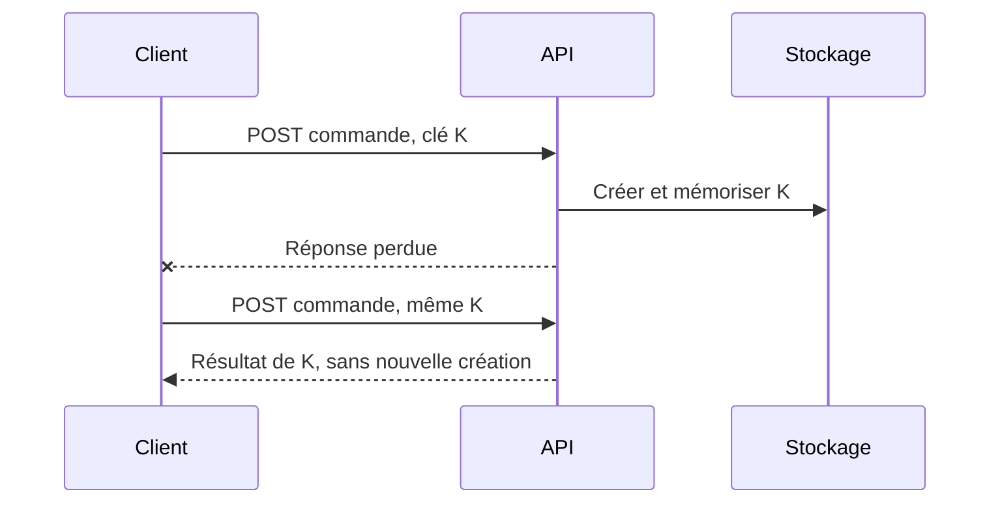

# Contrats API — HTTP, idempotence et pagination

## Le problème

Un client crée une commande, mais la connexion se coupe avant qu'il reçoive la réponse. Doit-il renvoyer sa requête ? Sans contrat explicite, il risque soit de perdre l'opération, soit de créer deux commandes. Le contrat d'une API ne se réduit pas à des chemins et à des champs JSON : il précise ce que signifient une méthode, une répétition, un échec et une collection qui change pendant la lecture.

## Sémantique et reprise

HTTP définit des propriétés de méthodes : `GET` est destiné à la consultation, `PUT` et `DELETE` sont idempotents au sens où répéter une requête ayant la même intention produit le même effet voulu sur la ressource. « Idempotent » ne signifie ni « la réponse sera toujours identique » ni « aucun journal ne sera écrit ». Un `POST` de création ne devient pas idempotent par magie. [1]

Pour rendre la reprise sûre dans ce cas, l'API peut accepter une **clé d'idempotence** choisie par le client. Le serveur associe cette clé à l'opération et à son résultat, puis refuse ou traite explicitement une réutilisation avec un contenu différent. La mémorisation de la clé et la création doivent partager une frontière atomique, faute de quoi deux requêtes simultanées peuvent toutes deux passer. Le contrat doit définir la portée de la clé, sa durée de conservation et le comportement si l'opération est encore en cours. C'est un choix de conception de l'application, non une propriété générale du protocole HTTP.

Les statuts aident à interpréter l'issue : distinguer demande invalide, conflit d'état, absence de ressource et défaillance du serveur permet au client d'éviter les relances aveugles. Le corps de l'erreur doit fournir une information exploitable sans divulguer de détails sensibles. Un délai d'attente ne prouve pas que le serveur n'a rien exécuté : l'échec de livraison de la réponse et l'échec de l'opération sont distincts.

## Parcourir une collection mouvante

Une pagination par `offset` et `limit` est simple, mais si de nouveaux éléments s'insèrent avant la position courante, le client peut revoir ou manquer un élément. Une pagination par curseur fondée sur un ordre stable et un critère de départ permet de continuer après la dernière ligne observée. Il faut prévoir un tri déterministe, par exemple date **et** identifiant lorsque plusieurs lignes partagent la même date ; un curseur opaque évite de promettre sa structure interne aux clients. Le contrat doit dire si la traversée représente un instantané fixe ou seulement une progression dans des données vivantes.

Le contre-exemple est une API qui retourne un tableau sans ordre défini, puis conseille aux clients de conserver un numéro de page. Une page n'a aucun sens stable sans ordre ; même avec un ordre, des écritures concurrentes modifient les frontières. Le bon choix dépend de l'usage : une interface de navigation tolère parfois des variations, une exportation exhaustive demande plutôt un instantané ou une stratégie de reprise vérifiable.

## Questions d'autoévaluation

1. Pourquoi une réponse perdue ne permet-elle pas de conclure que l'opération a échoué ?
2. Que faut-il stocker atomiquement avec une création dédupliquée ?
3. Pourquoi un tri par date seule peut-il rendre un curseur ambigu ?

À relier à [[Réseau - Du nom DNS à la réponse HTTP]], [[Concurrence - Consistance et isolation]] et [[Événements - Outbox, inbox et reprises]].

## Sources

- [1] [RFC 9110, méthodes, statuts et idempotence HTTP](https://www.rfc-editor.org/rfc/rfc9110.html)
