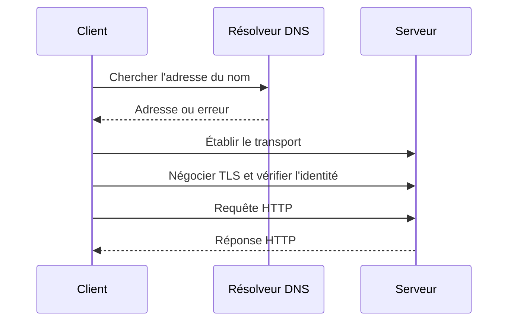

# Réseau — Du nom DNS à la réponse HTTP

## Le problème

Une application affiche « impossible de charger la page ». Cette phrase ne dit pas si le nom est introuvable, si la connexion est refusée, si le certificat est rejeté ou si le serveur répond par une erreur. Pour diagnostiquer sans confondre les causes, il faut suivre le chemin d'une requête et distinguer les garanties de chaque couche. Le nom d'un service, son adresse réseau, la connexion de transport, l'identité du serveur et la réponse applicative sont des objets différents.

## Le mécanisme

DNS associe notamment des noms à des enregistrements d'adresse. Un résolveur peut répondre depuis un cache : changer un enregistrement n'implique donc pas que tous les clients observent immédiatement le changement. Une réponse DNS n'est ni une preuve que le service écoute, ni une preuve de son identité. Le modèle hiérarchique de DNS explique la délégation entre zones, mais le client interroge généralement un résolveur plutôt que chaque serveur autoritatif lui-même. [1]

Dans une connexion HTTP sur TCP, TCP fournit un flux d'octets ordonné avec retransmission et contrôle de flux ; il ne découpe pas ce flux en « messages HTTP ». L'application doit interpréter son propre protocole. Une connexion TCP établie n'assure pas que l'application répond correctement. TLS, placé au-dessus du transport dans ce chemin, négocie des paramètres cryptographiques et permet au client de vérifier que le certificat présenté correspond à l'identité attendue selon sa politique de confiance. Chiffrer sans vérifier cette identité expose à parler au mauvais interlocuteur. [2][3]

HTTP porte ensuite une méthode, une cible, des en-têtes et éventuellement un contenu ; la réponse a un statut et éventuellement un contenu. Un statut d'erreur HTTP prouve déjà que l'échange est allé plus loin qu'un échec DNS ou TLS. Le temps observé par le client agrège résolution, établissement du transport, négociation, traitement serveur et transfert ; attribuer toute lenteur au serveur serait prématuré. [4]

## Un diagnostic raisonné

Sur un poste autorisé à interroger le service, on peut suivre cette séquence conceptuelle : résoudre le nom, tenter la connexion, vérifier le certificat et le nom demandé, puis lire le statut et le corps HTTP. Tester uniquement l'adresse IP peut contourner le nom utilisé par TLS et le routage HTTP ; le résultat n'est alors pas équivalent à la requête réelle. Pour comparer deux clients, relever aussi le nom exact, le résolveur, le chemin réseau et les éventuels intermédiaires.

Une autre variante existe : HTTP ne dépend pas toujours de TCP. Certaines versions emploient un transport différent. Le diagramme décrit le chemin TCP/TLS courant, pas une loi universelle. De même, un certificat valide ne prouve pas que la logique métier est correcte, et un cache DNS résolu ne prouve pas que les données reçues sont fraîches. Le bon diagnostic consiste à localiser la première étape qui échoue, puis à examiner la frontière suivante.

## Questions d'autoévaluation

1. Pourquoi une résolution DNS réussie ne suffit-elle pas à établir que le service est disponible ?
2. Comment distinguer un échec de certificat d'une erreur HTTP dans une observation côté client ?
3. Pourquoi un test sur une adresse IP seule peut-il être trompeur ?

À poursuivre : [[Contrats API - HTTP, idempotence et pagination]] et [[Systèmes distribués - Fiabilité et reprise]].

## Sources

- [1] [RFC 1034, concepts DNS](https://www.rfc-editor.org/rfc/rfc1034.html)
- [2] [RFC 9293, TCP](https://www.rfc-editor.org/rfc/rfc9293.html)
- [3] [RFC 8446, TLS](https://www.rfc-editor.org/rfc/rfc8446.html)
- [4] [RFC 9110, sémantique HTTP](https://www.rfc-editor.org/rfc/rfc9110.html)
