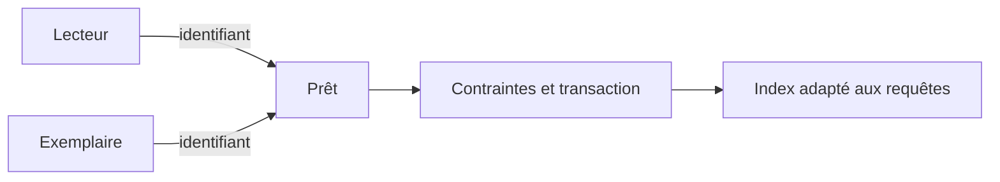

# SQL — Modéliser, transiger et indexer

## Le problème

Une bibliothèque de prêt doit savoir quel exemplaire est emprunté, par qui et depuis quand. Une table unique répétant le nom du lecteur dans chaque prêt paraît simple, mais la correction d'un nom oblige à modifier plusieurs lignes. Pire, si l'on peut enregistrer un prêt sans exemplaire existant, la base représente un état impossible. Le modèle relationnel sert d'abord à exprimer les entités, les relations et les invariants ; la performance des recherches vient ensuite.

## Du modèle à la transaction



Un lecteur, un exemplaire et un prêt sont des concepts distincts. Chaque ligne reçoit une clé stable ; les clés étrangères d'un prêt relient ces concepts et empêchent les références orphelines. Une contrainte d'unicité peut exprimer qu'un identifiant métier ne se répète pas. Cela ne signifie pas que toutes les règles métier tiennent dans le schéma : « un exemplaire ne peut avoir qu'un prêt actif » demande une représentation et une contrainte adaptées, ou un contrôle transactionnel correctement protégé contre la concurrence.

```sql
BEGIN;
INSERT INTO pret (lecteur_id, exemplaire_id, date_debut)
VALUES (:lecteur, :exemplaire, CURRENT_DATE);
UPDATE exemplaire SET disponible = FALSE
WHERE id = :exemplaire AND disponible = TRUE;
-- Vérifier que l'UPDATE a touché une ligne ; sinon ROLLBACK.
COMMIT;
```

Cet exemple est un **croquis**, pas une implémentation suffisante : si l'`INSERT` précède la vérification et que l'`UPDATE` ne modifie rien, il faut annuler toute la transaction. Il faut aussi décider si `disponible` est une donnée dérivée des prêts actifs, auquel cas la dupliquer crée un risque de divergence. Une transaction groupe les changements qui doivent réussir ou échouer ensemble ; elle ne garantit pas à elle seule que deux opérations concurrentes respectent un invariant. Les détails d'isolation sont développés dans [[Concurrence - Consistance et isolation]]. [1][2]

## Pourquoi un index n'est pas une décoration

Un index accélère potentiellement l'accès à certaines lignes en maintenant une structure auxiliaire. Pour une recherche des prêts actifs d'un exemplaire, le choix d'un index dépend des prédicats, des tris et de la distribution des données. Il consomme du stockage et doit être entretenu lors des écritures. Il ne rend pas automatiquement toute requête rapide : un filtre peu sélectif ou un plan qui lit une grande partie de la table peut justifier un parcours séquentiel. Pour juger, lire le plan d'exécution et confronter l'hypothèse aux requêtes réellement fréquentes, plutôt que créer un index pour chaque colonne. [3]

Une conception saine distingue donc trois questions : quelles situations le schéma autorise-t-il ? quelles opérations doivent être atomiques ? quels accès méritent une optimisation mesurée ? Ajouter des colonnes dénormalisées peut simplifier une lecture, mais impose de définir qui les met à jour et comment elles restent cohérentes. À l'inverse, multiplier les jointures sans raison peut rendre certains usages coûteux : la modélisation est un arbitrage explicite, non un concours de normalisation.

## Questions d'autoévaluation

1. Quelle règle doit être garantie par une clé étrangère plutôt que par le seul code applicatif ?
2. Pourquoi faut-il annuler la transaction si la réservation conditionnelle n'a changé aucune ligne ?
3. Quelles observations justifieraient un nouvel index ?

À poursuivre : [[Concurrence - Consistance et isolation]] et [[Événements - Outbox, inbox et reprises]].

## Sources

- [1] [PostgreSQL, transactions](https://www.postgresql.org/docs/current/tutorial-transactions.html)
- [2] [PostgreSQL, isolation](https://www.postgresql.org/docs/current/transaction-iso.html)
- [3] [PostgreSQL, index](https://www.postgresql.org/docs/current/indexes.html)
