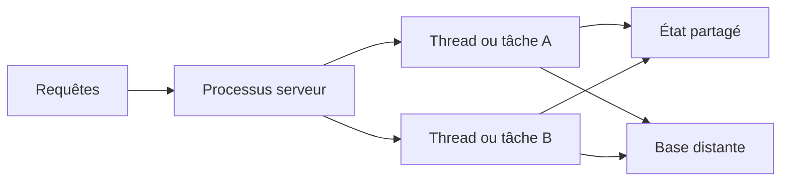

# Système — processus, threads et mémoire

## Pourquoi une application « parallèle » peut échouer

Un serveur accepte plusieurs requêtes à la fois. Chacune peut attendre une base ou un réseau, modifier un objet partagé et rencontrer une autre requête. Confondre **processus**, **thread**, **tâche asynchrone** et **transaction** masque des pannes différentes : mémoire partagée mal protégée, épuisement des connexions, blocage ou réponse périmée.



Un **processus** possède son espace d'adressage et des ressources gérées par le système ; deux processus ne partagent pas directement leurs variables ordinaires. Des **threads** d'un même processus partagent une mémoire et d'autres ressources, mais chacun a son exécution. Une **tâche asynchrone** exprime une opération qui pourra reprendre plus tard ; ce n'est pas nécessairement un nouveau thread ni une accélération des calculs CPU. Un `await` pendant une attente réseau peut libérer le fil d'exécution, mais deux opérations qui reprennent ensuite peuvent encore entrer en concurrence sur une ressource partagée.

## Observer une course

```text
solde = 10
A lit 10          B lit 10
A retire 7       B retire 7
A écrit 3        B écrit 3
```

Le solde final `3` ne révèle pas la seconde opération : une **mise à jour perdue** a eu lieu. Un verrou peut protéger un état en mémoire **dans un seul processus** ; avec plusieurs instances, il ne coordonne pas toute l'application. Pour des données en base, une transaction et une politique de concurrence adaptées, éventuellement une contrainte ou un verrou de base, doivent protéger l'invariant. Voir [[Concurrence - Consistance et isolation]].

## Décider sans recette universelle

Un pool de connexions limite le nombre d'accès simultanés à une ressource ; augmenter arbitrairement sa taille peut déplacer la saturation vers la base. Un timeout borne une attente mais ne garantit pas que l'opération distante s'est annulée. Des retries sans idempotence peuvent créer deux effets. Pour diagnostiquer, mesure les files d'attente, la latence, la consommation mémoire et les ressources saturées avant d'ajouter des threads. Le même code peut être sûr dans un processus unique et incorrect après multiplication des répliques.

## Questions

1. Pourquoi un verrou local ne protège-t-il pas un invariant entre deux instances ?
2. Une tâche `async` garantit-elle l'exécution parallèle sur plusieurs cœurs ?
3. Comment éviter qu'une opération distante encore active soit rejouée deux fois après timeout ?

[Références : Linux `fork(2)`](https://man7.org/linux/man-pages/man2/fork.2.html) et [spécification Java, threads et locks](https://docs.oracle.com/javase/specs/jls/se25/html/jls-17.html). Liens : [[Contrats API - HTTP, idempotence et pagination]], [[Systèmes distribués - Fiabilité et reprise]].
