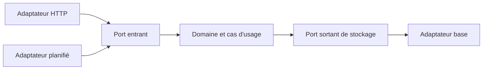

# Architecture hexagonale — Domaine, ports et limites

## Le problème

Une règle de remboursement dépend aujourd'hui d'un contrôleur web et de requêtes SQL. Demain, une tâche planifiée doit invoquer la même règle. Copier le code dans la tâche crée deux interprétations du remboursement ; appeler le contrôleur depuis elle fait dépendre le métier d'un transport qui n'a rien à voir avec lui. Il faut isoler les décisions métier sans prétendre que toutes les dépendances disparaîtront.

## Déplacer les dépendances, pas le travail

Le schéma montre le **flux des appels à l'exécution** (les flèches), et non le sens des imports ou dépendances de compilation :



Le port entrant exprime une intention : `demanderRemboursement(commandeId)`. Le cas d'usage orchestre la règle et son contexte transactionnel ; un port sortant décrit les opérations dont il a besoin, comme charger une commande et enregistrer une décision. Les adaptateurs traduisent les détails HTTP, SQL ou d'un système tiers. La direction des dépendances du code source va vers les concepts du cœur ; à l'exécution, le cœur appelle bien un adaptateur qui lui a été fourni. L'hexagone n'impose ni six côtés réels ni un nombre fixe de couches.

```text
rembourser(id, commandes, paiements):
    commande = commandes.charger(id)
    si commande.est_deja_remboursee(): retourner commande.resultat
    decision = commande.evaluer_remboursement()
    paiements.declencher(decision)
    retourner decision
```

Ce pseudocode expose justement une difficulté : déclencher un paiement externe puis sauvegarder un état local ne forme pas une transaction unique. Une erreur après l'appel peut entraîner un doublon lors d'une reprise. Un port n'efface pas cette contrainte ; il faut un protocole d'idempotence, un suivi d'état et éventuellement un mécanisme de messages comme dans [[Événements - Outbox, inbox et reprises]].

## Ce que DDD ajoute, sans obliger aux microservices

La conception pilotée par le domaine (DDD) commence par le langage des personnes qui maîtrisent le métier : « remboursement », « annulation » et « avoir » ne sont pas forcément interchangeables. Un **contexte borné** définit où un modèle et ses mots ont une signification cohérente. Par exemple, « commande réglée » peut signifier une chose pour la comptabilité et une autre pour l'expédition ; une traduction explicite à leur frontière évite d'imposer une classe universelle ambiguë. Une entité a une identité dans le temps ; un objet-valeur est décrit par ses attributs. Un agrégat peut délimiter les invariants qui doivent être modifiés ensemble, sans transformer chaque table en agrégat.

Un contexte borné n'est pas automatiquement un service déployé séparément. On peut commencer par des modules dans un même processus et une même base, puis séparer seulement si les besoins d'évolution et d'exploitation le justifient. À l'inverse, découper des services selon les tables tout en exigeant une transaction globale à chaque requête crée de la complexité distribuée sans autonomie. Les frontières doivent suivre les invariants et les responsabilités, non les noms des frameworks.

La contrepartie d'un cœur indépendant est la traduction aux frontières : objets d'entrée, erreurs, transactions et modèles persistés doivent être adaptés. Trop de ports fins produisent un code de plomberie ; trop peu mélangent politique et infrastructure. Un bon test est de pouvoir expliquer quelle variation chaque frontière protège, puis d'éprouver l'adaptateur avec sa vraie technologie.

## Questions d'autoévaluation

1. Pourquoi un port ne rend-il pas atomique un paiement externe et une écriture locale ?
2. Dans quel cas deux équipes peuvent-elles employer le même mot avec des sens différents ?
3. Pourquoi un contexte borné ne doit-il pas devenir automatiquement un microservice ?

À relier à [[Conception modulaire - SOLID, composition et injection]] et [[Concurrence - Consistance et isolation]].
