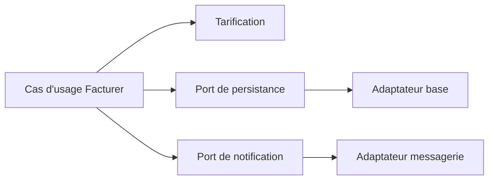

# Conception modulaire — SOLID, composition et injection

## Le problème

Une fonction de facturation calcule le montant, lit la base, envoie un courriel et journalise une erreur. La moindre modification d'un canal de notification oblige à retoucher le calcul. Ses tests requièrent réseau et base alors que la règle arithmétique pourrait être testée seule. Le problème n'est pas la longueur de la fonction en soi : c'est le couplage entre des raisons de changer indépendantes.

## Des frontières plutôt que des slogans



La responsabilité unique invite à regrouper une règle cohérente autour d'une raison identifiable de changer. L'ouverture à l'extension ne commande pas de fabriquer une interface pour chaque ligne de code : elle devient utile quand une variation réelle doit être introduite sans réécrire le cœur. La substitution demande qu'une implémentation respecte les préconditions, effets et garanties attendus par les utilisateurs de son abstraction. La ségrégation des interfaces limite les dépendances imposées à leurs consommateurs. L'inversion des dépendances dirige le code métier vers des abstractions qu'il utilise plutôt que vers une bibliothèque ou une base particulière. Ces principes sont des questions de conception, pas un barème de conformité.

La **composition** assemble de petits objets dont les capacités se combinent : un cas d'usage reçoit un calculateur de prix et un moyen de sauvegarder. Elle évite souvent une hiérarchie d'héritage où une sous-classe doit neutraliser des méthodes héritées. L'**injection de dépendances** est le geste concret qui fournit ces collaborateurs depuis l'extérieur, par constructeur ou paramètre ; un conteneur automatique n'est pas obligatoire.

```text
facturer(commande, tarification, depot):
    montant = tarification.calculer(commande)
    facture = creer_facture(commande, montant)
    depot.enregistrer(facture)
    retourner facture
```

Ici, le calcul peut être testé avec un dépôt en mémoire. Mais un faux dépôt qui ignore les contraintes réelles du stockage ne prouve pas que l'intégration fonctionne ; un test du vrai adaptateur reste nécessaire. Le contrat du dépôt doit préciser ce qu'implique `enregistrer` en cas d'échec ou de doublon. Sinon, l'abstraction masque précisément la décision importante.

## Où arrêter la découpe

Si une application n'a qu'une source de données et aucune raison plausible de la remplacer, un port peut rester petit, voire inutile pour certaines opérations. Multiplier `IFactureService`, `BaseFactureService` et `FactoryFactureService` sans variation concrète augmente les chemins de lecture et déplace le couplage au lieu de le réduire. À l'inverse, coder la remise directement dans le contrôleur HTTP et la copier dans un traitement différé fait diverger la règle. Le bon découpage sépare la politique stable des détails volatils, tout en conservant des flux lisibles.

La frontière technique n'est pas toujours la frontière métier. Si deux parties de l'application doivent évoluer et être comprises séparément, on peut explorer des limites de domaine comme dans [[Architecture hexagonale - Domaine, ports et limites]]. Si elles partagent réellement les mêmes invariants, une séparation artificielle peut produire des synchronisations coûteuses. Décider d'une abstraction à partir d'un changement concret à absorber et d'un test qui devient plus simple est plus fiable qu'appliquer un acronyme à l'aveugle.

## Questions d'autoévaluation

1. Quelles raisons distinctes de changer sont mélangées dans la fonction initiale ?
2. Quelle différence faites-vous entre injection par constructeur et conteneur d'injection ?
3. Quand une interface de dépôt peut-elle être une surconception ?

Voir aussi [[SQL - Modéliser, transiger et indexer]] et [[Architecture hexagonale - Domaine, ports et limites]].
