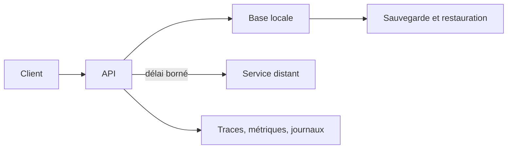

# Systèmes distribués — Fiabilité et reprise

## Le problème

Une API répond normalement tant que la base et un service distant sont rapides. Une panne du service distant déclenche des attentes longues ; les requêtes s'accumulent, épuisent les ressources et rendent aussi la partie saine indisponible. Restaurer le processus ne suffit pas si des données ont été perdues ou si les clients ignorent quelles opérations ont été acceptées. La fiabilité combine prévention, limitation de la propagation, observation et reprise.

## Isoler la défaillance

Chaque appel distant a besoin d'une limite de temps compatible avec le délai maximal de la requête globale. Une tentative répétée peut aider pour une erreur transitoire, mais relancer à plusieurs couches multiplie les appels et aggrave une surcharge. Il faut un budget de reprise, une temporisation adaptée et une opération réessayable : une création non idempotente ne peut être répétée sans contrat de déduplication. Un circuit ouvert temporairement peut empêcher d'envoyer des demandes à une dépendance manifestement défaillante ; il n'est pas un substitut à la réparation. L'isolation des ressources évite qu'une seule dépendance monopolise tous les travailleurs.

Un mode dégradé doit être explicite. Montrer une information en cache peut être acceptable pour une consultation, mais pas pour confirmer un paiement. Pour chaque fonction, définir ce qui peut échouer fermé, fonctionner avec une donnée ancienne ou rester en attente. Une disponibilité affichée ne prouve pas la correction des résultats ; mesurer seulement « répond en HTTP » peut masquer des échecs métier. Les limites transactionnelles et les messages différés sont abordés dans [[Événements - Outbox, inbox et reprises]].

## Reprendre avec un objectif mesurable

Le **RPO** (objectif de point de reprise) exprime quelle perte de données dans le temps est tolérable après sinistre. Le **RTO** (objectif de temps de reprise) exprime combien de temps le service peut rester indisponible avant retour à un état utilisable. Ce sont des objectifs décidés avec les responsables du service, pas des valeurs automatiquement garanties par une sauvegarde. Une sauvegarde quotidienne n'a d'intérêt opérationnel que si l'on sait la restaurer, vérifier son intégrité et comprendre quelles écritures postérieures devront être rejouées ou perdues. La réplication peut améliorer certains scénarios de panne, mais peut aussi propager une suppression logique : elle n'est pas à elle seule une sauvegarde.

L'**observabilité** rend les symptômes discutables avec des faits. Les métriques suivent des tendances et déclenchent des alertes ; les journaux décrivent des événements locaux ; les traces corrèlent un parcours entre composants. Un identifiant de corrélation, une opération nommée et un contexte d'erreur permettent de remonter du symptôme client à une dépendance, sans exposer de données privées. Les indicateurs doivent correspondre à l'expérience réelle : taux d'opérations réussies, durée perçue, retard des messages, âge de la dernière sauvegarde restaurable. Une alerte sans action possible n'est qu'un bruit supplémentaire.

Le contre-exemple est une architecture qui ajoute des répliques et des retries partout sans exercice de panne. Elle peut paraître redondante tout en partageant une même dépendance critique ou en doublant des opérations. Tester périodiquement un scénario réaliste de restauration, constater le temps et les données réellement récupérés, puis confronter ces observations aux objectifs est plus probant qu'un diagramme de haute disponibilité. Le chemin du client commence également en amont de l'API : voir [[Réseau - Du nom DNS à la réponse HTTP]].

## Questions d'autoévaluation

1. Pourquoi des retries à plusieurs niveaux peuvent-ils amplifier une panne ?
2. Quelle différence entre la perte de données tolérée et le temps d'indisponibilité toléré ?
3. Pourquoi la réplication ne remplace-t-elle pas une restauration testée ?
