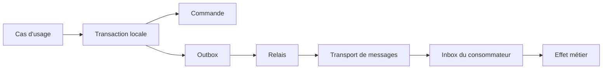

# Événements — Outbox, inbox et reprises

## Le problème

Une commande est validée en base et un message doit prévenir l'expédition. Si l'on valide la base puis publie le message, le processus peut tomber entre les deux : commande enregistrée, expédition jamais informée. Si l'on publie avant la validation, l'expédition peut agir sur une commande finalement annulée. Un simple `try/catch` ne supprime pas cette fenêtre de panne entre deux systèmes autonomes.

## Une écriture locale, une livraison asynchrone



L'**outbox** est une table de messages à publier, écrite dans la **même transaction** que la commande. Un relais lit les messages non publiés et les envoie au transport. Ainsi, une commande validée laisse une trace durable du message à émettre ; si la transaction échoue, les deux écritures échouent. Mais le relais peut tomber après publication et avant de marquer le message comme envoyé : il publiera peut-être à nouveau. Cette technique évite une perte due à la fenêtre locale, sans promettre une livraison unique de bout en bout.

L'**inbox** côté consommateur conserve l'identifiant du message traité. Le consommateur enregistre cet identifiant et l'effet métier dans une même transaction locale ; une réception ultérieure du même identifiant ne réapplique pas l'effet. Il faut définir la granularité de cette déduplication : le même événement peut légitimement être traité par deux consommateurs distincts. La clé et la règle d'unicité doivent donc refléter le consommateur et l'action visée.

```text
consommer(message):
    commencer_transaction()
    si inbox.contient(consommateur, message.id):
        valider_et_sortir()
    appliquer_effet(message)
    inbox.ajouter(consommateur, message.id)
    valider_transaction()
    accuser_reception_au_transport()
```

L'accusé de réception vient après la transaction locale : s'il se perd, une nouvelle livraison sera neutralisée par l'inbox. Ce croquis suppose que l'effet est dans la même base ; un appel externe ne devient pas atomique grâce à l'inbox. Pour un tel appel, il faut aussi une clé d'idempotence acceptée par le destinataire ou une machine à états de reprise explicite, comme dans [[Contrats API - HTTP, idempotence et pagination]].

## Reprises et limites

Une reprise automatique doit distinguer erreur temporaire et message irrémédiablement invalide. Des tentatives rapprochées peuvent saturer un service déjà dégradé : délai croissant, dispersion des tentatives et plafond sont des outils utiles, accompagnés d'une voie d'inspection pour les messages bloqués. L'ordre des événements n'est pas garanti par la seule présence d'une outbox : plusieurs relais et consommateurs peuvent traiter en parallèle. Si l'ordre importe pour un objet, préciser la clé de partition, la version attendue ou une règle de résolution des événements tardifs.

Un événement est un fait passé (« commande validée »), pas une instruction cachée dont l'émetteur suppose que tous les destinataires vont immédiatement agir. Les consommateurs doivent tolérer des doublons, des retards et des versions de schéma compatibles. Remplacer toute interaction directe par un bus augmente le délai de visibilité, les états intermédiaires et l'effort d'observation. Choisir l'asynchrone quand la séparation temporelle apporte un avantage concret, pas pour esquiver une frontière métier mal définie.

## Questions d'autoévaluation

1. Quelle panne demeure possible après publication par le relais ?
2. Pourquoi l'identifiant du message et l'effet doivent-ils être validés ensemble côté consommateur ?
3. Que change un appel externe dans l'exemple de l'inbox ?

Voir [[SQL - Modéliser, transiger et indexer]], [[Architecture hexagonale - Domaine, ports et limites]] et [[Systèmes distribués - Fiabilité et reprise]].
