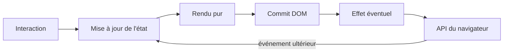

# React — rendu, état, effets et asynchrone

## Trois moments à distinguer

Un composant React calcule une description de l'interface à partir de ses propriétés et de son état. **Rendu** signifie ici appeler les composants, pas nécessairement modifier chaque nœud du DOM ; vient ensuite la validation des changements nécessaires, puis les effets synchronisent éventuellement un système extérieur. Le rendu doit rester pur : à entrées identiques, même description, sans écriture dans le stockage ou abonnement caché. La documentation officielle sépare rendu et commit ([React : Render and Commit](https://react.dev/learn/render-and-commit)).

## Choisir l'état juste

L'état est une photographie propre à un rendu, non une variable mutable immédiatement remplacée dans le gestionnaire qui s'exécute. Pour calculer le prochain état à partir du précédent, une fonction de mise à jour évite de relire une photographie périmée lors de plusieurs changements rapprochés ([React : Queueing a Series of State Updates](https://react.dev/learn/queueing-a-series-of-state-updates)). Une valeur déductible des propriétés et de l'état existant, comme le nombre d'éléments filtrés, n'a généralement pas besoin d'un deuxième état : la dupliquer crée un risque de désynchronisation. Un reducer rend lisibles les transitions lorsque plusieurs événements modifient une structure commune ; il ne rend pas automatiquement le code plus simple.

Pour une liste de préférences **locale**, l'utilisateur coche une option, un événement change l'état, puis l'interface se recalcule. `localStorage` peut conserver une représentation pour une visite suivante, mais ce stockage appartient au navigateur courant : ce n'est ni une API serveur, ni une sauvegarde partagée entre utilisateurs. À la lecture, l'absence de donnée et un JSON incorrect sont des cas normaux à traiter ; voir [[TypeScript - types et frontieres runtime]]. Écrire dans le stockage pendant le rendu est une erreur, car un rendu peut être recommencé. Un effet de synchronisation dépend de la valeur sauvegardée et peut rencontrer des erreurs d'accès au stockage ; l'expérience doit rester définie en cas d'échec.

## Effet ou événement ?

Un événement répond à une action particulière, par exemple enregistrer explicitement un brouillon. Un effet se déclenche parce qu'un rendu a été validé et qu'un système externe doit suivre le nouvel état. Pour une souscription, il faut libérer l'ancienne avant de créer la nouvelle et lors du démontage. Pour une opération asynchrone, une réponse tardive peut concerner une sélection dépassée : l'annulation, lorsqu'elle est disponible, ou l'ignorance du résultat périmé évite d'afficher le mauvais élément. Le nettoyage doit correspondre à l'effet réellement démarré ; un effet qui recopie seulement un état dans un autre est souvent superflu ([React : Synchronizing with Effects](https://react.dev/learn/synchronizing-with-effects)).

**Trade-off :** conserver un état au plus près de son usage limite les dépendances ; le remonter facilite le partage mais élargit les rendus et l'interface des composants. **Piège :** supprimer une dépendance d'effet pour « empêcher » sa répétition cache un problème de conception ou de nettoyage. On corrige plutôt la relation entre données et effet.

## Questions de révision

- Pourquoi une écriture `localStorage` n'appartient-elle pas au rendu ?
- Que faire si une réponse asynchrone arrive après un changement de sélection ?
- Quand préférer une valeur calculée à un nouvel état ?

Suite : [[UI - accessibilite et performance]]. Retour à [[Frontend - index]].