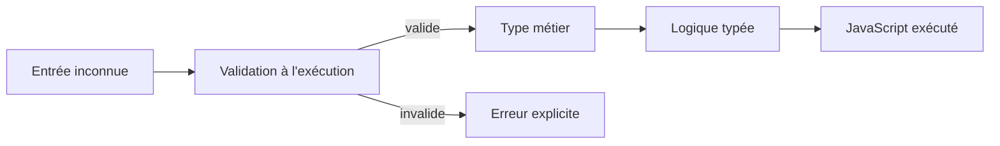

# TypeScript — types et frontières à l'exécution

## Le modèle mental

TypeScript analyse un programme **avant** son exécution. Ses annotations expriment des contrats entre fonctions, données et modules ; le compilateur signale certaines incohérences puis les types sont effacés du JavaScript produit. Un type n'est donc ni un parseur ni une preuve qu'une donnée extérieure est valide. Il faut séparer les garanties de l'éditeur et celles du programme en cours d'exécution. La documentation TypeScript précise que son système de types n'altère pas le comportement du JavaScript exécuté ([TypeScript Handbook](https://www.typescriptlang.org/docs/handbook/typescript-from-scratch)).

## Décrire sans inventer une garantie

Une propriété optionnelle signifie qu'elle peut manquer ; une union comme `"brouillon" | "publié"` restreint les valeurs admises par le contrôle statique. Une union discriminée rend les états plus lisibles : une commande `enCours` peut porter un identifiant, tandis qu'une commande `refusée` porte une raison. Le code qui traite chaque cas peut alors chercher l'exhaustivité. `unknown` est adapté à une réponse non vérifiée : il oblige à examiner sa forme avant d'accéder aux champs. `any`, au contraire, suspend localement les contrôles et propage facilement une confiance injustifiée.

Supposons une liste de préférences conservée dans le navigateur. Une fonction peut annoncer qu'elle retourne `Preference[]`, mais une lecture de `localStorage` fournit du texte, éventuellement absent, tronqué ou modifié. Même après `JSON.parse`, le résultat doit être considéré inconnu. Un validateur vérifie les champs nécessaires et choisit entre rejet, valeur de repli ou migration documentée. Le typage ne répare pas une version antérieure du format ; cette décision appartient à la frontière d'entrée. La même logique vaut pour une réponse HTTP, une variable d'environnement ou un formulaire.

## Découper le domaine

Un type métier exprime une contrainte compréhensible par l'équipe, pas seulement la structure d'un objet. Par exemple, `prix` et `quantite` sont tous deux des nombres mais n'ont pas le même sens. Une fonction de construction peut refuser une quantité négative ; si elle réussit, le reste du code manipule une valeur déjà vérifiée. Il faut néanmoins distinguer règle métier et présentation : un composant React n'a pas à décider seul de la validité globale d'une commande. Les interfaces décrivent les échanges, mais ne remplacent ni les invariants à l'exécution ni les tests.

**Erreur courante :** utiliser une assertion `as Preference[]` après un parseur et croire que la donnée est contrôlée. L'assertion change le regard du compilateur, pas l'objet. **Compromis :** une validation complète coûte du code et de la maintenance ; on la concentre aux frontières exposées et on évite de revérifier aveuglément chaque opération interne. Des types très complexes peuvent masquer le métier au lieu de l'éclairer.

## Questions de révision

- Que reste-t-il d'une annotation TypeScript dans le programme exécuté ?
- Où placer une validation quand les données viennent du stockage du navigateur ?
- Dans quel cas `unknown` protège-t-il mieux qu'une assertion ?

À relier à [[React - rendu état effets et asynchrone]] et [[Tests - pyramide et TDD]]. Retour à [[Frontend - index]].