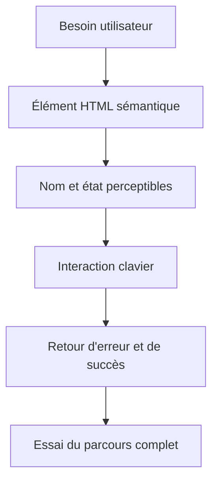

# UI — accessibilité et performance

## Une même interface, plusieurs parcours

Une interface n'est pas seulement ce qui apparaît à l'écran. Elle doit transmettre une structure, un nom et un état compréhensibles aux personnes utilisant le clavier ou une technologie d'assistance. Pour une action, un bouton natif expose déjà des comportements clavier et une sémantique ; une `div` cliquable oblige à les reconstruire. Pour une navigation, un lien décrit une destination. Cette distinction rend le code plus robuste avant même l'ajout d'attributs ARIA. Les règles WCAG décrivent les résultats attendus ; elles ne remplacent pas l'observation de vrais parcours ([W3C : WCAG](https://www.w3.org/TR/WCAG22/)).

## Formulaires, focus et retours

Un champ a besoin d'un libellé associé, d'instructions quand le format n'est pas évident et d'une erreur identifiable. Une couleur seule ne suffit pas à signaler l'échec. Après une validation, il faut que la personne sache quel champ corriger ; si une boîte de dialogue s'ouvre, le focus doit rejoindre un endroit pertinent et revenir de manière cohérente à sa fermeture. On vérifie que la navigation au clavier suit un ordre intelligible, que le focus reste visible et que les éléments désactivés ne masquent pas la raison de l'indisponibilité. Les attributs ARIA complètent la sémantique native, mais ne créent pas à eux seuls le comportement attendu ([WAI : ARIA Authoring Practices](https://www.w3.org/WAI/ARIA/apg/)).

Une recherche filtrée illustre aussi la performance : si la liste est petite, le calcul direct pendant le rendu est généralement plus clair qu'un cache. Si elle devient réellement coûteuse, on mesure le temps de réponse et on envisage mémorisation, pagination ou virtualisation selon la cause. La mémorisation ne corrige ni une donnée mal structurée ni une boucle inutile ; elle ajoute une dépendance à maintenir. Charger moins de JavaScript, limiter les ressources critiques et éviter des changements de mise en page inattendus améliorent la perception de rapidité. Les mesures sur le parcours réel distinguent un problème de réseau, de calcul ou de rendu ([web.dev : Web Vitals](https://web.dev/articles/vitals)).

## Traiter les tensions

Une liste virtualisée peut réduire le nombre d'éléments rendus mais compliquer la lecture continue, la recherche dans la page ou la gestion du focus. Un chargement différé peut accélérer l'écran initial tout en retardant une action secondaire. L'optimisation doit donc préciser le parcours visé et vérifier qu'aucun utilisateur ne perd l'accès à une information. Les outils automatiques repèrent certains défauts ; ils ne prouvent pas que le dialogue ou les annonces d'erreur sont compréhensibles. Tester au clavier et avec une technologie d'assistance pertinente reste nécessaire.

**Erreur courante :** ajouter `role="button"` à un élément non interactif puis oublier les touches clavier et le focus. **Autre erreur :** entourer tous les composants de mémorisation sans profilage. Dans les deux cas, la couche supplémentaire crée une illusion de qualité sans vérifier le résultat. Choisir d'abord le bon élément et le bon indicateur.

## Questions de révision

- Que fournit un bouton natif qu'une `div` cliquable ne fournit pas d'emblée ?
- Comment savoir si la mémorisation résout un ralentissement réel ?
- Pourquoi une liste virtualisée demande-t-elle une vérification d'accessibilité ?

À rapprocher de [[React - rendu état effets et asynchrone]] et [[Tests - pyramide et TDD]]. Retour à [[Frontend - index]].