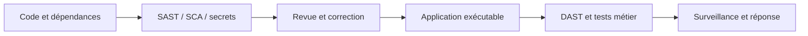

# DevSecOps — SAST, SCA, DAST et recherche de secrets

## Plusieurs questions, plusieurs signaux

La sécurité intégrée au cycle de développement consiste à rendre les risques visibles assez tôt pour agir, sans croire qu'un seul scan les résout. **SAST** analyse le code ou un artefact sans exécuter l'application et peut repérer certains chemins dangereux. **SCA** examine les composants et dépendances connus, leurs vulnérabilités signalées et parfois leurs licences. **DAST** interagit avec une application en cours d'exécution pour chercher des comportements observables. La recherche de secrets repère des chaînes potentiellement sensibles dans les modifications et parfois l'historique. Ces contrôles se complètent : ils n'observent pas la même surface.

## Comprendre les limites

Un résultat SAST est une hypothèse sur un défaut exploitable ; la présence de données non fiables, leur transformation et les protections réelles demandent une analyse humaine. La SCA peut signaler une dépendance vulnérable même si un chemin d'exploitation n'est pas atteignable, mais elle peut aussi manquer une bibliothèque non inventoriée. Un inventaire des composants aide à savoir quoi examiner et mettre à jour. Le DAST ne couvre que les pages et états auxquels le scanner accède ; sans authentification ou données représentatives, une partie du service lui reste invisible. Aucun scanner ne remplace une modélisation des menaces, une revue du contrôle d'accès ou des tests de règles métier. L'OWASP propose des catégories et guides utiles pour raisonner sur les surfaces plutôt que pour déclarer un produit « sûr » ([OWASP : Web Security Testing Guide](https://owasp.org/www-project-web-security-testing-guide/)).

Un secret détecté dans Git doit être traité comme potentiellement compromis : effacer une ligne dans le dernier commit ne le retire pas des copies et historiques. La réponse consiste à révoquer ou faire tourner la valeur, examiner les accès et empêcher sa réintroduction. Un faux positif peut être documenté et écarté de manière ciblée ; ignorer tous les résultats détruit le signal. Les journaux et artefacts de CI ne doivent pas reproduire la valeur détectée. Les identités à durée et portée limitées réduisent les conséquences d'une exposition, sans supprimer le besoin de répondre à l'incident.

## Placer les contrôles

Les vérifications rapides et déterministes peuvent accompagner chaque changement ; les tests dynamiques plus coûteux s'exécutent dans un environnement contrôlé et autorisé. Un résultat critique peut bloquer la promotion après qualification, alors qu'un signal ambigu nécessite triage, propriétaire et délai explicites. Il faut enregistrer ce qui a été scanné, avec quelle configuration et pour quel commit. La surveillance en exploitation reste nécessaire : une vulnérabilité de dépendance peut être divulguée après la construction, et une mauvaise configuration peut apparaître hors du dépôt.

**Trade-off :** bloquer sur chaque alerte non qualifiée encourage le contournement ; ne bloquer sur rien laisse passer les risques connus. **Erreur courante :** confondre absence de résultat et absence de vulnérabilité. On évalue couverture, contexte et capacité de correction avant de fixer les seuils. Les contrôles de sécurité de la chaîne de livraison ont eux-mêmes besoin de permissions minimales ([OWASP : CI/CD Security Cheat Sheet](https://cheatsheetseries.owasp.org/cheatsheets/CI_CD_Security_Cheat_Sheet.html)).

## Questions de révision

- Quel défaut chaque famille de scan risque-t-elle de ne pas voir ?
- Pourquoi supprimer un secret d'un fichier ne suffit-il pas ?
- Comment éviter qu'un « gate » produise surtout des contournements ?

Liens : [[Git - branches PR CI CD et reproductibilite]], [[Cloud - responsabilite IAM reseau et fiabilite]]. Retour à [[Qualite DevOps - index]].