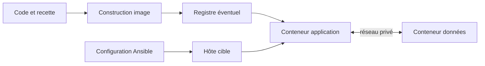

# Docker et Ansible — images, réseaux et déploiement

## Image et conteneur ne sont pas synonymes

Une image est un assemblage de couches et de métadonnées servant de modèle ; un conteneur est une instance exécutée avec un système de fichiers modifiable et une configuration au démarrage. L'image peut être partagée entre instances, mais une modification faite dans le conteneur ne devient pas automatiquement une nouvelle image. Une image décrit un processus et ses dépendances ; elle ne constitue ni une machine virtuelle complète ni, à elle seule, une stratégie de déploiement. La documentation Docker distingue explicitement image et conteneur ([Docker : What is a container?](https://docs.docker.com/get-started/docker-concepts/the-basics/what-is-a-container/)).

## Construire et relier

Une construction copie des fichiers, installe des dépendances et définit une commande de lancement. L'ordre des couches influence le cache : copier des manifestes de dépendances avant un code qui change souvent peut éviter un travail répété. Réduire le contexte de construction évite d'embarquer des fichiers inutiles, notamment des données privées. Un tag peut changer de cible ; un identifiant immuable permet de relier plus précisément une image au contrôle qui l'a précédée. Les volumes servent aux données qui doivent survivre au remplacement d'un conteneur, mais leur sauvegarde et leur restauration restent des responsabilités distinctes.

Sur un réseau Docker, les conteneurs peuvent communiquer par les noms et les ports disponibles sur ce réseau. Publier un port vers l'hôte ouvre un autre chemin d'accès : ce n'est pas nécessaire pour tous les services internes. Un port exposé dans une recette d'image documente une intention ; il n'est pas forcément publié vers l'extérieur. Un réseau privé limite les connexions accidentelles sans constituer une politique complète de sécurité. Les mécanismes exacts dépendent du mode réseau et de la plateforme ([Docker : Networking](https://docs.docker.com/engine/network/)).

## Où se situe Ansible ?

Ansible décrit des tâches et des états attendus sur des hôtes inventoriés. Un playbook peut installer un moteur de conteneurs, déposer une configuration ou piloter un service, mais son rôle n'est pas identique à celui d'une image : l'un décrit des opérations de configuration, l'autre un paquet d'exécution. L'idempotence est un objectif : réappliquer une tâche ne devrait pas créer un changement inutile lorsque l'état désiré est déjà atteint. Cela dépend des modules et des commandes employés ; une commande arbitraire n'est pas idempotente par magie ([Ansible : Playbooks](https://docs.ansible.com/ansible/latest/playbook_guide/playbooks_intro.html)).

**Trade-off :** une image stable facilite la promotion entre environnements, mais la configuration doit être fournie au bon moment sans reconstruire pour chaque secret. **Piège :** confondre « le conteneur démarre » avec « le service est prêt » ; les dépendances, la santé et le stockage doivent être pensés séparément. Un exemple d'architecture n'atteste aucun déploiement réel.

## Questions de révision

- Quelle différence entre image immuable et système de fichiers modifiable du conteneur ?
- Pourquoi éviter de publier le port d'une base destinée à un seul service interne ?
- Que garantit — et ne garantit pas — l'idempotence d'un playbook ?

Liens : [[Git - branches PR CI CD et reproductibilite]], [[Cloud - responsabilite IAM reseau et fiabilite]]. Retour à [[Qualite DevOps - index]].