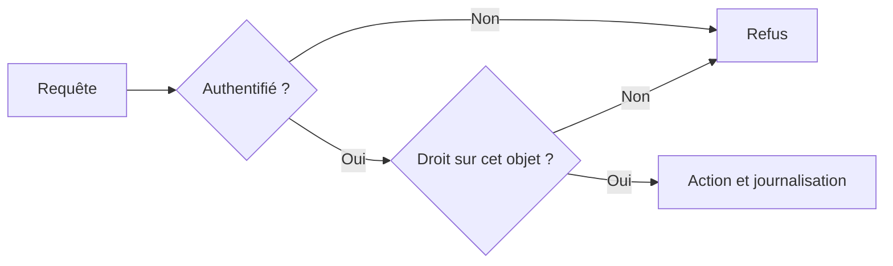

# Sécurité applicative — identité, autorisation et sessions

## Trois décisions distinctes

Une application doit distinguer : **qui prétend agir ?** (identification), **comment le prouve-t-il ?** (authentification), **a-t-il le droit de faire cette action sur cet objet ?** (autorisation). Une session lie des requêtes successives à une identité authentifiée. Une réponse d'API valide sur la forme ne prouve aucun de ces droits.

## Une règle à vérifier à chaque frontière

Supposons une route `GET /factures/123`. Comparer seulement « utilisateur connecté » à « facture existante » autorise potentiellement la lecture de la facture d'une autre personne. La vérification doit lier l'identité courante, l'objet demandé et une règle explicite, côté serveur. Changer `123` en `124` ne doit pas contourner cette règle : c'est une question d'**autorisation sur l'objet**, pas d'interface masquant un bouton. Le refus par défaut et le moindre privilège réduisent les omissions ; des tests avec deux comptes et deux objets distincts éprouvent la frontière.

Une session basée sur cookie exige des attributs adaptés (`HttpOnly`, `Secure`, `SameSite` selon l'usage), une durée de vie maîtrisée et une protection contre la falsification de requêtes lorsque le navigateur envoie automatiquement le cookie. Un jeton porteur est une capacité : quiconque le possède peut potentiellement agir jusqu'à expiration ou révocation ; le journaliser ou le placer dans une URL l'expose. **CORS** contrôle quels scripts de navigateurs peuvent lire des réponses entre origines ; ce n'est pas une autorisation métier et n'empêche pas un client HTTP direct d'appeler le serveur.

## Menaces et vérification

Cartographie les acteurs, données sensibles, frontières de confiance et actions à privilège avant de choisir des contrôles. Vérifie les changements de rôle et la révocation : un droit retiré doit cesser de fonctionner dans les conditions définies. Un scanner peut détecter certains défauts mais pas la signification métier de « propriétaire de la facture » ; associe revue de code, tests d'autorisation et contrôles de session. Voir [[DevSecOps - SAST SCA DAST et secrets]] et [[Cloud - responsabilite IAM reseau et fiabilite]] : un rôle cloud et un droit applicatif ne sont pas interchangeables.

**Piège :** cacher une ressource derrière un identifiant difficile à deviner n'est pas une politique d'accès. De même, un contrôle fait dans l'UI ne protège pas l'API. Évite de retenir un code HTTP unique comme preuve de non-divulgation : vérifie aussi la réponse et les journaux.

## Questions

1. Quel test ferais-tu avec deux comptes pour détecter un accès à la facture d'autrui ?
2. Pourquoi `HttpOnly` ne supprime-t-il pas à lui seul les risques de requête falsifiée ?
3. En quoi CORS est-il différent d'une règle d'autorisation serveur ?

Sources : [OWASP Authentication Cheat Sheet](https://cheatsheetseries.owasp.org/cheatsheets/Authentication_Cheat_Sheet.html) et [OWASP Authorization Cheat Sheet](https://cheatsheetseries.owasp.org/cheatsheets/Authorization_Cheat_Sheet.html).
