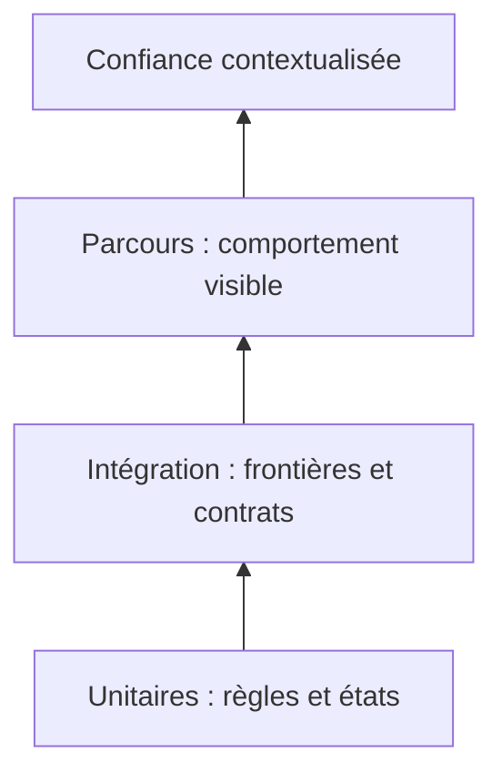

# Tests — pyramide et TDD

## Ce qu'un test établit

Un test automatise une observation : dans un contexte donné, une action doit produire un résultat observable. Il ne démontre pas l'absence de tout défaut. La « pyramide » suggère beaucoup de vérifications ciblées et rapides, des tests d'intégration aux frontières réelles, et moins de scénarios traversant toute l'application. Ce n'est pas un quota : la répartition dépend du risque et de l'architecture. Un test unitaire peut vérifier une règle de remise sans navigateur ; un test d'intégration peut vérifier que la sérialisation et le stockage se comprennent ; un parcours utilisateur confirme que la personne peut réellement terminer son action.

## Définir la bonne frontière

« Unitaire » ne signifie pas nécessairement « une fonction ». L'unité intéressante peut être un petit ensemble cohérent qui expose un comportement métier. Doubler toutes les dépendances rend les tests rapides mais peut cacher une incompatibilité entre modules. Inversement, démarrer toute l'application pour une addition rend le retour lent et le diagnostic flou. Les tests d'intégration concentrent l'effort sur les zones où nos hypothèses rencontrent une vraie interface : parseur, base de données, API ou stockage navigateur. Pour une interface React, préférer souvent les interactions et textes visibles aux détails internes du composant : un refactoring peut changer les fonctions privées tout en préservant le service rendu.

Une assertion doit couvrir aussi un échec significatif. Dans un panier, on teste par exemple qu'une quantité refusée n'est pas simplement ignorée silencieusement. Les propriétés invariantes, comme « le total ne devient pas négatif pour des entrées admises », complètent les exemples. Les tests doivent disposer de données contrôlées et nettoyer leurs effets ; ordre d'exécution, horloge, réseau et asynchronisme peuvent sinon rendre un échec intermittent. Une suite verte ne couvre pas nécessairement un risque non exprimé : relire les exigences et observer les défauts réels demeure indispensable.

## TDD comme boucle de conception

Le TDD suit une boucle : écrire un petit test qui échoue pour la bonne raison, écrire le minimum de production qui le fait passer, puis améliorer la structure sans modifier le comportement. L'étape rouge protège contre un test qui n'exerce rien ; l'étape verte donne un retour ; le refactoring combat la duplication. La boucle se répète à l'échelle d'un comportement, pas d'une classe entière. Un test de bout en bout peut cadrer une fonctionnalité, tandis que des tests plus ciblés guident son implémentation. Le TDD n'interdit pas l'exploration préalable ni les vérifications manuelles, et ne dispense pas d'une revue de sécurité ou d'accessibilité.

**Trade-off :** un test très proche de l'implémentation localise vite une panne, mais casse à chaque réorganisation. Un test traversant de nombreuses couches protège un parcours, mais peut être plus lent et moins explicatif. **Piège :** utiliser la couverture de lignes comme preuve de qualité ; elle mesure l'exécution de code, pas la pertinence des assertions. Définir d'abord ce qui pourrait mal se passer aide à choisir le niveau.

## Questions de révision

- Qu'est-ce qu'un test d'intégration peut détecter qu'un double de test masque ?
- Pourquoi vérifier l'échec initial dans une boucle TDD ?
- Quel risque un taux de couverture élevé ne révèle-t-il pas ?

Liens : [[Git - branches PR CI CD et reproductibilite]], [[UI - accessibilite et performance]]. Retour à [[Qualite DevOps - index]].