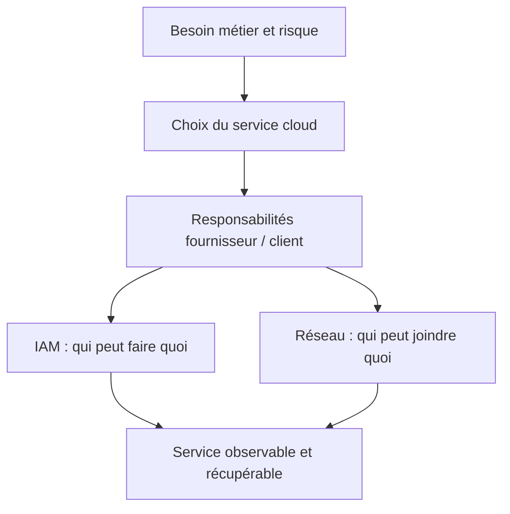

# Cloud — responsabilité, IAM, réseau et fiabilité

## Une frontière qui dépend du service

Dans le cloud, fournisseur et client se partagent les responsabilités ; la frontière varie entre machine virtuelle, plateforme gérée et logiciel fourni comme service. Le fournisseur peut gérer l'infrastructure physique, mais le client conserve des choix sur les identités, les données, les configurations et les accès qu'il contrôle. Dire « le cloud sécurise l'application » masque ces choix. Un modèle de responsabilité partagée doit être lu pour **le service précis** et non appliqué comme une formule universelle ([Microsoft : Shared responsibility in the cloud](https://learn.microsoft.com/en-us/azure/security/fundamentals/shared-responsibility)).

## Identités et chemins réseau

IAM distingue une identité, une action et une ressource. Le moindre privilège consiste à ne donner que les permissions nécessaires, dans le périmètre nécessaire et pour une durée adaptée. Un rôle accordé trop largement à une identité de pipeline peut permettre de modifier des ressources sans rapport avec sa tâche. La fédération d'identité évite parfois un secret durable, mais la confiance entre émetteur et cible doit être limitée aux bons dépôts, branches ou environnements. Les journaux d'audit permettent d'expliquer qui a tenté quoi ; ils ne préviennent pas à eux seuls un accès mal autorisé.

Un réseau virtuel fournit une segmentation logique. Une ressource avec adresse privée n'est pas automatiquement inaccessible depuis tous les réseaux : routes, appairages, passerelles et règles de filtrage déterminent le chemin effectif. Inversement, une application publique peut garder ses composants de données non publics. On dessine les flux nécessaires entre navigateur, application, données et services de gestion ; chaque ouverture doit correspondre à un flux justifié. La protection réseau ne remplace pas l'authentification et l'autorisation applicatives. Un pare-feu permissif et une identité très puissante créent ensemble un risque supérieur à chacun pris isolément.

## Fiabilité et récupération

La disponibilité ne vient pas seulement d'une région ou d'un service « managé ». Il faut identifier les dépendances, les modes de panne et la possibilité de restaurer les données. Une sauvegarde non testée n'établit pas la restaurabilité. RPO désigne la perte de données maximale tolérée exprimée en temps ; RTO, la durée de reprise visée. Ces objectifs sont choisis par le métier et orientent réplication, sauvegardes, procédures et exercices. La réplication propage aussi potentiellement une suppression erronée : elle ne remplace pas des copies récupérables. Mesures, alertes et plans de réponse donnent une chance de détecter puis traiter les dégradations ([Azure Well-Architected Framework : Reliability](https://learn.microsoft.com/en-us/azure/well-architected/reliability/)).

**Trade-off :** des redondances supplémentaires peuvent réduire certains temps d'arrêt mais augmentent complexité et coût ; elles ne couvrent pas forcément les erreurs logiques. **Piège :** déduire la sécurité d'un produit de sa seule étiquette « privé » ou « géré ». Décrire explicitement les permissions, chemins et responsabilités observables.

## Questions de révision

- Quelles responsabilités restent au client quand l'infrastructure est gérée ?
- Pourquoi une adresse privée ne suffit-elle pas à définir la politique d'accès ?
- Que manque-t-il à une sauvegarde jamais restaurée ?

Liens : [[IaC - Bicep Terraform plan et state]], [[FinOps - couts budgets et FOCUS]]. Retour à [[Cloud - index]].