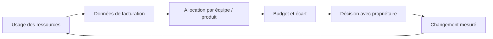

# FinOps — coûts, budgets et FOCUS

## Relier consommation et décision

Le coût cloud résulte de ressources provisionnées, consommées ou transférées selon des règles propres aux services. Une architecture techniquement fonctionnelle peut donc être coûteuse sans que personne sache quelle équipe ou quel usage en bénéficie. FinOps rapproche ingénierie, finance et métier pour rendre cette relation visible et décider d'un compromis entre coût, valeur, fiabilité et vitesse. Ce n'est pas seulement « réduire la facture » : une dépense supplémentaire peut être justifiée si elle protège un objectif explicite. Le cadre FinOps décrit un processus itératif d'information, d'optimisation et d'exploitation ([FinOps Foundation : Framework](https://www.finops.org/framework/)).

## Observer sans confondre indicateurs

La facture réelle, l'estimation avant usage et le budget sont trois objets différents. Une estimation anticipe des hypothèses ; un budget fixe une enveloppe et des alertes ; la facturation décrit ce qui a été imputé selon les données disponibles. Une alerte budgétaire n'arrête pas nécessairement la consommation : elle déclenche une investigation et une décision selon la configuration. Les tableaux de bord peuvent présenter des données avec un décalage ; il faut préciser leur période et leur périmètre avant de comparer deux montants. Éviter de conclure sur une journée atypique ou sur une ressource sans examiner l'ensemble de son service.

Attribuer les coûts par équipe, produit ou environnement permet de poser une question actionnable : qui décide de garder, réduire ou supprimer une ressource ? Les étiquettes aident si elles sont cohérentes, mais certains coûts partagés ne suivent pas proprement une seule étiquette. Une règle d'allocation explicite répartit les frais communs et affiche ce qui reste non attribué. Montrer les coûts unitaires — par transaction utile, par environnement ou par capacité rendue — peut être plus éclairant qu'un total brut, à condition que le dénominateur soit défini. Une baisse de coût total due à une baisse d'usage ne démontre pas une amélioration d'efficacité.

## FOCUS et arbitrages

FOCUS fournit une spécification pour normaliser des données de coûts et d'utilisation entre fournisseurs et outils. Elle aide à rendre comparables des champs, sans garantir que deux services différents aient le même modèle économique ni que toutes les données d'allocation soient renseignées. La qualité des métadonnées et les conventions internes restent essentielles ([FinOps Foundation : FOCUS](https://focus.finops.org/)). Une optimisation peut consister à supprimer une ressource oubliée, ajuster une capacité surdimensionnée ou modifier une politique de conservation ; chacune demande de vérifier la sécurité et la fiabilité après le changement.

**Trade-off :** réserver de la capacité peut réduire certains coûts dans un scénario prévisible, mais crée un engagement si l'usage change ; décider sans connaître la demande déplace le risque. **Piège :** poursuivre un budget comme un objectif absolu et couper des sauvegardes ou des contrôles essentiels. Le bon indicateur lie coût et service rendu. Les calculs doivent indiquer leurs hypothèses, pas inventer des tarifs universels.

## Questions de révision

- Pourquoi une alerte budgétaire ne constitue-t-elle pas une limite technique de dépense ?
- Comment traiter un coût partagé qui ne correspond à aucune équipe unique ?
- Que normalise FOCUS, et qu'est-ce qu'il ne décide pas pour nous ?

Liens : [[Cloud - responsabilite IAM reseau et fiabilite]], [[IaC - Bicep Terraform plan et state]]. Retour à [[Cloud - index]].