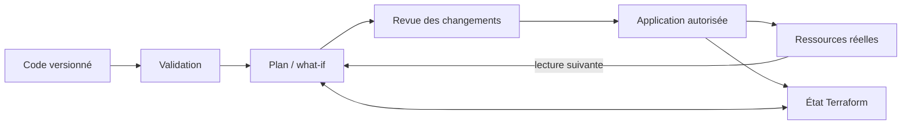

# IaC — Bicep, Terraform, plan et état

## Décrire une intention, examiner l'écart

L'infrastructure as code représente des ressources et leurs relations dans des fichiers relus, versionnés et vérifiables. Cette description n'est pas l'infrastructure elle-même : un moteur compare l'intention à ce qu'il connaît de l'environnement, puis propose ou applique des changements. Bicep cible les ressources Azure via les modèles de déploiement Azure ; Terraform utilise des fournisseurs et un mécanisme d'état pour gérer les objets qu'il suit. Le choix dépend notamment des plateformes concernées, des services requis et de la manière de gérer l'état, pas d'un classement abstrait des syntaxes ([Microsoft : Bicep overview](https://learn.microsoft.com/en-us/azure/azure-resource-manager/bicep/overview) ; [Terraform : State](https://developer.hashicorp.com/terraform/language/state)).

## Ce que montre une prévision

Une prévisualisation (`plan` ou `what-if`) aide à distinguer création, mise à jour et suppression envisagées. Elle mérite une revue attentive lorsqu'un changement touche des données, un réseau ou des permissions. Mais elle est calculée avec les informations et droits disponibles à cet instant : une modification extérieure ou une valeur inconnue peut changer le résultat de l'application. La validation de syntaxe ne dit pas que les permissions de déploiement sont suffisantes, ni que le service fonctionnera une fois créé. Le code IaC et la revue font partie du processus, puis viennent l'observation et les tests adaptés.

Terraform tient un état qui associe ses adresses logiques aux objets distants. Cet état ne constitue pas une sauvegarde de toutes les données des ressources ; il peut contenir des informations sensibles, même si certaines variables ont été marquées sensibles dans l'affichage. Il faut protéger son stockage et ses accès, contrôler les écritures concurrentes et prévoir sa récupération. Supprimer l'état pour « repartir proprement » peut rendre des ressources existantes orphelines aux yeux de Terraform. Un import associe un objet existant à une adresse, mais ne produit pas magiquement une configuration complète correcte. Un renommage sans mécanisme de déplacement peut être interprété comme une destruction suivie d'une création ([Terraform : State purpose](https://developer.hashicorp.com/terraform/language/state/purpose)).

## Organisation et dérive

Des modules permettent de réutiliser une convention, mais une abstraction trop générale cache les choix de sécurité et complique les mises à jour. Des paramètres distinguent les environnements sans copier tout le code ; ils ne doivent pas contenir de secrets en clair. La dérive survient lorsqu'une modification manuelle change les ressources sans mettre à jour l'intention versionnée. La prochaine prévision doit alors servir à comprendre l'écart, pas être appliquée aveuglément. Les politiques, les droits IAM et les validations complètent l'IaC : le fait de déclarer une ressource ne prouve pas qu'elle respecte les exigences d'exploitation.

**Trade-off :** déployer en un seul ensemble simplifie certaines dépendances mais agrandit l'impact d'une erreur ; découper exige de gérer les interfaces entre ensembles. **Piège :** lire un plan favorable comme une garantie de coût ou de disponibilité. Les usages, la tarification et les pannes futures n'y figurent pas entièrement.

## Questions de révision

- Pourquoi l'état Terraform n'est-il pas une sauvegarde des données applicatives ?
- Que peut changer entre la prévisualisation et l'application ?
- Comment traiter une ressource modifiée manuellement hors IaC ?

Liens : [[Cloud - responsabilite IAM reseau et fiabilite]], [[FinOps - couts budgets et FOCUS]]. Retour à [[Cloud - index]].