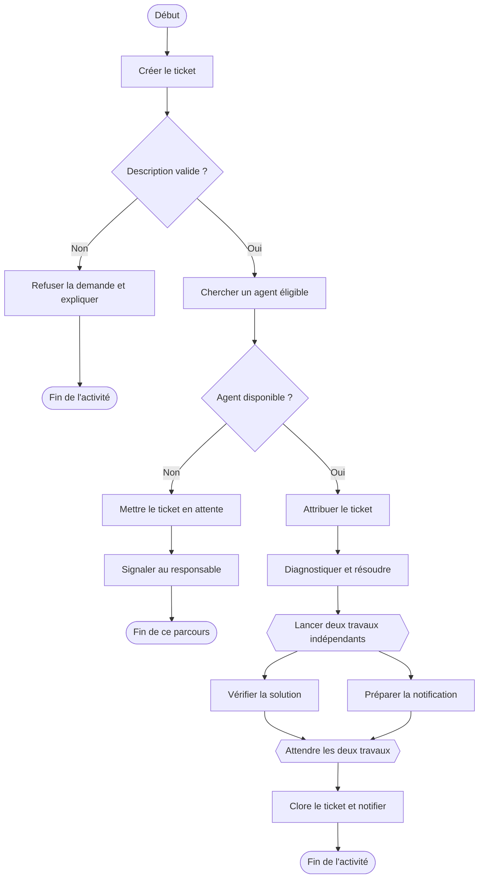

# UML — diagramme d'activité

> **Question directrice :** quels travaux et quels flux de contrôle permettent de mener un ticket de support de sa création à sa résolution ? Voir [[UML - index]], [[UML - cas d utilisation]] et [[UML - sequence]].

## Pourquoi et quand le choisir

Une activité modélise un **flux de travail** : actions, décisions, parallélisme et terminaisons. Elle sert à discuter un processus métier entre rôles, à identifier les chemins oubliés et à séparer une règle d'orientation d'une obligation d'attente. Elle ne fixe pas à elle seule la structure des objets (voir [[UML - classes et relations]]) ni le protocole exact entre services (voir [[UML - sequence]]). Pour le fil rouge, le ticket est créé, contrôlé, attribué ou mis en attente, puis résolu ; la validation de la solution et la préparation d'une notification peuvent être indépendantes avant la clôture.

Une **action** est une unité de comportement nommée par un verbe et son objet (« vérifier la description »). Les **flux de contrôle** transportent des jetons : l'exécution d'une action dépend de ce qui lui parvient. Un diagramme UML peut aussi porter des flux d'objets ; une flèche ne précise pas automatiquement les données transmises.

## Exemple de parcours

Le schéma ci-dessous utilise un *flowchart* Mermaid, **approximation** de l'activité UML. Les losanges expriment des choix ; les deux branches après « Lancer en parallèle » figurent deux travaux indépendants qu'il faut tous deux achever avant la clôture. Le dessin ne fournit pas à lui seul la sémantique normative d'un fork/join UML.

Ici, « fin de ce parcours » signifie que **cette exécution** s'arrête avec un ticket en attente, pas que la vie du ticket est terminée. Une nouvelle attribution relèverait d'un autre processus (voir [[UML - etats]]). « Vérifier la solution » pourrait échouer : ajouter un choix « solution validée ? », `Non` vers correction et `Oui` vers clôture. La notification doit être spécifiée comme préparation ou envoi effectif.

## Nœuds de contrôle et responsabilités

Une **décision** distribue le flux entrant vers une branche selon ses **gardes** ; un **merge** rassemble des chemins alternatifs sans attendre qu'ils aient tous produit un jeton. Pour « description valide ? », `[oui]` et `[non]` sont mutuellement exclusifs et couvrent les cas ; si la validation peut être indéterminée, ajouter explicitement cette issue. Des gardes qui se chevauchent rendent le choix ambigu ; des gardes non exhaustives peuvent bloquer le flux. Le merge n'est donc pas un rendez-vous de deux branches simultanées.

Un **fork** dédouble un flux pour lancer des branches concurrentes ; un **join** synchronise ces branches avant la suite. Il ne faut pas remplacer fork/join par un losange « oui/non » : ce dernier sélectionne une alternative, alors que le join attend normalement les travaux requis. En UML, la condition de jonction peut être explicitée ; une règle de synchronisation particulière doit être documentée, surtout si une branche peut échouer ou ne jamais se terminer. Le double embranchement et le nœud de rassemblement Mermaid ci-dessus rendent l'intention lisible, **sans garantir** que le moteur Mermaid appliquera une sémantique de jetons UML.

Les **partitions d'activité** (souvent appelées couloirs) allouent les actions à des responsabilités : demandeur crée, service tickets vérifie et attribue, agent diagnostique, responsable traite l'attente. Une partition n'est pas forcément une machine, un thread ou une frontière transactionnelle. Dans Mermaid, des `subgraph` peuvent regrouper visuellement ces tâches, mais ils ne sont pas des partitions UML normatives. Préciser le propriétaire de chaque décision et l'information qu'il utilise plutôt que d'inférer la responsabilité de la couleur ou de la position.

Enfin, distinguer **fin de flux** (*flow final*) et **fin d'activité** (*activity final*) : la première absorbe le jeton de son seul chemin, la seconde termine l'activité entière, y compris ses autres flux actifs. Si l'on veut abandonner uniquement une branche de vérification sans tuer la préparation de notification, une fin de flux peut convenir ; si une erreur de validation stoppe tout le processus, une fin d'activité convient. Les ovales Mermaid ci-dessus sont des légendes explicatives, **pas** des symboles UML distincts.

## Erreurs fréquentes

- Utiliser un merge pour attendre des tâches simultanées, ou un join pour réunir deux alternatives dont une seule s'exécute.
- Laisser une garde « oui » sans « non » ni comportement par défaut ; supposer qu'une vérification échouée disparaît.
- Confondre fin d'une exécution de processus et état final du ticket ; faire du parallélisme un simple `if`.
- Prendre un `subgraph` Mermaid pour une preuve de responsabilité ou de synchronisation UML.

## Questions de révision

1. Deux contrôles indépendants doivent finir avant la clôture : décision/merge ou fork/join ? **Corrigé :** fork/join ; aucune branche n'est exclue.
2. Que devient un ticket valide si aucun agent n'est disponible ? **Indice :** chemin explicite d'attente et propriétaire de sa reprise, pas résolution fictive.
3. Une branche facultative finit, mais une autre travaille encore : quel nœud de fin employer ? **Corrigé :** fin de flux ; une fin d'activité arrêterait aussi l'autre branche.

### Références

- OMG, *Unified Modeling Language*, version 2.5.1, spécification normative (activités et nœuds de contrôle) : https://www.omg.org/spec/UML/2.5.1/.
- Obsidian, *Advanced formatting syntax*, section « Diagram » : https://obsidian.md/help/advanced-syntax.
