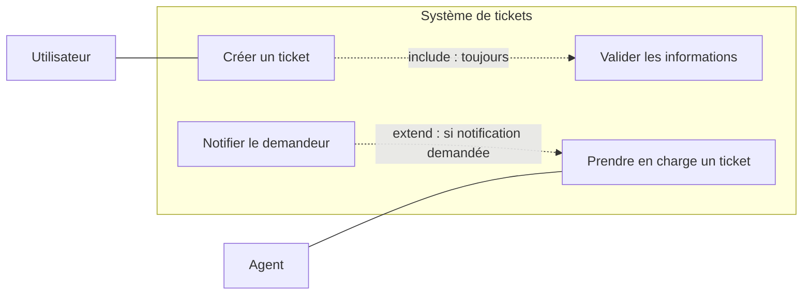

# UML — cas d’utilisation : décrire les buts vus de l’extérieur

[[UML - index]] · [[UML - classes et relations]] · [[UML - sequence]] · [[UML - activite]]

## Quand l’utiliser ?

Un diagramme de cas d’utilisation répond à deux questions : **qui interagit avec le système ?** et **quel résultat observable en attend-il ?** Il cadre le périmètre et prépare des scénarios de validation. Dans l’exemple **fictif** des tickets d’assistance, « créer un ticket » est un but ; « cliquer sur Envoyer » est une étape d’interface. Le dessin ne décrit ni les écrans, ni l’ordre des étapes. Pour ces vues, voir [[UML - sequence]] et [[UML - activite]].

## Comment le lire ?

- **Frontière du système** : le rectangle nommé désigne le sujet modélisé. Les cas sont dedans ; les acteurs sont dehors. Changer le périmètre peut transformer un composant interne en acteur externe.
- **Acteur** : un *rôle* joué par une personne, une organisation ou un autre système. Une personne peut jouer plusieurs rôles. « Agent » et « Utilisateur » sont des rôles ; « Sophie » n’est pas un acteur pertinent ici.
- **Cas d’utilisation** : un comportement produisant un résultat utile pour un acteur ou une partie prenante. Nommez-le avec un verbe (« prendre en charge un ticket », pas « ouvrir la page 2 »).
- **Association** : un trait acteur–cas indique une participation ou communication ; il ne décrit ni qui initie chaque message, ni les droits détaillés. Une **généralisation** d’acteur ou de cas signifie qu’un élément spécialisé hérite du comportement et des relations pertinents de l’élément général ; elle ne sert pas à représenter « puis ».
- **`«include»`** : du cas incluant **vers** le cas inclus. Le comportement inclus est inséré dans l’exécution du cas incluant : c’est une partie requise de ce comportement, souvent réutilisée, et non une option de l’utilisateur. Cela ne signifie pas qu’il faut toujours extraire tout petit sous-geste en cas autonome.
- **`«extend»`** : du cas d’extension **vers** le cas de base. Un comportement supplémentaire s’insère à un **point d’extension** défini dans le cas de base, sous une condition éventuelle ; le cas de base reste compréhensible sans lui. La condition ne veut pas dire que le système doit exécuter systématiquement l’extension. Un point d’extension nomme un lieu du comportement, pas un écran.

## Exemple : tickets d’assistance

Le schéma suivant est un **flowchart Mermaid de communication**, pas un diagramme UML normatif : les rectangles remplacent notamment les ellipses UML, et les flèches pointillées annotées ne sont pas des relations `«include»` ou `«extend»` normalisées. Les traits acteurs–cas indiquent seulement une participation. Le cadre représente le sujet « Système de tickets ».

**Lecture métier** : pour créer un ticket, le système valide les informations nécessaires. Pour prendre en charge un ticket, l’agent obtient une affectation ; si la règle « notification demandée » est vraie, le système peut notifier le demandeur au point d’extension **après affectation**. Dans un vrai diagramme UML, on dessinerait une flèche en tirets `«include»` de « Créer » vers « Valider » et une flèche en tirets `«extend»` de « Notifier » vers « Prendre en charge ». L’association ne dit pas si le demandeur possède un compte ni comment le message est envoyé.

### Scénario textuel : prendre en charge un ticket

- **Acteur principal** : Agent. **Déclencheur** : l’agent veut traiter un ticket ouvert.
- **Préconditions** : l’agent est autorisé ; le ticket est ouvert et non attribué.
- **Succès** : le ticket est attribué à l’agent et son état est cohérent avec la prise en charge. L’agent voit la confirmation.
- **Déroulé nominal** : l’agent choisit un ticket disponible ; le système vérifie sa disponibilité ; le système enregistre l’affectation et confirme. Au point « après affectation », la notification est ajoutée seulement si la condition métier s’applique.
- **Alternatives** : si un autre agent a déjà pris le ticket, aucune nouvelle affectation n’est enregistrée et le système le signale ; si la notification échoue, la politique choisie doit préciser si l’affectation reste acquise ou est annulée. Le diagramme seul ne tranche pas cette politique.

Les pré/postconditions et alternatives lèvent les ambiguïtés du dessin. Le cycle de vie complet du ticket se modélise plutôt en [[UML - etats]] ; ses relations structurelles, en [[UML - classes et relations]].

## Erreurs fréquentes

1. Mettre une base de données **interne** comme acteur alors qu’elle appartient au sujet modélisé ; vérifier la frontière avant de dessiner.
2. Lire `include` comme « éventuellement », ou inverser la flèche `extend`. Énoncer en phrase le cas de base, la condition et le point d’insertion.
3. Faire du diagramme une maquette de menus ou une liste d’étapes. Garder les buts ; détailler le scénario en texte ou dans une autre vue.

## S’autoévaluer

1. « Agent » représente-t-il une personne précise ? **Non** : c’est un rôle externe, potentiellement joué par plusieurs personnes.
2. Une validation exécutée à chaque création relève-t-elle de `include` ou de `extend` ? **`include`**, si l’on choisit d’en faire un cas réutilisable.
3. Où placer « envoyer une notification si demandé » ? **Dans une extension** pointant vers « prendre en charge », avec condition et point d’extension explicités ; préciser séparément la politique en cas d’échec.

## Références

- [OMG — Unified Modeling Language 2.5.1, § 18 « UseCases »](https://www.omg.org/spec/UML/2.5.1/) : référence pour les acteurs, cas et relations ; [PDF normatif](https://www.omg.org/spec/UML/2.5.1/PDF).
- [Obsidian — Advanced formatting syntax, diagrammes Mermaid](https://obsidian.md/help/advanced-syntax) : affichage des blocs `mermaid`.
- [Mermaid — Flowcharts](https://mermaid.js.org/syntax/flowchart.html) : syntaxe du schéma approximatif ci-dessus.
