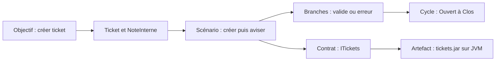

# UML — choisir et relire ses diagrammes

> Un diagramme répond à une question délimitée, non à « dessiner tout le système ». Fil rouge fictif : créer et traiter un ticket d’assistance. Parcours général : [[UML - index]]. Les catégories et notations UML sont définies par l’OMG ; Mermaid sert ici à illustrer un raisonnement dans Obsidian, sans remplacer la notation UML.[1][2]

## Partir de la question, puis choisir la vue

| Question à résoudre | Vue adaptée | Ce qu’elle ne prouve pas seule |
|---|---|---|
| Qui poursuit quel objectif avec le système ? | [[UML - cas d utilisation]] : acteurs, cas, frontière | Ordre précis des appels ou écrans |
| Quelles entités, attributs et liens durables ? | [[UML - classes et relations]] : classes, associations, multiplicités | Ordre temporel et transactions |
| Qui échange quoi dans un scénario daté ? | [[UML - sequence]] : lignes de vie et messages | Tous les chemins alternatifs du système |
| Quelles décisions et tâches conduisent au résultat ? | [[UML - activite]] : flux, gardes, parallélisme | État complet et durable d’un objet |
| Quels états et transitions sont permis pour un ticket ? | [[UML - etats]] : déclencheurs, gardes, effets | Affectation des services aux machines |
| Qui fournit ou requiert quel contrat ? | [[UML - composants et deploiement]] : composants, interfaces | Où tourne chaque binaire |
| Quel artefact est sur quelle cible et quels nœuds communiquent ? | [[UML - composants et deploiement]] : déploiement | La qualité réelle ou la disponibilité de l’installation |

Ce tableau n’impose pas sept dessins. Ajouter les vues selon le risque : états pour le cycle de vie, déploiement pour la frontière réseau. Avant de tracer, fixer question, périmètre, public et niveau **type** ou **instance**. Relier explicitement l’« agent » métier au `PortailSupport` technique.[1]

## Traverser les vues sans les confondre

Le cas « créer un ticket » ne dicte pas une classe `DemandeurService`. Les classes fixent `Ticket 1 — 0..* NoteInterne` ; la séquence fait appeler `ITickets.creer(...)`, persister le ticket puis demander l’avis. L’activité branche sur « données invalides » et « aucun agent disponible » ; une branche d’échec de notification peut ensuite être ajoutée. Les états autorisent `Ouvert → Attribué → En cours → Résolu → Clos`, avec garde de clôture. `GestionTickets` fournit `ITickets` ; `tickets.jar` le manifeste sur une JVM. La cohérence vient des **invariants partagés**, non de la duplication.[1]

**Limite :** ce graphe Mermaid est une carte de relecture, **pas** un diagramme UML. Une flèche signifie « vérifier la correspondance », non « déduire formellement ». Un cas a potentiellement plusieurs scénarios.[1][2]

## Revue d’invariants : une méthode praticable

1. **Identité et quantité.** Nommer `Ticket`, `NoteInterne`, `ITickets` et leurs alias. `Ticket 1 — 0..* NoteInterne` autorise zéro commentaire ; chercher tout commentaire orphelin. Distinguer multiplicité structurelle et quantité observée.
2. **Décisions et états.** Vérifier gardes, échecs et terminaisons. « Clore `Ouvert` » est impossible si seule la transition `Résolu → Clos` existe. Une garde `[agentAutorise]` ne prouve pas l’authentification.
3. **Responsabilités et messages.** Associer chaque message à un receveur, un contrat et un effet vérifiable. `PortailSupport → GestionTickets : creer` doit être compatible avec `ITickets` ; éviter les effets magiques d’une classe `Ticket` passive.
4. **Erreurs et temps.** Tester données invalides, indisponibilité, timeout, réponse tardive et répétition. Si l’avis échoue, le ticket persiste-t-il ? Faire concorder état final, réponse et reprise dans les vues dynamiques.
5. **Architecture concrète.** Relier contrat requis à fournisseur et artefact à cible ; distinguer topologie cible et réalité observée. La flèche réseau ne prouve pas la connectivité.[1]

**Anti-patterns :** vue surchargée ; noms incohérents ; flèches ambiguës ; classes en organigramme ; état franchi sans transition ; erreur omise ; cible présentée comme inventaire. Remède : une question par vue, table de correspondance et relecture nominale puis en échec.

### Exercice de synthèse

Un utilisateur crée un ticket ; un agent est trouvé et l’attribution est enregistrée. Après la réponse de création, le traitement de la notification asynchrone échoue. Proposer les vues à dessiner et une règle cohérente de résultat. **Réponse possible :** séquence distinguant envoi et traitement ultérieur, activité avec branche de reprise, état du ticket restant `Attribue`, composants `GestionTickets` requérant `IEnvoiAvis`, et déploiement seulement si l’on enquête sur la liaison réseau. La réponse initiale confirme création et attribution, **pas** réception de l’avis ; l’échec ultérieur déclenche une reprise ou une alerte. **Critères :** identité du ticket stable, transition autorisée, responsabilité de la reprise identifiée, résultat utilisateur fidèle, aucun nœud inventé. Une politique d’échec global avec compensation serait un autre modèle : elle exigerait des transitions et des effets différents, cohérents dans toutes les vues.

### Questions de révision

1. Quelle vue choisit-on pour vérifier la multiplicité `Ticket–NoteInterne`, et laquelle pour l’ordre des appels ?
2. Pourquoi la présence d’une garde dans l’activité ne prouve-t-elle pas que le ticket peut passer de `Ouvert` à `Clos` ?
3. Après un timeout de notification, quels invariants vérifier entre séquence, activité, états et composants ?

## Sources

[1] https://www.omg.org/spec/UML/2.5.1 — OMG UML 2.5.1
[2] https://obsidian.md/help/advanced-syntax — Obsidian Advanced formatting syntax
