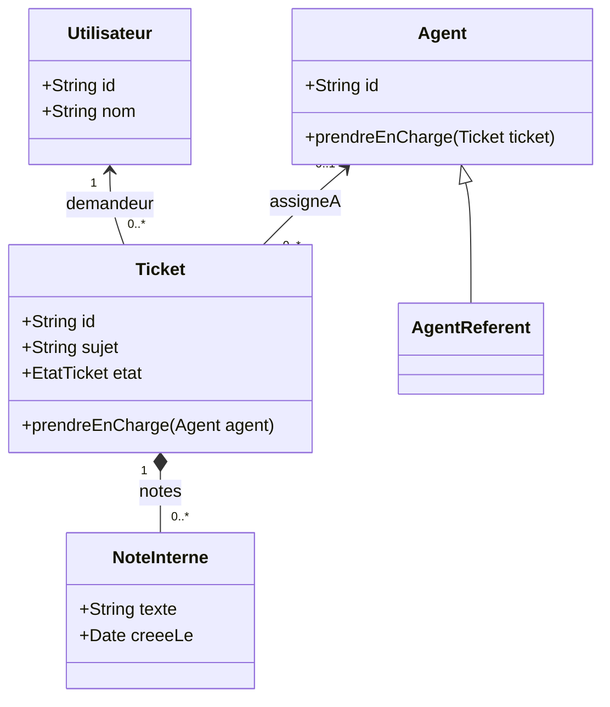
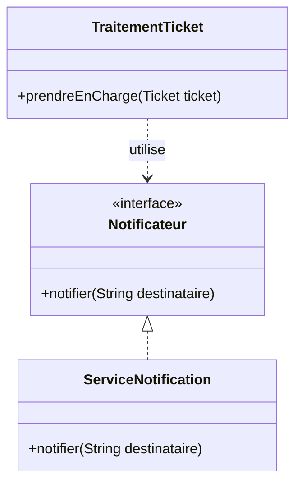

# UML — classes et relations : modéliser la structure

[[UML - index]] · [[UML - cas d utilisation]] · [[UML - sequence]] · [[UML - etats]] · [[UML - composants et deploiement]]

## Quand l’utiliser ?

Un diagramme de classes décrit des **types**, leurs propriétés et les liens possibles entre leurs instances. Utilisez-le pour discuter du vocabulaire métier, des responsabilités et des contraintes structurelles, pas pour recopier automatiquement les tables SQL ou le code existant. Ici, le système de tickets d’assistance est un **exemple fictif** : « Ticket », « Agent » et « NoteInterne » ne décrivent aucun service effectivement déployé. Le cas « prendre en charge » est d’abord un but externe ([[UML - cas d utilisation]]) ; la structure ci-dessous précise ensuite quelles informations et relations peuvent le soutenir.

## Comment le lire ?

Une **classe** nomme un type. Ses **attributs** décrivent des propriétés (`etat`, `sujet`) ; ses **opérations** exposent des comportements (`prendreEnCharge`). En UML, `+` signifie public, `-` privé, `#` protégé, `~` visibilité de paquet. Une association est un lien structurel entre instances : les **multiplicités à chaque extrémité** comptent les instances liées. Chaque ticket a un demandeur ; un demandeur peut avoir plusieurs tickets. `0..1` = facultatif et unique, `1` = exactement un, `*` = zéro à plusieurs. La navigabilité (flèche) indique un accès possible, pas une permission ni un flux temporel ; son absence ne prouve pas une bidirectionnalité.

Une **généralisation** (« est un ») rend un sous-type substituable au type général ; elle n’est pas un raccourci pour partager des champs. Une **réalisation** relie une classe à l’interface qu’elle implémente ; une **dépendance** indique un usage sans lien structurel durable.

**Agrégation partagée** (losange blanc) : relation « tout/partie » peu contraignante ; UML laisse la sémantique précise du partage au domaine. **Composition** (losange noir) : une partie appartient à au plus un composite à un instant donné ; le composite est responsable de son existence. Sa destruction détruit ses parties *dans le modèle*, sans imposer `DELETE CASCADE` SQL ni suppression physique de toute trace.

## Exemple structurel

Le `classDiagram` Mermaid illustre les types et relations sans garantir toute la sémantique UML ; les contraintes se lisent aussi dans le texte.

Un ticket peut ne pas avoir d’agent (`0..1`) ; un agent peut avoir plusieurs tickets (`0..*`). Une note appartient à **un seul ticket** et n’existe pas indépendamment dans ce modèle : d’où la composition. Si elle doit être transférable, revoir ce choix. L’héritage `AgentReferent` suppose un contrat spécialisé ; une simple permission relèverait plutôt d’une règle d’autorisation.

Pour séparer contrat et implémentation, on peut zoomer sur une autre partie du modèle :

La ligne pointillée vers l’interface est une **réalisation** ; celle depuis `TraitementTicket` est une **dépendance**. Aucun protocole réseau ni déploiement n’est impliqué : voir [[UML - composants et deploiement]] pour la vue des composants et du placement éventuel.

### Invariants et autres vues

- Chaque ticket possède exactement un demandeur ; l’agent assigné est facultatif tant que le ticket attend une prise en charge.
- À un instant donné, un ticket est assigné à **au plus un agent** ; l’opération de prise en charge doit préserver cet invariant même sous accès concurrents.
- Une note interne ne peut appartenir à deux tickets simultanément dans ce modèle de composition.

Le diagramme de classes ne raconte pas la chronologie de la prise en charge : [[UML - sequence]] montre un scénario ; [[UML - etats]] précise les transitions autorisées du ticket. Un **diagramme d’objets** montrerait un instant concret, par exemple `ticket42:Ticket` lié à `alice:Utilisateur` et sans agent ; il ne remplace pas les multiplicités du modèle de types. Les classes métier ne sont pas non plus des tables SQL : une association peut devenir une clé étrangère, mais une table technique, un événement ou une valeur intégrée ne correspondent pas nécessairement à une classe métier.

## Erreurs fréquentes

1. Lire `0..1` du mauvais côté : toujours formuler « pour **une** instance de l’autre extrémité, combien ici ? ».
2. Mettre de la composition partout parce que le code contient une propriété ; justifier exclusivité et cycle de vie, sinon préférer l’association.
3. Confondre héritage et réutilisation de code, ou dépendance et association permanente. Tester la substituabilité et préciser l’usage concret.

## S’autoévaluer

1. Un ticket ouvert sans agent viole-t-il le diagramme ? **Non**, `0..1` agent autorise l’absence.
2. Une note transférable entre tickets convient-elle à cette composition ? **Pas sans modifier le modèle** de propriété et de cycle de vie.
3. Deux tickets en cours peuvent-ils avoir le même agent ? **Oui**, `0..*` côté tickets pour un agent ; ce modèle ne fixe aucune capacité maximale.

## Références

- [OMG — Unified Modeling Language 2.5.1, § 9 « Classification » et § 11 « Structured Classifiers »](https://www.omg.org/spec/UML/2.5.1/) : référence pour types, propriétés et relations ; [PDF normatif](https://www.omg.org/spec/UML/2.5.1/PDF).
- [Obsidian — Advanced formatting syntax, diagrammes Mermaid](https://obsidian.md/help/advanced-syntax) : affichage des blocs `mermaid`.
- [Mermaid — Class diagrams](https://mermaid.js.org/syntax/classDiagram.html) : syntaxe des exemples, non spécification UML.
