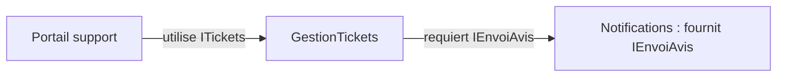
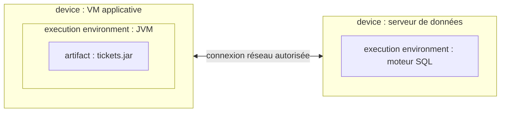

# UML — composants et déploiement

> Fil rouge : une plateforme fictive de tickets d’assistance. Cette fiche passe de **qui fournit un service** à **où s’exécute son artefact**. Pour replacer ces vues, voir [[UML - index]] et [[UML - choisir et relire ses diagrammes]].

## Composants : contrats et dépendances

Un **composant** est une unité logique modulaire dont on peut décrire les interactions par des interfaces, sans imposer sa réalisation interne. Dans notre système, `GestionTickets` accepte la création d’un ticket et demande l’envoi d’un avis à `Notifications`. Son interface **fournie**, `ITickets`, énonce ce que d’autres peuvent appeler ; son interface **requise**, `IEnvoiAvis`, énonce ce dont il a besoin. La dépendance va du consommateur vers le fournisseur : si le contrat d’envoi change, `GestionTickets` peut être touché. On peut montrer ces contrats sur des ports, par notation « lollipop/socket » ou par dépendances explicites ; le choix du détail doit rester lisible. Une interface ne signifie pas nécessairement un endpoint HTTP : ce contrat pourrait être un appel local, une API ou un échange asynchrone, à préciser ailleurs.[1]

**Lecture :** le schéma Mermaid ci-dessus est une *approximation pédagogique*, **pas** la notation UML exacte des composants, ports, interfaces fournies/requises ou connecteurs. La flèche exprime la dépendance requise par `GestionTickets` ; la mention dans `Notifications` indique qui fournit le contrat, sans dessiner la notation UML d'interface fournie/requise. Dans un véritable diagramme UML, distinguer contrat fourni et contrat requis, puis vérifier que leurs signatures et obligations sont compatibles. Un composant peut être réalisé par plusieurs classes ; inversement, une classe `Ticket` du [[UML - classes et relations]] n’est pas automatiquement un composant.[1][2]

Un **package** range des éléments du modèle dans un espace de noms ; un composant exprime une unité de responsabilité et des contrats d’interaction. Ranger `Ticket`, `NoteInterne` et `Statut` dans un package `support` ne prouve ni qu’ils forment une unité remplaçable, ni qu’ils exposent `ITickets`. Utiliser le diagramme de packages pour organiser ou montrer des dépendances entre ensembles de modèles ; celui de composants pour discuter du couplage entre services. L’existence d’un composant n’oblige pas à avoir un microservice, un conteneur ou un dépôt Git par composant.[1]

## Déploiement : ressources, artefacts et liaisons

Le **nœud** est une ressource de calcul : un **device** représente un équipement physique ou virtuel ; un **execution environment** est l’environnement d’exécution hébergé sur un nœud, par exemple un runtime applicatif. Un **artifact** est un élément physique d’implémentation ou de livraison (ici `tickets.jar`), que l’on peut déployer sur une cible. L’artefact peut *manifester* un composant, sans devenir ce composant : `tickets.jar` n’est ni la classe `Ticket` ni l’interface `ITickets`. Un chemin de communication relie des nœuds capables d’échanger ; nommer protocole et frontière réseau est une annotation utile du cas concret, pas une obligation de cette esquisse.[1]

Cette deuxième **approximation Mermaid** montre un emboîtement et une connexion, sans prétendre reproduire les glyphes ni la sémantique complète du diagramme de déploiement UML. Une vue au **niveau type** dit « une VM héberge une JVM » ; une vue d’**instances** dit « `vm-tickets-01 : VM` héberge `jvm-01 : JVM` ». Préciser laquelle est dessinée évite de lire une topologie générique comme une liste exhaustive des machines présentes. Pour montrer deux réplicas, dessiner deux instances et leur mécanisme d’accès, plutôt qu’un unique rectangle ambigu.[1][2]

### Exemple, limites et vérification

`GestionTickets` fournit `ITickets` au portail et utilise `IEnvoiAvis`. `tickets.jar` manifeste `GestionTickets` et est installé dans la JVM de la VM applicative. La base contient les tickets mais le diagramme de déploiement ne remplace pas le modèle de données ; une liaison VM–base ne prouve ni disponibilité, ni chiffrement, ni sens d’initiation de toutes les requêtes. Une erreur/timeout de notification appartient aussi aux vues dynamiques [[UML - sequence]] et [[UML - activite]].[1]

Étiqueter le dessin **cible envisagée** ou **constat déployé**, avec environnement et date d’observation si c’est un constat. Ne pas affirmer que deux réplicas ou une zone de secours existent parce qu’ils figurent dans l’architecture souhaitée : confronter les instances aux inventaires et à la configuration réels. Vérifier enfin que chaque artefact possède une cible plausible, que les interfaces requises ont un fournisseur identifiable et que le réseau autorise effectivement les échanges supposés.

### Questions de révision

1. Pourquoi `support` comme package ne suffit-il pas à décrire `GestionTickets` comme composant ?
2. Quelle différence entre `GestionTickets`, `Ticket` et `tickets.jar` ?
3. Que faut-il ajouter pour prouver que deux instances applicatives sont *réellement* déployées et reliées à la base ?

## Sources

[1] https://www.omg.org/spec/UML/2.5.1 — OMG UML 2.5.1
[2] https://obsidian.md/help/advanced-syntax — Obsidian Advanced formatting syntax
