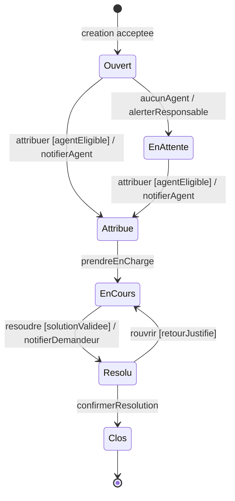

# UML — machine à états pour un ticket

> **Question directrice :** quels événements autorisent un ticket à changer d'état, et quelles opérations sont interdites dans chaque état ? Voir [[UML - index]], [[UML - cas d utilisation]] et [[UML - sequence]].

## Pourquoi et quand la choisir

Une **machine à états** décrit la vie d'une entité dont le comportement dépend de son état courant. Elle sert lorsque la même commande est acceptée ou refusée selon l'état : attribuer un ticket ouvert, rouvrir un ticket résolu, interdire la résolution d'un ticket clos. Contrairement à l'activité, qui suit un travail, elle énonce les états admissibles d'un **même ticket** et ses transitions. [[UML - sequence]] détaille une réalisation ; [[UML - classes et relations]] peut porter le statut sans remplacer ses règles.

Un **état** est une situation stable, non une simple valeur d'interface. Un **événement** déclenche éventuellement une transition ; une **garde** entre crochets doit être vraie ; une **action d'effet** après `/` accompagne la transition. Une action `entry` s'exécute à l'entrée d'un état, `exit` à sa sortie. Une notification en effet de `attribuer` ne concerne que cette transition ; en action d'entrée, elle concernerait **tous** les chemins entrants. « Après délai » exige une politique explicite, pas une distance sur le dessin.

## Exemple : cycle de vie simplifié

Hypothèse : un ticket ne passe à « résolu » qu'avec une solution validée ; un agent éligible est requis pour l'attribution. « Clôturé » est terminal dans **ce modèle**, et la mise en attente est un état distinct pour préserver l'issue « aucun agent ». Le diagramme Mermaid suivant est lisible dans Obsidian ; ses étiquettes décrivent des règles métiers, sans prétendre valider automatiquement les gardes.

La flèche initiale indique une création acceptée. `Clos` vers le pseudo-état final termine **la machine du ticket** dans cette vue, pas le serveur. `aucunAgent` est un résultat métier explicite. Réattribuer depuis « attribué » exigerait une transition dédiée.

## Contrats, invariants et cas alternatifs

Les invariants rendent le modèle testable : en `Ouvert` ou `EnAttente`, aucun agent n'est affecté ; en `Attribue` ou `EnCours`, un agent éligible est identifié ; en `Resolu`, une résolution validée existe ; en `Clos`, les commandes modifiant le traitement sont refusées. Préciser où vérifier ces contraintes et comment arbitrer deux attributions concurrentes. Un statut stocké ne suffit pas si d'autres champs le contredisent (voir [[UML - composants et deploiement]] pour les frontières techniques).

Une **transition invalide** ne se « saute » pas : `resoudre` en `Ouvert`, `confirmerResolution` en `EnCours` ou `attribuer` en `Clos` doit être refusé, ou ignoré si cette politique est explicite. Absence de flèche signifie absence de comportement autorisé **dans ce modèle**, pas un code HTTP précis. Si `[solutionValidee]` est faux, documenter le rejet ; une transition interne pourrait traiter un commentaire sans changer d'état.

`entry / horodaterPriseEnCharge` et `exit / tracerFinTraitement` dans `EnCours` illustreraient les actions attachées à cet état. Une notification externe peut échouer après le changement d'état : prévoir reprise ou signalement ; aucune atomicité n'est garantie. Un délai dépassé pourrait conduire `EnAttente` à `Escalade` après définition du délai et de son déclenchement.

Un **pseudo-état d'historique** sert avec des états composites : suspendre « diagnostic » ou « intervention », puis reprendre le sous-état antérieur. L'historique superficiel et profond diffèrent pour les sous-états imbriqués ; les états plats ici n'en ont pas besoin.

**UML ≠ Mermaid.** `stateDiagram-v2` donne un schéma pratique dans Obsidian, mais ce n'est pas un validateur de machines à états UML 2.5.1. Les gardes et effets écrits dans les libellés Mermaid sont du texte : il faut vérifier séparément leur exclusivité, les événements concurrents, les invariants et les actions d'entrée/sortie. Une flèche dessinée ne prouve ni persistance, ni délai réel, ni livraison de notification.

## Erreurs fréquentes

- Confondre état « en attente » et ticket « clos » ; autoriser la résolution depuis n'importe quel statut sans garde.
- Oublier le refus d'une transition invalide ou supposer qu'un effet asynchrone est atomique avec l'état.
- Mettre une action de notification en `entry` alors qu'elle ne doit survenir que sur une transition particulière.
- Employer un historique pour contourner l'absence de définition des règles de reprise.

## Questions de révision

1. `resoudre` arrive en `Ouvert` : quel comportement prévoir ? **Corrigé :** refus explicite, ou politique d'ignorance documentée ; aucune transition de résolution n'est autorisée ici.
2. Pourquoi placer `notifierAgent` sur `attribuer` plutôt qu'à l'entrée de `Attribue` ? **Indice :** l'entrée s'applique à tous les chemins entrants, y compris ceux ajoutés plus tard.
3. Quelle différence entre `Clos --> [*]` et la fin d'une activité ? **Corrigé :** fin du cycle modélisé pour un ticket contre terminaison d'une exécution de flux.

### Références

- OMG, *Unified Modeling Language*, version 2.5.1, spécification normative (machines à états) : https://www.omg.org/spec/UML/2.5.1/.
- Obsidian, *Advanced formatting syntax*, section « Diagram » : https://obsidian.md/help/advanced-syntax.
