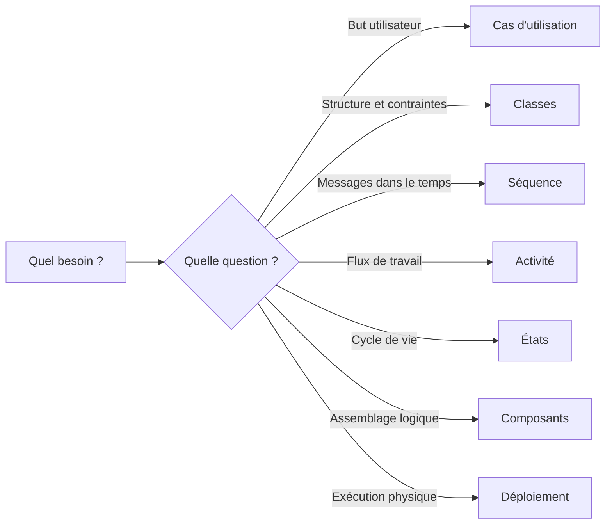

# UML — comprendre et décider, pas seulement dessiner

**UML** (*Unified Modeling Language*) est un langage de modélisation : ses diagrammes donnent des vues complémentaires d'un système, pas un programme exécutable ni la preuve qu'une architecture est déployée. L'objectif est de répondre à une **question de conception** et de rendre une décision discutable.

> [!important] Notation et affichage
> Les dessins ci-dessous utilisent **Mermaid**, que le coffre affiche dans Obsidian. Ils illustrent des concepts UML mais **ne reproduisent pas toujours exactement la notation normalisée** (en particulier cas d'utilisation, composants et déploiement). Pour une notation formelle ou un échange UML entre outils, utiliser un outil UML adapté et la spécification OMG.

## Parcours de lecture

1. [[UML - cas d utilisation]] — acteurs, frontière du système, buts, `include` et `extend`.
2. [[UML - classes et relations]] — attributs, associations, multiplicités, composition et généralisation.
3. [[UML - sequence]] — ordre des appels, branches, boucles et erreurs.
4. [[UML - activite]] — flux, décisions et parallélisme.
5. [[UML - etats]] — cycle de vie d'une entité et transitions autorisées.
6. [[UML - composants et deploiement]] — dépendances logiques et placement des artefacts.
7. [[UML - choisir et relire ses diagrammes]] — choisir la bonne vue et vérifier leur cohérence.

**Fil rouge fictif :** un système de tickets d'assistance. Un utilisateur crée un ticket, un agent le traite, un service enregistre les changements et peut notifier une personne. Ce système sert d'exemple de conception ; aucun service réel n'est déployé ici.

## À retenir en entretien ou en revue

- Un diagramme **de classes** exprime des types et relations ; un diagramme **d'objets** montre un instant d'instances concrètes.
- Une **séquence** explique un scénario particulier ; une **activité** organise un flux et ses branches ; une machine **à états** définit les transitions possibles d'une entité au cours de sa vie.
- **Composants** répond à « qui dépend de quelle interface ? » ; **déploiement** à « quel artefact tourne où ? ».
- Un schéma utile a un périmètre, des hypothèses, des invariants et une date de validité ; s'il prétend tout expliquer d'un coup, il est probablement trop chargé.

## Références

- [OMG — spécification UML 2.5.1](https://www.omg.org/spec/UML/2.5.1/) (autorité pour la sémantique UML).
- [Obsidian — syntaxe des diagrammes Mermaid](https://obsidian.md/help/advanced-syntax) (affichage des exemples du coffre).

[[Cours - index]] · [[Patterns - index]] · [[Projets - index]]
