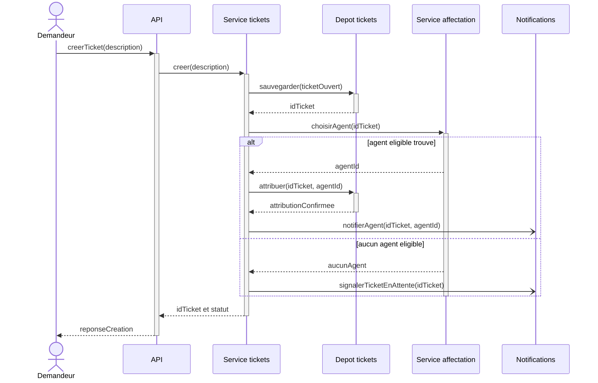

# UML — diagramme de séquence

> **Question directrice :** dans quel ordre les participants échangent-ils des messages pour traiter un scénario précis ? Voir [[UML - index]], [[UML - cas d utilisation]] et [[UML - classes et relations]].

## Pourquoi et quand le choisir

Le diagramme de séquence est une **interaction** : il décrit un chemin observable d'un cas d'utilisation, pas toutes les capacités du système. Il est utile pour clarifier les responsabilités d'une API, d'un service métier et d'un adaptateur, vérifier le traitement d'une réponse ou d'une erreur, puis discuter les contrats entre composants. Pour le fil rouge, une personne crée un ticket de support ; le système l'enregistre, cherche un agent, puis lui signale l'attribution. Un diagramme distinct pourrait détailler la résolution : garder chaque vue lisible prime sur l'exhaustivité. Le modèle structurel correspondant relève de [[UML - composants et deploiement]], non de cette chronologie.

Une **ligne de vie** représente un participant à l'interaction (acteur, instance ou service dans une vue simplifiée). Le temps se lit normalement du haut vers le bas ; une ligne pointillée n'est pas une durée mesurée. Le **message synchrone** attend la fin de l'appel avant que l'appelant poursuive ; le **message asynchrone** n'impose pas cette attente. Une **activation** matérialise une exécution sur la ligne de vie et peut s'emboîter ; un **retour** explicite une réponse ou un résultat, mais ne crée pas une seconde opération métier. La flèche seule ne prouve ni transport réseau, ni persistance, ni garantie de livraison.

## Scénario : création et attribution

Hypothèse métier de cet exemple : la création renvoie un identifiant, et la recherche d'agent peut ne pas en trouver. La notification est ici une commande asynchrone ; cela ne garantit pas que l'agent l'a reçue. Le diagramme Mermaid ci-dessous est une **projection pédagogique**, non une notation UML normative.

Le `alt` partitionne deux issues selon une condition de recherche : un ticket créé sans agent reste **ouvert en attente**, il n'est pas magiquement attribué. Les barres `+`/`-` indiquent les activations Mermaid ; la flèche `-)` représente un envoi asynchrone dans cette syntaxe. Le « statut » renvoyé doit être défini par le contrat de l'API : il ne faut pas inférer un code HTTP particulier du dessin. Une confirmation d'attribution n'établit pas qu'une notification asynchrone a été traitée.

## Variantes et précision de lecture

Dans un modèle UML plus riche, un **fragment combiné** `alt` sépare des opérandes à gardes (par exemple `[agent éligible]` et `[sinon]`) ; `opt` représente une interaction facultative si sa garde est vraie ; `loop` répète un fragment tant que la condition le permet, avec éventuellement des bornes. Exemple : `opt [demande de notification]` pour demander un accusé ; `loop [candidats restants]` pour examiner successivement des agents. Il faut annoter l'arrêt du `loop`, sans assimiler la répétition à un nombre d'instances. La **cardinalité** des tickets par demandeur ou des agents par équipe se lit dans un modèle de classes, pas dans le nombre de lignes de vie ou de messages. Deux appels dessinés n'imposent pas « exactement deux » en production.

Une erreur de validation peut être figurée par `alt [description valide]` / `[sinon]`, avec un retour d'erreur sans sauvegarde. Un **timeout** exige un déclencheur ou une politique explicite (« aucune réponse de l'affectation après le délai défini ») et une branche de récupération ; la longueur verticale du dessin n'est ni une horloge, ni une preuve de temps réel. Pour les envois asynchrones, distinguer « commande acceptée », « livraison » et « traitement effectif ». Même si la sauvegarde et l'attribution apparaissent consécutives, aucune **transaction unique**, atomicité distribuée ou compensation automatique n'en découle : ces garanties demandent des contrats et mécanismes spécifiés ailleurs.

**UML ≠ Mermaid.** La norme UML 2.5.1 définit la sémantique des interactions, lignes de vie, occurrences et fragments combinés ; Obsidian affiche des blocs Mermaid, dont la syntaxe et les possibilités sont propres à Mermaid. Les mots `alt`, `opt` et `loop` y aident la lecture, mais le rendu ne vérifie ni les gardes, ni la conformité complète UML. Documenter les hypothèses textuellement lorsque le dessin simplifie le protocole.

## Erreurs fréquentes

- Dessiner un acteur comme s'il exécutait directement une méthode de stockage, sans expliquer la frontière applicative.
- Confondre réponse d'appel synchrone et événement métier ultérieur ; laisser une activation ouverte ou oublier quelle branche renvoie quoi.
- Présenter un appel asynchrone comme une notification garantie, ou un timeout comme une simple distance entre flèches.
- Lire la multiplicité du domaine dans le nombre de participants du scénario.

## Questions de révision

1. Pourquoi une flèche `Tickets-)Notifications` ne prouve-t-elle pas que l'agent a reçu le message ? **Indice :** envoi, livraison et traitement sont trois événements distincts.
2. Comment représenter « examiner les candidats jusqu'au premier agent éligible », puis « aucun agent » ? **Corrigé bref :** `loop` avec condition d'arrêt explicite, suivi d'un `alt` attribué / en attente.
3. Que faut-il ajouter pour prétendre que création et attribution sont atomiques ? **Corrigé bref :** définir une frontière transactionnelle et son mécanisme ; le diagramme seul ne le spécifie pas.

### Références

- OMG, *Unified Modeling Language*, version 2.5.1, spécification normative (interactions et diagrammes de séquence) : https://www.omg.org/spec/UML/2.5.1/.
- Obsidian, *Advanced formatting syntax*, section « Diagram » (blocs Mermaid) : https://obsidian.md/help/advanced-syntax.
