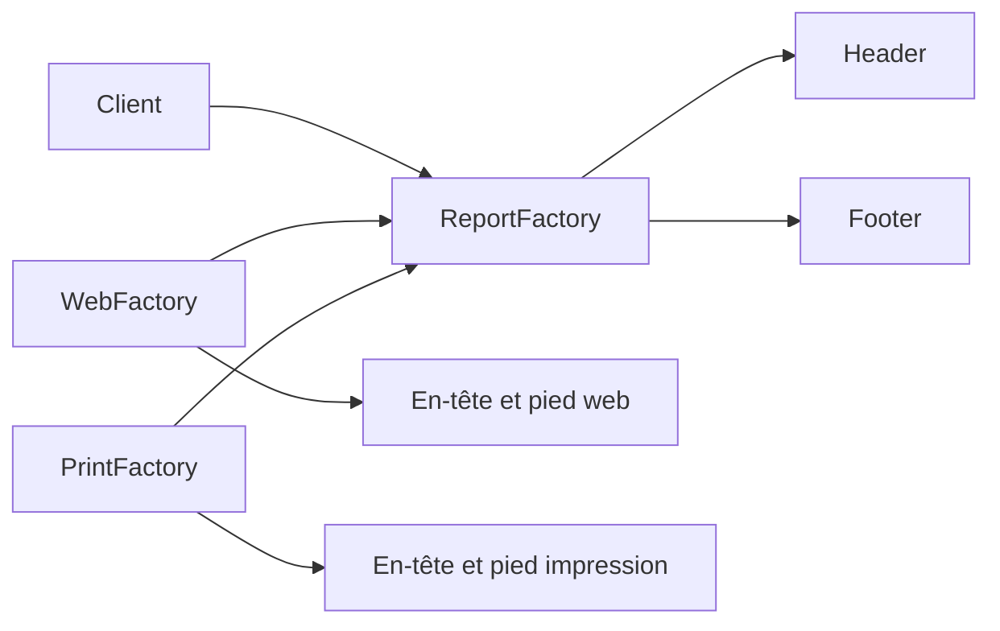

# Abstract Factory — fabriquer une famille compatible

## Intention et problème

Un service produit des rapports pour deux canaux, web et impression. Chaque canal exige à la fois un en-tête et un pied de page adaptés : du HTML pour le web, du texte paginé pour l'impression. Si le service choisit séparément chaque composant avec des conditions dispersées, une nouvelle variante risque de mélanger un en-tête web avec un pied de page imprimé. **Abstract Factory** regroupe les créations liées derrière une interface : le client choisit une famille une fois, puis ne connaît plus les classes concrètes. C'est un choix de cohérence, pas seulement une façon de remplacer `new`.

## Acteurs et mécanisme

La *fabrique abstraite* expose une opération par type de produit ; chaque *fabrique concrète* fournit les variantes d'une même famille. Les produits partagent une interface minimale et le client consomme ces interfaces. La garantie de compatibilité vient de la sélection d'une seule fabrique pour tout le rendu ; le système de types, à lui seul, n'empêche pas de mélanger des objets issus de deux fabriques si le client les crée séparément.



```typescript
interface Header { render(): string }
interface Footer { render(): string }
interface ReportFactory {
  header(): Header;
  footer(): Footer;
}
class WebFactory implements ReportFactory {
  header(): Header { return { render: () => "<h1>Rapport</h1>" }; }
  footer(): Footer { return { render: () => "<footer>Fin</footer>" }; }
}
class PrintFactory implements ReportFactory {
  header(): Header { return { render: () => "RAPPORT\n" }; }
  footer(): Footer { return { render: () => "\n--- FIN ---" }; }
}
function produce(factory: ReportFactory, body: string): string {
  return factory.header().render() + body + factory.footer().render();
}
console.log(produce(new PrintFactory(), "Bilan"));
```

## Déroulement et arbitrages

Au démarrage, la configuration choisit `PrintFactory`. `produce` demande l'en-tête et le pied à cette même instance, puis assemble le contenu sans tester le canal. Pour ajouter une famille « mobile », on ajoute une fabrique et les deux produits correspondants ; le client reste stable. En revanche, ajouter un *nouveau type de produit* (par exemple une table des matières) modifie l'interface et toutes les fabriques : c'est l'axe d'extension coûteux. La délégation ajoute quelques interfaces et classes, avec un coût d'exécution négligeable devant le rendu, mais une complexité de maintenance réelle.

**Ne pas l'utiliser** pour un unique produit ou deux variantes indépendantes : une fonction de création ou une injection directe suffit. À la différence de [[Pattern - Factory Method]], qui laisse une sous-classe choisir *un produit* via une méthode redéfinie, Abstract Factory fournit plusieurs produits coordonnés par une fabrique interchangeable. Les fabriques peuvent elles-mêmes utiliser des factory methods, mais les intentions restent distinctes.

## Questions de révision

1. Pourquoi passer une seule fabrique au client protège-t-il mieux la cohérence que deux paramètres `Header` et `Footer` ?
2. Quel changement est plus coûteux ici : ajouter une famille ou ajouter un nouveau type de produit ? Pourquoi ?

**Source de catalogage :** Gamma, Helm, Johnson et Vlissides, *Design Patterns: Elements of Reusable Object-Oriented Software*, [fiche éditeur Pearson](https://www.pearson.com/en-us/subject-catalog/p/design-patterns-elements-of-reusable-object-oriented-software/P200000009480). Exemple et explications originaux.
