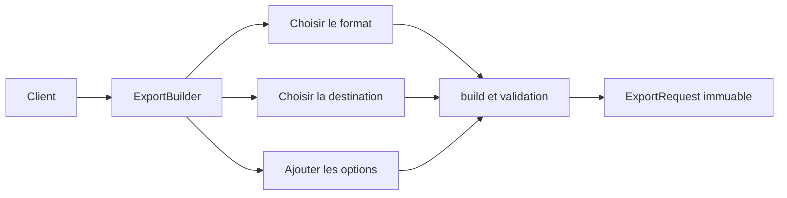

# Builder — construire un objet par étapes

## Intention et problème

Une application prépare des requêtes d'export de données. Certaines options sont facultatives (filtre, limite), d'autres obligatoires (format, destination). Un constructeur positionnel comme `new ExportRequest("csv", "/out", undefined, 500)` devient difficile à lire ; multiplier les surcharges ne clarifie pas les combinaisons valides. **Builder** sépare la collecte progressive des paramètres de la création finale. Il permet de nommer les choix et de valider l'ensemble avant de livrer un objet utilisable.

## Acteurs et mécanisme

Le *produit* est la requête finale. Le *builder* conserve un état provisoire, expose des méthodes de configuration et une méthode `build`. Le client orchestre les étapes ; un *director* est facultatif et n'est utile que si plusieurs recettes de construction doivent être réutilisées. Ici, la requête est figée à la construction : on ne transmet pas l'état mutable du builder au produit.



```typescript
type ExportRequest = Readonly<{
  format: "csv" | "json"; target: string;
  filter?: string; limit?: number;
}>;
class ExportBuilder {
  private format?: ExportRequest["format"];
  private target?: string;
  private filter?: string;
  private limit?: number;
  as(format: ExportRequest["format"]): this { this.format = format; return this; }
  to(target: string): this { this.target = target; return this; }
  where(filter: string): this { this.filter = filter; return this; }
  max(limit: number): this { this.limit = limit; return this; }
  build(): ExportRequest {
    if (!this.format || !this.target?.trim()) throw new Error("format/destination requis");
    if (this.limit !== undefined && this.limit <= 0) throw new Error("limite invalide");
    return Object.freeze({ format: this.format, target: this.target,
      filter: this.filter, limit: this.limit });
  }
}
const request = new ExportBuilder().as("csv").to("archive.csv").max(500).build();
```

## Déroulement et arbitrages

Le client nomme d'abord le format et la destination, ajoute éventuellement une limite, puis appelle `build`. C'est à ce dernier moment que les invariants sont contrôlés. Appeler `build` trop tôt échoue ; réutiliser le builder après `build` est techniquement possible ici, mais ses changements ultérieurs n'affectent pas la requête déjà produite. `Readonly` agit à la compilation TypeScript, `Object.freeze` protège au runtime les propriétés de premier niveau seulement : pour des options imbriquées, il faudrait copier puis figer plus profondément.

Le prix est un objet intermédiaire, des méthodes supplémentaires et un état transitoire à raisonner ; la construction reste linéaire dans le nombre de champs. **Ne pas l'utiliser** pour deux paramètres obligatoires simples ou quand un objet littéral typé avec validation dédiée est plus clair. Contrairement à un constructeur, le builder répartit la saisie sur plusieurs appels et centralise la validation finale ; contrairement à [[Pattern - Abstract Factory]], il construit *un objet complexe* plutôt qu'une famille de produits compatibles.

## Questions de révision

1. Pourquoi placer la validation transversale dans `build` plutôt que dans chaque setter ?
2. Quelles garanties `Readonly` et `Object.freeze` apportent-ils, et où s'arrêtent-elles ?

**Source de catalogage :** Gamma, Helm, Johnson et Vlissides, *Design Patterns: Elements of Reusable Object-Oriented Software*, [fiche éditeur Pearson](https://www.pearson.com/en-us/subject-catalog/p/design-patterns-elements-of-reusable-object-oriented-software/P200000009480). Exemple et explications originaux.
