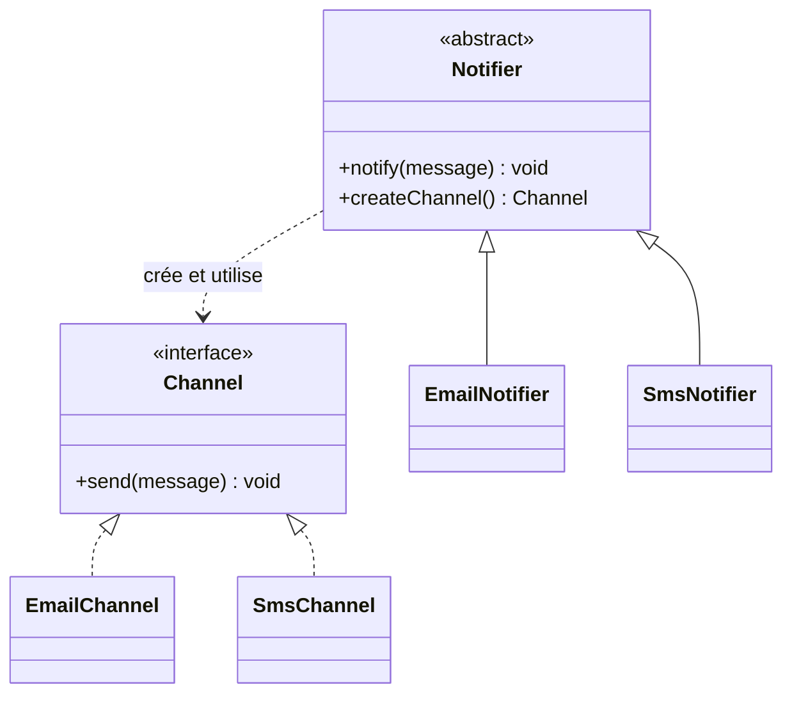

# Factory Method — déléguer le choix d'un produit

## Intention et problème

Un service de notification doit enregistrer une tentative, appliquer une politique commune d'envoi, puis utiliser un canal concret : courriel ou SMS. Dupliquer tout le déroulement pour chaque canal dériverait rapidement ; mettre un `switch` sur le canal dans la logique commune la ferait dépendre des classes concrètes. **Factory Method** conserve le déroulement dans une classe créatrice et laisse ses sous-classes décider quel objet de notification instancier.

## Acteurs et mécanisme

Le *produit* définit l'opération commune (`send`). Le *créateur* contient la logique métier stable (`notify`) et déclare une méthode de fabrication abstraite. Chaque *créateur concret* redéfinit cette méthode et retourne un produit conforme au contrat. Le point de variation est protégé par le polymorphisme : le client choisit un créateur, pas une branche conditionnelle dans l'algorithme.



```typescript
interface Channel { send(message: string): void }
class EmailChannel implements Channel {
  send(message: string): void { console.log(`email: ${message}`); }
}
class SmsChannel implements Channel {
  send(message: string): void { console.log(`sms: ${message}`); }
}
abstract class Notifier {
  notify(message: string): void {
    console.log("tentative enregistrée");
    this.createChannel().send(message);
  }
  protected abstract createChannel(): Channel;
}
class EmailNotifier extends Notifier {
  protected createChannel(): Channel { return new EmailChannel(); }
}
class SmsNotifier extends Notifier {
  protected createChannel(): Channel { return new SmsChannel(); }
}
const notifier: Notifier = new EmailNotifier();
notifier.notify("Rapport disponible");
```

## Déroulement et arbitrages

`notify` enregistre la tentative, appelle `createChannel`, puis envoie via l'interface. Pour un nouveau canal, une nouvelle sous-classe peut fournir son produit sans modifier cette séquence. L'exemple ne promet ni livraison réelle ni journal persistant : `console.log` représente seulement les opérations. En production, la gestion des erreurs et la politique de reprise doivent aussi faire partie du contrat du service.

Le coût est au moins une sous-classe par variante et un couplage à l'héritage ; la création d'un objet est généralement de coût constant, mais la hiérarchie devient lourde si les variantes sont nombreuses et indépendantes. **Ne pas l'utiliser** lorsque le seul besoin est de choisir une classe selon une valeur : une fonction `makeChannel(kind)` qui fait un `switch` est une *simple factory*, pas le Factory Method GoF. Elle centralise la création, mais aucun créateur n'y délègue le choix par redéfinition. Si le comportement commun n'a pas vocation à être hérité, injecter directement `Channel` peut être plus simple. Contrairement à [[Pattern - Abstract Factory]], on varie ici un produit au sein d'un algorithme, et non une famille coordonnée de produits.

## Questions de révision

1. Quelle opération reste inchangée quand on ajoute `SmsNotifier` ?
2. Pourquoi une fonction `makeChannel(kind)` n'est-elle pas, à elle seule, un Factory Method ?

**Source de catalogage :** Gamma, Helm, Johnson et Vlissides, *Design Patterns: Elements of Reusable Object-Oriented Software*, [fiche éditeur Pearson](https://www.pearson.com/en-us/subject-catalog/p/design-patterns-elements-of-reusable-object-oriented-software/P200000009480). Exemple et explications originaux.
