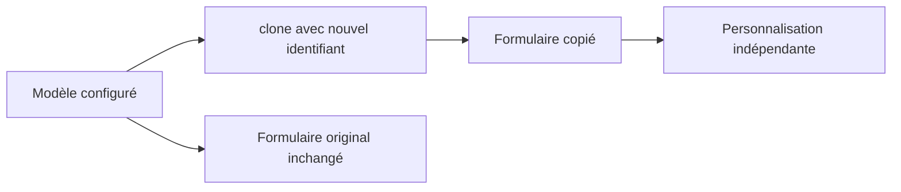

# Prototype — créer à partir d'un exemplaire

## Intention et problème

Un éditeur de formulaires offre des modèles déjà configurés : champs, règles de validation et textes d'aide. Recréer chaque formulaire à partir de dizaines de paramètres oblige le client à connaître sa configuration interne. **Prototype** part d'un exemplaire configuré et en produit une copie que le client personnalise. C'est utile lorsque la configuration de départ varie à l'exécution ou coûte à reconstituer ; cela n'implique pas que copier soit toujours moins coûteux que construire.

## Acteurs et mécanisme

Le *prototype* expose une opération de clonage, les *prototypes concrets* savent copier leur état, et le client demande une copie avant de la modifier. Deux propriétés méritent d'être séparées : l'**identité** du clone doit être nouvelle, et son état mutable imbriqué ne doit pas être partagé par accident. Une copie superficielle (`{ ...objet }`) duplique l'enveloppe, pas les tableaux ni leurs éléments. Le contrat doit annoncer ce qui reste partagé, notamment d'éventuelles ressources externes.



```typescript
type Field = { label: string; rules: string[] };
interface Prototype<T> { clone(newId: string): T }
class FormTemplate implements Prototype<FormTemplate> {
  constructor(public readonly id: string, public fields: Field[]) {}
  clone(newId: string): FormTemplate {
    if (newId === this.id) throw new Error("identifiant non renouvelé");
    return new FormTemplate(newId, this.fields.map(field => ({
      label: field.label, rules: [...field.rules]
    })));
  }
}
const original = new FormTemplate("modele", [
  { label: "Courriel", rules: ["required", "email"] }
]);
const copie = original.clone("formulaire-42");
copie.fields[0].rules.push("unique");
console.log(original.fields[0].rules); // ["required", "email"]
```

## Déroulement et arbitrages

Le modèle est configuré une fois. Le client lui fournit un nouvel identifiant, obtient une instance distincte, puis ajoute une règle. Le tableau des champs et les tableaux de règles sont recopiés : l'ajout ne modifie donc pas le modèle. Ici, les valeurs imbriquées sont des chaînes ; si un champ contenait un objet mutable, une référence circulaire, un fichier ouvert ou un service, il faudrait définir explicitement sa stratégie de copie plutôt que supposer qu'un `map` suffit. L'exemple exige seulement un identifiant différent de celui du modèle ; l'unicité dans un stockage global reste la responsabilité du client.

Le clonage parcourt tous les champs et règles : temps et mémoire croissent avec la taille de l'état copié. Une copie profonde peut être coûteuse et doit traiter les objets spéciaux avec soin. **Ne pas l'utiliser** pour de petits objets faciles à construire, ou lorsque l'identité et les ressources partagées ne peuvent être clonées sans ambiguïté. À la différence de [[Pattern - Builder]], qui collecte progressivement des paramètres puis valide un nouvel objet, Prototype duplique un état préconfiguré ; les deux peuvent se compléter si un builder prépare le modèle initial.

## Questions de révision

1. Que se passerait-il si `clone` retournait `this.fields` sans recopier ses éléments ?
2. Pourquoi faut-il distinguer nouvelle identité et copie profonde de l'état ?

**Source de catalogage :** Gamma, Helm, Johnson et Vlissides, *Design Patterns: Elements of Reusable Object-Oriented Software*, [fiche éditeur Pearson](https://www.pearson.com/en-us/subject-catalog/p/design-patterns-elements-of-reusable-object-oriented-software/P200000009480). Exemple et explications originaux.
