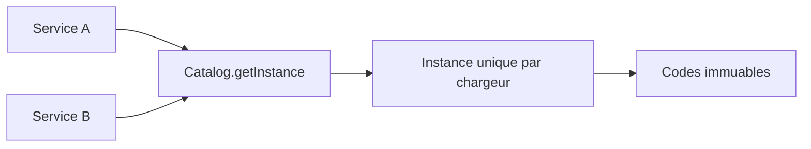

# Singleton — limiter une classe à une instance

## Intention et problème

Un processus charge un catalogue de codes statiques, commun à toutes ses opérations. Reconstruire le catalogue à chaque appel serait superflu ; il peut être tentant d'exposer un seul objet partagé. **Singleton** combine une instance unique dans un périmètre donné et un point d'accès à cette instance. Ce périmètre doit être explicite : une instance par processus ou par chargeur de classes n'est pas une instance unique dans tout un système distribué.

## Acteurs et mécanisme

La classe interdit sa construction ordinaire depuis le client, conserve l'instance et expose une opération d'accès. Dans cet exemple Java, l'initialisation statique de la JVM publie l'instance lors du chargement de la classe ; le contenu est immuable pour éviter les courses sur un état modifiable. Le code illustre l'unicité dans le chargeur de classes ordinaire, pas un verrou distribué ni une garantie absolue face à toute technique de réflexion ou de sérialisation.



```java
import java.util.Map;

final class Catalog {
    private static final Catalog INSTANCE = new Catalog();
    private final Map<String, String> labels =
        Map.of("OK", "Terminé", "KO", "Échec");

    private Catalog() {}

    static Catalog getInstance() { return INSTANCE; }

    String label(String code) {
        return labels.getOrDefault(code, "Inconnu");
    }
}

class Demo {
    public static void main(String[] args) {
        System.out.println(Catalog.getInstance().label("OK"));
    }
}
```

## Déroulement et arbitrages

Au premier accès à `Catalog`, la JVM initialise `INSTANCE`. Les clients récupèrent ensuite la même référence dans ce chargeur et consultent la table. L'initialisation statique évite ici un double calcul concurrent de l'instance ; elle ne rendrait **pas** automatiquement sûres des mutations ultérieures d'un compteur ou d'un cache. Avec un Singleton paresseux écrit à la main, la publication et la synchronisation devraient être traitées explicitement. Dans plusieurs processus, chaque processus aurait son instance : pour coordonner un état réellement global, il faut un service ou stockage partagé.

Le risque principal n'est pas le coût d'un appel, proche d'un accès statique, mais la dépendance cachée. Un état global mutable rend l'ordre des tests significatif, complique leur isolation et peut provoquer des races sous concurrence. Même un objet immuable complique le remplacement par un double de test. **Ne pas l'utiliser** pour une dépendance métier, une configuration variable selon le locataire, ou un état à réinitialiser entre tests. Préférer souvent l'**injection de dépendances** : fournir une instance depuis le point de composition, avec une durée de vie contrôlée par le conteneur ou l'application, et passer une interface aux consommateurs. Cette solution permet aussi un partage unique sans accès global imposé.

Contrairement à [[Pattern - Prototype]], qui crée volontairement de nouvelles copies, Singleton restreint leur création ; contrairement à une simple classe statique, il expose un objet pouvant implémenter une interface, mais cela ne justifie pas à soi seul son emploi.

## Questions de révision

1. Pourquoi une initialisation d'instance sûre sous concurrence ne suffit-elle pas à sécuriser un état mutable ?
2. Comment une instance injectée avec une durée de vie applicative préserve-t-elle le partage sans point d'accès global ?

**Source de catalogage :** Gamma, Helm, Johnson et Vlissides, *Design Patterns: Elements of Reusable Object-Oriented Software*, [fiche éditeur Pearson](https://www.pearson.com/en-us/subject-catalog/p/design-patterns-elements-of-reusable-object-oriented-software/P200000009480). Exemple et explications originaux.
