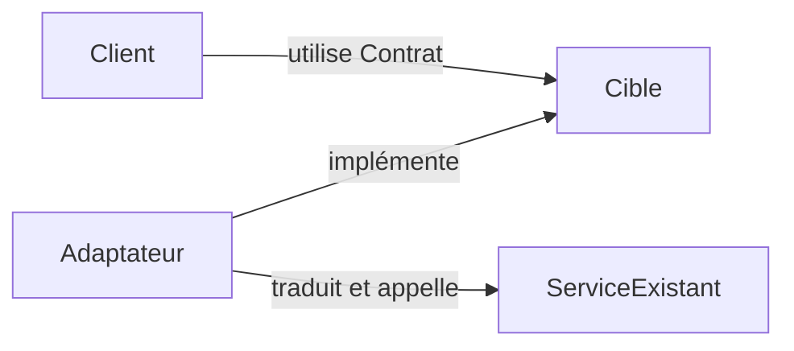

# Adapter — faire dialoguer deux contrats incompatibles

## Problème et intention

Un client dépend d'un contrat stable, mais un service utile expose une autre interface : noms de méthodes, paramètres, unités ou représentation des résultats ne coïncident pas. Modifier tous les clients étendrait la migration à des endroits sans rapport avec la capacité recherchée ; modifier la bibliothèque tierce est parfois impossible. **Adapter** interpose une traduction locale : le client voit toujours son interface cible, tandis que l'adaptateur appelle l'objet existant, dit *adapté*. Le problème est celui de la compatibilité des contrats, non celui de la création d'un nouvel algorithme.

Les acteurs sont le **client**, la **cible** attendue, l'**adapté** dont l'API diffère, et l'**adaptateur** qui implémente la cible. L'adaptateur peut convertir des arguments et des réponses, mais doit aussi expliciter les différences sémantiques : transformer des centimes en euros est simple ; prétendre qu'un résultat asynchrone est immédiatement disponible ne l'est pas. La composition, plutôt que l'héritage, permet d'emballer un service externe sans dépendre de sa hiérarchie de classes.



## Exemple TypeScript

Une application facture en centimes entiers ; une API historique attend des euros décimaux. Ici, la conversion reste à la frontière et l'arrondi est explicite au retour.

```typescript
interface Tarification {
  prixCentimes(reference: string): Promise<number>;
}
class ServiceHistorique {
  async prixEuros(code: string): Promise<number> {
    return code === "A" ? 12.50 : 0;
  }
}
class AdaptateurTarification implements Tarification {
  constructor(private readonly ancien: ServiceHistorique) {}
  async prixCentimes(reference: string): Promise<number> {
    const euros = await this.ancien.prixEuros(reference);
    return Math.round(euros * 100);
  }
}
const tarif: Tarification = new AdaptateurTarification(new ServiceHistorique());
tarif.prixCentimes("A").then(console.log); // 1250
```

Le client appelle `prixCentimes` sans connaître `prixEuros`. L'adaptateur attend la réponse, convertit l'unité, puis rend une promesse conforme à la cible. En production, vérifier aussi les montants négatifs, devises, dépassements et règles d'arrondi ; des nombres flottants ne constituent pas, à eux seuls, une politique monétaire fiable. Un test de contrat devrait comparer quelques cas limites et le comportement en cas d'erreur du service historique.

## Décision et voisinage

L'adaptateur ajoute une indirection et peut masquer une incompatibilité de sens si l'on ne documente que les signatures. **Ne pas l'utiliser** lorsque les deux interfaces sont déjà compatibles ou lorsque la migration doit au contraire supprimer l'ancien contrat partout : une traduction permanente entretient alors une dette inutile. Ne confondez pas Adapter avec [[Pattern - Facade|Facade]] : la façade simplifie l'usage d'un sous-système, l'adaptateur rend compatible un contrat attendu avec un contrat existant. Une façade peut exposer une API nouvelle sans implémenter l'interface du client.

## Questions

1. Pourquoi une conversion de signature ne suffit-elle pas si les erreurs ou l'asynchronisme des deux services diffèrent ?
2. Où placer les tests de contrat lors du remplacement progressif d'une bibliothèque externe ?

**Repère bibliographique :** Gamma, Helm, Johnson et Vlissides, *Design Patterns: Elements of Reusable Object-Oriented Software*, Addison-Wesley, catalogue des patterns structurels ([fiche éditeur Pearson](https://www.pearson.com/en-us/subject-catalog/p/design-patterns-elements-of-reusable-object-oriented-software/P200000009480)). Ce texte et son exemple sont originaux.
