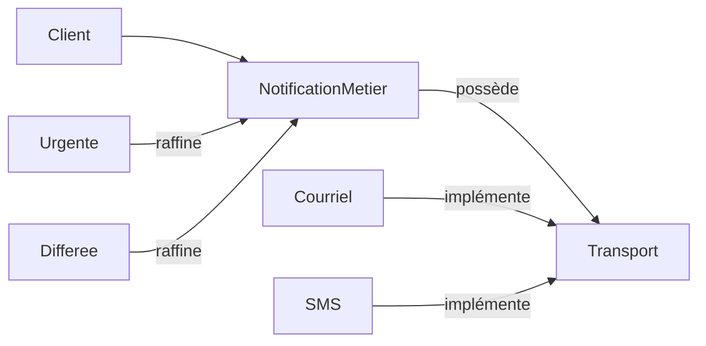

# Bridge — séparer deux axes de variation

## Problème et intention

Une abstraction varie selon deux dimensions indépendantes : par exemple, une notification peut être urgente ou différée, et transiter par courriel ou par SMS. Si chaque combinaison devient une sous-classe, leur nombre croît comme le produit des possibilités ; une évolution du transport oblige à retoucher la hiérarchie métier. **Bridge** sépare l'abstraction visible du client et l'implémentation interchangeable derrière elle. L'abstraction possède une référence vers une interface d'implémentation et lui délègue la partie technique. Chaque dimension peut ainsi évoluer avec ses propres variantes.

Ce découpage ne signifie pas que tout est substituable sans conditions : une implémentation peut ne pas supporter un canal ou une garantie de livraison. Le contrat et les capacités doivent être décrits explicitement. Le **client** choisit une abstraction raffinée et une implémentation concrète ; la première porte la politique métier, la seconde exécute une opération élémentaire. Leur assemblage se fait à la construction ou via une configuration contrôlée.



## Exemple TypeScript

L'urgence règle la forme du message ; le transport règle le canal. Ajouter un transport ne nécessite pas une nouvelle classe de notification urgente.

```typescript
interface Transport {
  envoyer(destinataire: string, message: string): void;
}
class Courriel implements Transport {
  envoyer(d: string, m: string): void { console.log(`Mail ${d}: ${m}`); }
}
class SMS implements Transport {
  envoyer(d: string, m: string): void { console.log(`SMS ${d}: ${m}`); }
}
class NotificationMetier {
  constructor(protected readonly transport: Transport) {}
  envoyer(d: string, m: string): void { this.transport.envoyer(d, m); }
}
class Urgente extends NotificationMetier {
  envoyer(d: string, m: string): void {
    this.transport.envoyer(d, `[URGENT] ${m}`);
  }
}
new Urgente(new SMS()).envoyer("0612345678", "Incident détecté");
```

Le client compose `Urgente` avec `SMS`, puis appelle `envoyer`. La classe métier applique sa règle avant de déléguer au canal choisi. Le code illustre la séparation des responsabilités, pas la fiabilité d'un vrai service SMS : gestion d'échec, délais, conformité et accusés de réception demanderaient un contrat plus riche. Tester séparément la mise en forme et chaque transport réduit le besoin de tester toutes les combinaisons, sans dispenser d'un test d'intégration représentatif.

## Décision et voisinage

Le coût est une interface et une composition supplémentaires ; **ne pas utiliser** Bridge pour un seul axe de changement ou quand toutes les variantes doivent évoluer ensemble. Si la matrice est petite et figée, deux classes simples peuvent suffire. Par rapport à [[Pattern - Adapter|Adapter]], Bridge est généralement conçu dès le départ pour faire évoluer deux dimensions : Adapter traduit après coup des interfaces incompatibles. Par rapport à [[Pattern - Decorator|Decorator]], Bridge sélectionne une implémentation d'une dimension ; il n'empile pas des responsabilités additionnelles autour d'un même composant.

## Questions

1. Quelles modifications seraient nécessaires pour ajouter un transport push dans ce modèle ?
2. Quand la politique d'urgence et le canal cesseraient-ils d'être réellement indépendants ?

**Repère bibliographique :** Gamma, Helm, Johnson et Vlissides, *Design Patterns: Elements of Reusable Object-Oriented Software*, Addison-Wesley, catalogue des patterns structurels ([fiche éditeur Pearson](https://www.pearson.com/en-us/subject-catalog/p/design-patterns-elements-of-reusable-object-oriented-software/P200000009480)). Ce texte et son exemple sont originaux.
