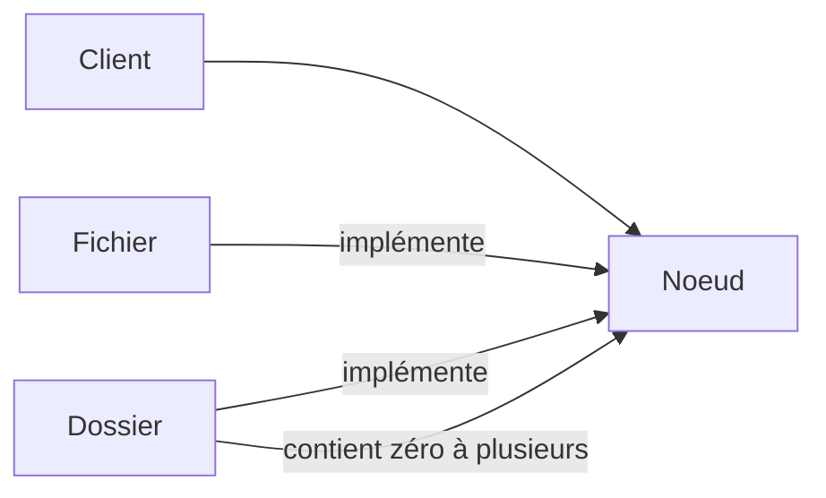

# Composite — traiter une feuille et un groupe par le même contrat

## Problème et intention

Un domaine forme naturellement un arbre : dossiers et fichiers, tâches élémentaires et lots, éléments graphiques et groupes. Le client souhaite effectuer une opération sur un nœud sans multiplier les embranchements selon qu'il s'agit d'un objet isolé ou d'un ensemble. **Composite** définit une interface commune, puis distingue les **feuilles**, qui réalisent directement l'opération, des **composites**, qui contiennent des enfants et propagent l'opération dans l'arbre. Le même appel peut ainsi porter sur une feuille ou sur une sous-arborescence.

Il faut préciser la sémantique de l'agrégation : somme des tailles, maximum des durées ou simple parcours ne sont pas interchangeables. La relation parent-enfant doit aussi prévenir les cycles, sans quoi une récursion peut ne jamais terminer. Selon l'API, ajouter ou retirer un enfant peut appartenir seulement au composite, ce qui évite de promettre une opération absurde sur une feuille ; c'est le choix retenu ici.



## Exemple TypeScript

Une taille de dossier est la somme des tailles de ses descendants. Le code construit un arbre acyclique à la main ; une API de modification complète devrait empêcher l'insertion d'un ancêtre parmi ses descendants.

```typescript
interface Noeud {
  taille(): number;
}
class Fichier implements Noeud {
  constructor(private readonly octets: number) {}
  taille(): number { return this.octets; }
}
class Dossier implements Noeud {
  private readonly enfants: Noeud[] = [];
  ajouter(enfant: Noeud): void { this.enfants.push(enfant); }
  taille(): number {
    return this.enfants.reduce((total, n) => total + n.taille(), 0);
  }
}
const dossier = new Dossier();
dossier.ajouter(new Fichier(120));
dossier.ajouter(new Fichier(80));
console.log(dossier.taille()); // 200
```

Le client interroge `taille()` sur le dossier comme sur un fichier. Le dossier parcourt ses enfants, demande leur taille et additionne les résultats ; si l'un des enfants est lui-même un dossier, l'appel se poursuit récursivement. Ce parcours est proportionnel au nombre de nœuds visités, sauf si une stratégie de cache est ajoutée. Un cache rend les lectures plus rapides mais impose d'invalider les tailles de tous les ancêtres après chaque modification.

## Décision et voisinage

Le contrat commun peut être trop pauvre pour les besoins propres à chaque type ; l'arbre mutable introduit aussi des questions d'identité, de propriété et de cycles. **Ne pas utiliser** Composite pour une liste plate dont les éléments ne peuvent jamais contenir d'autres éléments, ni pour cacher des règles d'agrégation différentes sous une fausse uniformité. À la différence de [[Pattern - Decorator|Decorator]], qui enveloppe généralement un seul composant pour enrichir son comportement, Composite possède plusieurs enfants et représente une structure partie-tout. Les deux peuvent néanmoins partager une interface.

## Questions

1. Comment empêcher qu'un dossier soit ajouté à lui-même, directement ou indirectement ?
2. Quelle invalidation prévoir si la taille d'un fichier change et que les totaux sont mis en cache ?

**Repère bibliographique :** Gamma, Helm, Johnson et Vlissides, *Design Patterns: Elements of Reusable Object-Oriented Software*, Addison-Wesley, catalogue des patterns structurels ([fiche éditeur Pearson](https://www.pearson.com/en-us/subject-catalog/p/design-patterns-elements-of-reusable-object-oriented-software/P200000009480)). Ce texte et son exemple sont originaux.
