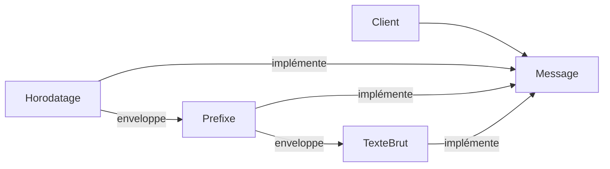

# Decorator — enrichir un objet sans changer son interface

## Problème et intention

Une capacité possède un contrat stable, mais certaines instances doivent recevoir des responsabilités supplémentaires : traçage, compression, contrôle ou mise en forme. Créer une sous-classe pour chaque combinaison entraîne une explosion de variantes, tandis qu'ajouter toutes les options à la classe de base la surcharge. **Decorator** enveloppe un composant dans un autre objet qui respecte la même interface. Plusieurs décorateurs peuvent être composés à l'exécution ; chacun décide ce qu'il fait avant ou après la délégation.

Les acteurs sont le **composant** commun, une **implémentation concrète**, et un ou plusieurs **décorateurs** qui conservent une référence vers un composant. Le client manipule l'interface commune. L'ordre des enveloppes est observable : chiffrer puis compresser ne produit pas la même chose que compresser puis chiffrer. Cette souplesse exige de documenter l'ordre autorisé et l'effet des erreurs ; « même interface » ne veut pas dire « comportement identique ».



## Exemple TypeScript

Chaque couche retourne une chaîne et peut s'appliquer à une autre couche sans modifier le composant initial.

```typescript
interface Message {
  rendre(): string;
}
class TexteBrut implements Message {
  constructor(private readonly texte: string) {}
  rendre(): string { return this.texte; }
}
class Prefixe implements Message {
  constructor(private readonly source: Message, private readonly label: string) {}
  rendre(): string { return `${this.label}: ${this.source.rendre()}`; }
}
class Horodatage implements Message {
  constructor(private readonly source: Message, private readonly date: string) {}
  rendre(): string { return `[${this.date}] ${this.source.rendre()}`; }
}
const message: Message = new Horodatage(
  new Prefixe(new TexteBrut("Prêt"), "État"), "2026-01-01"
);
console.log(message.rendre()); // [2026-01-01] État: Prêt
```

Le client interroge l'objet extérieur. `Horodatage` appelle `Prefixe`, qui appelle `TexteBrut` ; les résultats reviennent en ordre inverse, puis chaque couche ajoute sa contribution. La date est passée explicitement pour garder l'exemple déterministe. Dans un service réel, si l'horodatage doit représenter l'instant de lecture plutôt que celui de construction, il faudrait injecter une horloge et clarifier ce contrat.

## Décision et voisinage

L'empilement rend la chaîne plus difficile à inspecter et peut dupliquer des effets : deux horodatages, deux logs ou un cache placé au mauvais niveau. **Ne pas utiliser** Decorator si une seule variante fixe suffit ou si l'enveloppe modifie radicalement les obligations du contrat au point de ne plus être substituable. Par rapport à [[Pattern - Proxy|Proxy]], le décorateur ajoute une responsabilité fonctionnelle, alors que le proxy régule principalement l'accès à un sujet ; leur forme de composition peut se ressembler, mais l'intention et les garanties diffèrent.

## Questions

1. Quel résultat obtiendrait-on en inversant `Horodatage` et `Prefixe` ?
2. Pourquoi un décorateur de cache doit-il expliciter les règles d'invalidation ?

**Repère bibliographique :** Gamma, Helm, Johnson et Vlissides, *Design Patterns: Elements of Reusable Object-Oriented Software*, Addison-Wesley, catalogue des patterns structurels ([fiche éditeur Pearson](https://www.pearson.com/en-us/subject-catalog/p/design-patterns-elements-of-reusable-object-oriented-software/P200000009480)). Ce texte et son exemple sont originaux.
