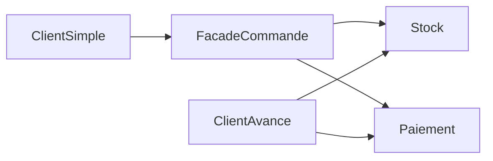

# Facade — offrir une entrée simple à un sous-système

## Problème et intention

Une opération courante traverse plusieurs composants : valider une requête, réserver une ressource, enregistrer un paiement puis notifier un client. Obliger chaque appelant à connaître l'ordre des appels et les dépendances du sous-système duplique l'orchestration et multiplie les erreurs. **Facade** propose un point d'entrée de plus haut niveau pour un scénario fréquent. Elle coordonne les objets existants sans nécessairement remplacer leurs interfaces détaillées : un client avancé peut encore accéder directement aux composants lorsque c'est approprié.

Les acteurs sont le **client**, la **façade** et les **services du sous-système**. La façade ne doit pas absorber toute la logique métier par commodité : si elle devient le seul endroit où vivent règles, état et gestion de toutes les erreurs, elle peut se transformer en objet central difficile à faire évoluer. Une bonne façade réduit le couplage de ses clients tout en gardant explicites les garanties transactionnelles et les cas d'échec.



## Exemple TypeScript

L'exemple orchestre un scénario synchrone minimal. L'ordre réserve puis paie ; si le paiement échoue, la compensation est visible au lieu de laisser une réservation orpheline.

```typescript
class Stock {
  reserver(article: string): void { console.log(`Réservé ${article}`); }
  liberer(article: string): void { console.log(`Libéré ${article}`); }
}
class Paiement {
  debiter(montant: number): void {
    if (montant <= 0) throw new Error("Montant invalide");
    console.log(`Débité ${montant}`);
  }
}
class FacadeCommande {
  constructor(private readonly stock: Stock, private readonly paiement: Paiement) {}
  passer(article: string, montant: number): void {
    this.stock.reserver(article);
    try { this.paiement.debiter(montant); }
    catch (erreur) { this.stock.liberer(article); throw erreur; }
  }
}
new FacadeCommande(new Stock(), new Paiement()).passer("livre", 20);
```

Le client appelle une seule méthode. La façade réserve, tente le débit et libère l'article en cas d'échec ; elle propage ensuite l'erreur. Ce flux rend le scénario lisible, mais n'assure aucune atomicité réelle : si la libération échoue ou si un processus s'interrompt, une stratégie de reprise et des opérations idempotentes sont nécessaires. La façade ne remplace donc ni transaction distribuée ni conception des invariants métier.

## Décision et voisinage

Une façade peut cacher des options utiles si elle devient le seul accès autorisé ; **ne pas l'utiliser** pour encapsuler une unique méthode triviale ou imposer une simplification qui interdit les opérations avancées indispensables. [[Pattern - Adapter|Adapter]] convertit un contrat attendu vers une interface incompatible ; Facade conçoit plutôt une API commode autour de plusieurs opérations existantes, sans devoir implémenter un contrat imposé. [[Pattern - Proxy|Proxy]] garde, lui, en principe l'interface du sujet afin de contrôler son accès.

## Questions

1. Quelle garantie supplémentaire faudrait-il pour gérer une panne entre réservation et paiement ?
2. Pourquoi garder un accès direct aux composants pour certains clients, et avec quelles limites ?

**Repère bibliographique :** Gamma, Helm, Johnson et Vlissides, *Design Patterns: Elements of Reusable Object-Oriented Software*, Addison-Wesley, catalogue des patterns structurels ([fiche éditeur Pearson](https://www.pearson.com/en-us/subject-catalog/p/design-patterns-elements-of-reusable-object-oriented-software/P200000009480)). Ce texte et son exemple sont originaux.
