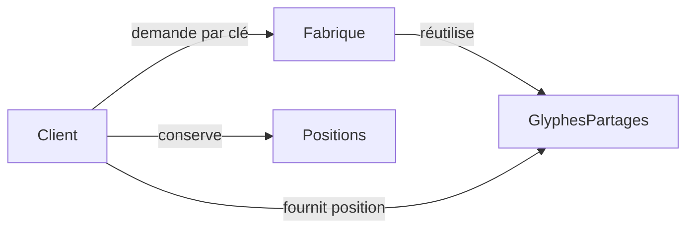

# Flyweight — partager l'état commun de nombreux objets

## Problème et intention

Un système manipule un très grand nombre d'éléments dont une partie de l'état se répète : caractères d'un document, particules d'une simulation, symboles d'une carte. Conserver pour chaque occurrence toutes les données identiques gaspille de la mémoire. **Flyweight** extrait l'état **intrinsèque**, stable et partageable, dans un objet commun ; l'état **extrinsèque**, propre à chaque occurrence, est fourni au moment de l'utilisation. Une fabrique réutilise une instance par clé intrinsèque.

Le client conserve les coordonnées ou le contexte de chaque occurrence ; le flyweight conserve uniquement ce qui peut être partagé. La frontière est déterminante : si l'objet partagé reçoit une position mutable, modifier un élément risque de déplacer toutes ses occurrences. L'immuabilité de l'état intrinsèque est donc une discipline centrale. Il faut aussi compter la mémoire des clés, de la fabrique et des états extrinsèques avant de supposer un gain.



## Exemple TypeScript

Chaque glyphe partagé porte un caractère ; chaque appel à `dessiner` reçoit la position de son occurrence. La `Map` conserve une seule instance par caractère demandé.

```typescript
class Glyphe {
  constructor(readonly caractere: string) { Object.freeze(this); }
  dessiner(x: number, y: number): string {
    return `${this.caractere}@${x},${y}`;
  }
}
class FabriqueGlyphes {
  private readonly cache = new Map<string, Glyphe>();
  obtenir(caractere: string): Glyphe {
    let glyphe = this.cache.get(caractere);
    if (!glyphe) {
      glyphe = new Glyphe(caractere);
      this.cache.set(caractere, glyphe);
    }
    return glyphe;
  }
}
const fabrique = new FabriqueGlyphes();
console.log(fabrique.obtenir("A").dessiner(1, 2)); // A@1,2
console.log(fabrique.obtenir("A") === fabrique.obtenir("A")); // true
```

Lors du premier `obtenir("A")`, la fabrique crée puis mémorise le glyphe ; les demandes suivantes reçoivent la même référence. `dessiner` utilise une position passée par le client, sans l'enregistrer dans le glyphe. Pour une application concurrente, l'accès au registre et l'initialisation devront être sûrs pour les accès simultanés ; une fabrique sans politique d'éviction peut aussi retenir indéfiniment des clés rares.

## Décision et voisinage

**Ne pas utiliser** Flyweight si peu d'objets sont créés, si presque tout leur état diffère, ou si le coût de recherche et de transport de l'état extrinsèque dépasse l'économie attendue. Mesurer mémoire et temps sur un volume représentatif. À la différence de [[Pattern - Composite|Composite]], Flyweight ne construit pas un arbre partie-tout ; il partage l'identité d'une représentation intrinsèque entre plusieurs occurrences. Il peut néanmoins être utilisé à l'intérieur des feuilles d'un arbre.

## Questions

1. Pourquoi stocker `x` et `y` dans `Glyphe` casserait-il le partage ?
2. Que doit-on mesurer pour décider si la fabrique est rentable ?

**Repère bibliographique :** Gamma, Helm, Johnson et Vlissides, *Design Patterns: Elements of Reusable Object-Oriented Software*, Addison-Wesley, catalogue des patterns structurels ([fiche éditeur Pearson](https://www.pearson.com/en-us/subject-catalog/p/design-patterns-elements-of-reusable-object-oriented-software/P200000009480)). Ce texte et son exemple sont originaux.
