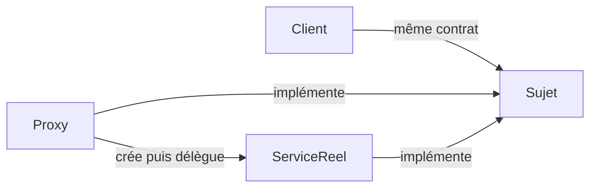

# Proxy — contrôler l'accès à un sujet

## Problème et intention

Un objet coûteux ou sensible ne devrait pas forcément être utilisé directement. Son initialisation peut être différée, son accès soumis à une permission, ses réponses mises en cache, ou ses appels acheminés vers un serveur distant. **Proxy** présente au client la **même interface** que le sujet réel, mais intercepte les appels pour décider quand et comment les lui transmettre. Le client dépend du contrat commun ; le proxy possède ou retrouve le sujet lorsque c'est nécessaire.

Les acteurs sont le **sujet**, le **sujet réel**, le **proxy** et le **client**. La similitude d'interface facilite la substitution syntaxique, mais ne garantit pas une transparence totale : le chargement différé ajoute une latence au premier appel ; un proxy distant introduit réseau, délais et erreurs partielles ; un cache peut rendre des données obsolètes. Le contrat doit annoncer ces effets plutôt que promettre que l'appel sera indiscernable d'un accès local.



## Exemple TypeScript

Le proxy ci-dessous construit le moteur uniquement à la première consultation. Pour voir le bénéfice, il faut imaginer une initialisation réelle coûteuse ; ici, les messages console rendent simplement le flux observable.

```typescript
interface Catalogue {
  titre(id: string): string;
}
class CatalogueReel implements Catalogue {
  constructor() { console.log("Catalogue chargé"); }
  titre(id: string): string { return id === "1" ? "Atlas" : "Inconnu"; }
}
class CatalogueDiffere implements Catalogue {
  private reel?: CatalogueReel;
  titre(id: string): string {
    if (!this.reel) this.reel = new CatalogueReel();
    return this.reel.titre(id);
  }
}
const catalogue: Catalogue = new CatalogueDiffere();
console.log(catalogue.titre("1"));
console.log(catalogue.titre("2")); // pas de second chargement
```

La création du proxy ne charge rien. Le premier appel crée `CatalogueReel`, puis délègue ; le second réutilise la même instance. Dans un service asynchrone, deux requêtes concurrentes pourraient déclencher deux chargements si l'on ne mémorise pas la promesse en cours. Un proxy de cache devrait définir expiration et invalidation ; un proxy distant, les délais, reprises et éventuelles répétitions d'effets.

## Décision et voisinage

Le proxy ajoute un niveau d'indirection et déplace des erreurs vers le moment de l'utilisation. **Ne pas l'utiliser** si la création du sujet est bon marché et systématiquement nécessaire, ou si l'interception cache des effets critiques que le contrat ne peut pas exprimer. Par rapport à [[Pattern - Decorator|Decorator]], qui ajoute une responsabilité au comportement d'un composant, Proxy gouverne surtout l'accès au même sujet ; les deux partagent souvent la même structure d'enveloppe. Contrairement à [[Pattern - Adapter|Adapter]], il n'a pas pour but de convertir une interface incompatible.

## Questions

1. Comment éviter deux initialisations lors de deux appels asynchrones simultanés ?
2. Quelles informations supplémentaires une interface devrait-elle exposer pour un proxy distant fiable ?

**Repère bibliographique :** Gamma, Helm, Johnson et Vlissides, *Design Patterns: Elements of Reusable Object-Oriented Software*, Addison-Wesley, catalogue des patterns structurels ([fiche éditeur Pearson](https://www.pearson.com/en-us/subject-catalog/p/design-patterns-elements-of-reusable-object-oriented-software/P200000009480)). Ce texte et son exemple sont originaux.
