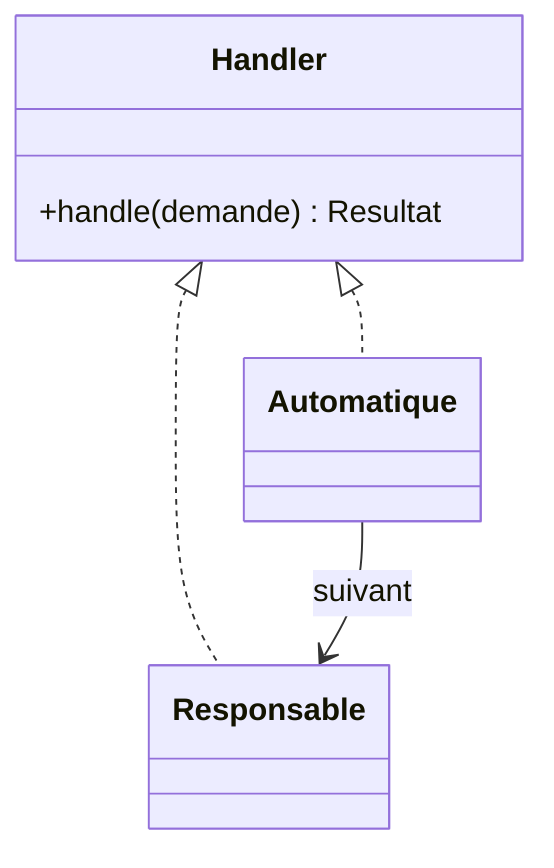

# Chain of Responsibility — chaîne de responsabilité

## Intention et problème

Découpler l’émetteur d’une requête de son destinataire en donnant à plusieurs objets la possibilité de la traiter successivement. Imaginons un service recevant des demandes de remboursement : certaines relèvent d’une validation automatique, d’autres d’un responsable, d’autres encore d’un contrôle de conformité. Si l’appelant choisit lui-même le bon interlocuteur, il connaît toutes les règles métier et doit changer à chaque nouvelle étape. Une chaîne permet de déplacer ce choix vers des maillons composables.

## Participants et mécanisme

Le **client** construit la chaîne et soumet une requête au premier **handler**. Chaque handler connaît éventuellement un **successeur** et décide explicitement de traiter la requête, de la transmettre, ou de la rejeter. Les handlers concrets portent chacun une politique ciblée. Le résultat doit distinguer une prise en charge effective d’une fin de chaîne sans réponse. La politique de **propagation** est essentielle : dans une chaîne « premier capable », le traitement s’arrête après succès ; dans un pipeline de journalisation ou de validation cumulative, un maillon peut agir **puis** transmettre. Ce sont deux contrats différents : les mélanger produit des doublons ou des validations sautées. Il faut aussi définir l’ordre, les erreurs et l’absence de destinataire, plutôt que de compter sur un comportement implicite.



Voici une variante TypeScript « premier capable » ; `null` signifie qu’aucun maillon n’a accepté. L’appelant reste libre de convertir cette absence en erreur métier.

```ts
interface Demande { montant: number; motif: string }
interface Handler { traiter(d: Demande): string | null }
class Automatique implements Handler {
  constructor(private suivant: Handler) {}
  traiter(d: Demande): string | null {
    if (d.montant <= 50 && d.motif === "retard") return "accord auto";
    return this.suivant.traiter(d);
  }
}
class Responsable implements Handler {
  traiter(d: Demande): string | null {
    return d.montant <= 500 ? "accord responsable" : null;
  }
}
const chaine: Handler = new Automatique(new Responsable());
const resultat = chaine.traiter({ montant: 120, motif: "retard" });
if (resultat === null) throw new Error("Demande non prise en charge");
```

## Compromis et voisinage

La chaîne facilite l’ajout et le réordonnancement de règles sans modifier l’émetteur, mais l’ordre devient une partie discrète du comportement ; un maillon trop permissif peut masquer les suivants. Une longue chaîne complique l’observabilité et ne garantit pas qu’une demande aboutisse. Éviter ce patron si une simple condition stable et locale suffit, ou si toutes les règles doivent nécessairement s’exécuter sans politique de court-circuit : un pipeline explicite est alors plus lisible. Contrairement à **Strategy**, qui choisit un algorithme déterminé avant l’appel, la chaîne délègue la décision de prise en charge pendant le parcours. Contrairement à **Decorator**, qui enveloppe un composant pour enrichir son comportement, chaque maillon peut refuser la demande et passer la main.

## Questions de révision

1. Que faut-il changer si deux contrôles doivent tous deux s’exécuter même lorsque le premier réussit ?
2. Comment rendre visibles une demande non traitée et le maillon qui l’a arrêtée ?

*Référence canonique : Gamma, Helm, Johnson et Vlissides, **Design Patterns: Elements of Reusable Object-Oriented Software**, Pearson, 1994, chapitre « Chain of Responsibility » ; explications et exemple reformulés.*
