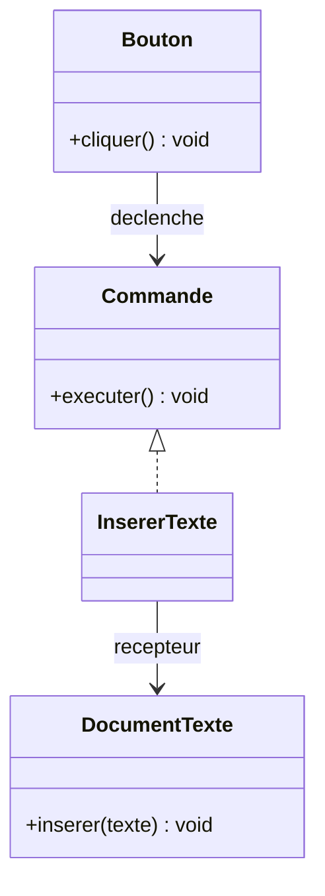

# Command — commande

## Intention et problème

Transformer une requête en objet afin de dissocier celui qui demande une action de celui qui sait l’exécuter. Un éditeur peut déclencher « insérer un texte » depuis un bouton, un raccourci ou une file de tâches. Si chaque déclencheur appelle directement les détails du document, l’interface connaît trop de logique et il devient difficile de journaliser ou de différer les actions. Une commande porte l’opération, ses paramètres et la référence à son récepteur ; elle peut être stockée ou transmise comme une valeur.

## Participants et mécanisme

Le **client** crée la commande avec son **récepteur** et les paramètres requis. L’**invoker** déclenche `executer()` sans connaître l’opération concrète. Le **récepteur** accomplit le travail ; la commande concrète traduit la requête en appels pertinents. La commande représente une intention exécutable, pas nécessairement un événement déjà accompli. Pour une file persistante, il faut traiter séparément sérialisation, idempotence, autorisation, échec et éventuelle reprise. La possibilité d’**annuler** ne découle pas automatiquement de l’encapsulation : elle exige une opération inverse fiable ou un état préalable sauvegardé, ainsi qu’une politique face aux effets externes irréversibles.



Le même objet de commande peut être remis à plusieurs invokers ; l’exemple évite volontairement de promettre un `undo()` que son contrat ne réalise pas.

```ts
interface Commande { executer(): void }
class DocumentTexte {
  texte = "";
  inserer(texte: string): void { this.texte += texte; }
}
class InsererTexte implements Commande {
  constructor(private doc: DocumentTexte, private texte: string) {}
  executer(): void { this.doc.inserer(this.texte); }
}
class Bouton {
  constructor(private commande: Commande) {}
  cliquer(): void { this.commande.executer(); }
}
const doc = new DocumentTexte();
const action = new InsererTexte(doc, "Bonjour");
new Bouton(action).cliquer();
console.log(doc.texte); // Bonjour
```

## Compromis et voisinage

Cette indirection permet files, historique, composition de macros et instrumentation uniforme, au prix de classes ou d’objets supplémentaires. Une instance réexécutée peut répéter l’effet ; l’exemple ajouterait deux fois « Bonjour » si l’on cliquait deux fois. Éviter Command pour un appel direct unique sans besoin de découplage ou de conservation de la requête. **Strategy** encapsule plutôt un algorithme interchangeable pour accomplir une tâche ; Command encapsule une demande d’action, souvent avec ses paramètres et son récepteur. **Memento** peut servir à restaurer l’état avant une commande, mais un snapshot n’annule pas à lui seul un paiement ou un courriel envoyé.

## Questions de révision

1. Quelles informations faudrait-il conserver pour annuler correctement une insertion à une position donnée ?
2. Pourquoi la répétition d’une commande conservée dans une file demande-t-elle une réflexion sur l’idempotence ?

*Référence canonique : Gamma, Helm, Johnson et Vlissides, **Design Patterns: Elements of Reusable Object-Oriented Software**, Pearson, 1994, chapitre « Command » ; explications et exemple reformulés.*
