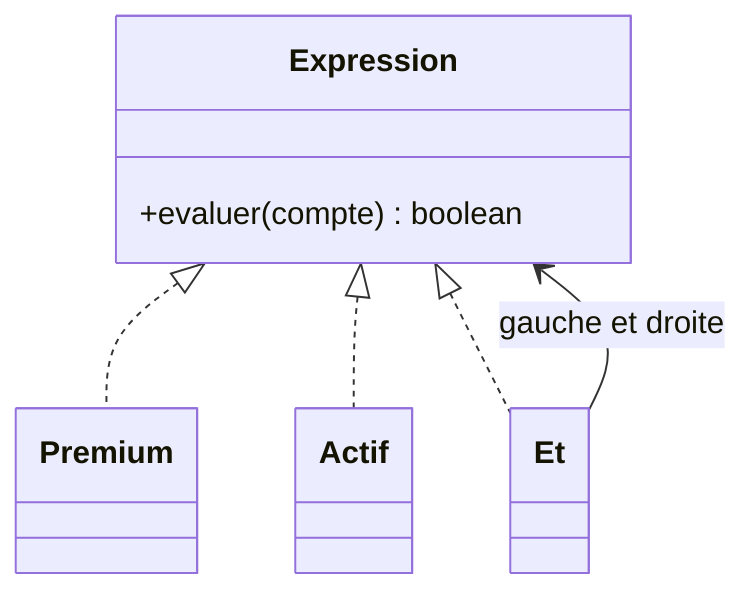

# Interpreter — interpréteur

## Intention et problème

Représenter une petite grammaire par des objets et évaluer des expressions selon cette structure. Une application peut autoriser des règles simples du type « premium ET actif » pour sélectionner des comptes. Placer ces règles dans une cascade de conditions de l’application rend chaque nouvelle combinaison difficile à tester. Une représentation explicite en arbre d’expressions permet de composer et d’évaluer des règles sans multiplier les branches dans le service appelant.

## Participants et mécanisme

Une **expression abstraite** définit l’opération d’interprétation avec un **contexte** (ici, les propriétés d’un compte). Les **terminaux** sont les éléments atomiques du langage ; les **non-terminaux** assemblent ces éléments selon les règles grammaticales. Le **client** construit l’arbre syntaxique puis demande l’évaluation. Dans l’exemple, `Premium` et `Actif` sont des terminaux ; `Et` est une production binaire. La grammaire implicite est restreinte : `Expression ::= Premium | Actif | (Expression ET Expression)`. L’arbre encode déjà la priorité des opérations. Une évaluation récursive doit également prévoir une borne de profondeur si l’arbre provient de données externes : une règle malveillante ou simplement immense peut épuiser la pile. Des tests de tables de vérité permettent de vérifier chaque production indépendamment. Transformer une chaîne utilisateur en cet arbre est une **étape distincte** : la tokenisation, les erreurs de syntaxe, les limites de profondeur et les entrées non fiables ne sont pas résolues par le seul patron Interpreter.



Cet exemple TypeScript évalue une structure assemblée par le programme ; il ne prétend pas parser une phrase arbitraire.

```ts
interface Compte { premium: boolean; actif: boolean }
interface Expression { evaluer(c: Compte): boolean }
class Premium implements Expression {
  evaluer(c: Compte): boolean { return c.premium; }
}
class Actif implements Expression {
  evaluer(c: Compte): boolean { return c.actif; }
}
class Et implements Expression {
  constructor(private a: Expression, private b: Expression) {}
  evaluer(c: Compte): boolean {
    return this.a.evaluer(c) && this.b.evaluer(c);
  }
}
const regle: Expression = new Et(new Premium(), new Actif());
console.log(regle.evaluer({ premium: true, actif: false })); // false
```

## Compromis et voisinage

L’ajout d’une construction grammaticale est local, et les tests peuvent cibler chaque expression. En revanche, une grammaire étendue engendre beaucoup de classes, des arbres coûteux et des diagnostics peu utiles sans parseur dédié. Réserver ce patron aux langages **petits et stables** ; pour des syntaxes riches, de fortes exigences de performance ou une récupération d’erreurs élaborée, choisir un parseur et un moteur d’évaluation spécialisés. **Composite** décrit la structure arborescente des expressions, alors qu’Interpreter précise la sémantique de leur évaluation. **Strategy** remplace un algorithme entier ; ici les objets représentent les productions combinables d’un langage.

## Questions de révision

1. Où traiter une chaîne invalide avant d’appeler `evaluer`, et pourquoi ?
2. Quel coût architectural apparaît quand on ajoute de nombreuses productions et priorités ?

*Référence canonique : Gamma, Helm, Johnson et Vlissides, **Design Patterns: Elements of Reusable Object-Oriented Software**, Pearson, 1994, chapitre « Interpreter » ; explications et exemple reformulés.*
