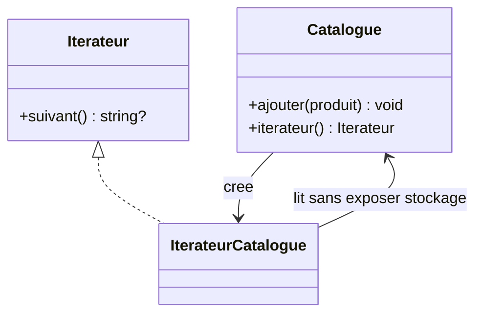

# Iterator — itérateur

## Intention et problème

Donner accès aux éléments d’un agrégat dans un ordre défini sans divulguer sa représentation interne. Un catalogue de produits peut conserver ses éléments dans un tableau aujourd’hui, puis dans un arbre ou une source paginée demain. Si les clients manipulent directement ses indices et ses champs internes, toute évolution de stockage se répercute sur eux. Un itérateur expose une opération de parcours, laissant à l’agrégat la responsabilité du stockage et de l’ordre.

## Participants et mécanisme

L’**agrégat** crée un **itérateur** ; celui-ci mémorise une position et fournit l’élément suivant, ou signale la fin. Plusieurs itérateurs peuvent parcourir indépendamment le même agrégat. Les variantes choisissent ordre, filtrage et mode de parcours : instantané, vivant ou paresseux. Le contrat doit préciser ce qu’il advient si la collection change pendant la traversée. Un itérateur vivant peut voir des éléments ajoutés, manquer des éléments déplacés ou devenir invalide. Dans l’exemple, un compteur de version invalide explicitement le parcours lors d’une mutation : c’est une politique **fail-fast**, pas une garantie universelle du patron.



Le tableau reste privé ; l’itérateur reçoit une fonction de lecture interne et une fonction de version, plutôt que l’array lui-même.

```ts
class Catalogue {
  private produits: string[] = [];
  private version = 0;
  ajouter(p: string): void { this.produits.push(p); this.version++; }
  iterateur(): { suivant(): string | undefined } {
    let index = 0;
    const origine = this.version;
    return {
      suivant: (): string | undefined => {
        if (this.version !== origine) throw new Error("Parcours invalide");
        return this.produits[index++];
      }
    };
  }
}
const catalogue = new Catalogue();
catalogue.ajouter("livre");
const parcours = catalogue.iterateur();
console.log(parcours.suivant()); // livre
```

## Compromis et voisinage

Iterator isole les clients de la disposition des données et autorise des parcours simultanés, mais déplace la complexité vers la gestion d’état et de durée de vie. Un parcours paginé doit en plus définir erreurs réseau, cohérence entre pages et fermeture éventuelle des ressources. Pour une simple liste locale dont le langage fournit déjà une itération adéquate, créer une hiérarchie d’itérateurs dédiée est souvent excessif. **Composite** organise des objets en arbre ; un itérateur peut fournir un parcours profondeur d’abord sans exposer cet arbre. La sémantique de fin (`undefined` ici) doit rester distincte d’un élément valide, sinon le client ne peut plus reconnaître avec certitude l’épuisement du parcours. **Visitor** répartit des opérations sur des types d’éléments ; Iterator ne définit pas l’opération effectuée sur chacun, seulement la façon de les obtenir.

## Questions de révision

1. Que promet un itérateur « snapshot » qu’un itérateur fail-fast ne promet pas ?
2. Pourquoi deux parcours simultanés ne doivent-ils pas partager un index mutable unique ?

*Référence canonique : Gamma, Helm, Johnson et Vlissides, **Design Patterns: Elements of Reusable Object-Oriented Software**, Pearson, 1994, chapitre « Iterator » ; explications et exemple reformulés.*
