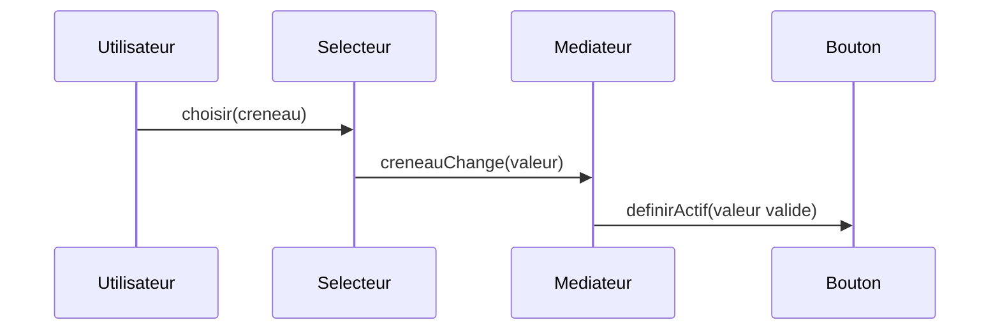

# Mediator — médiateur

## Intention et problème

Centraliser les règles de collaboration entre plusieurs objets pour éviter un réseau de références croisées. Dans un formulaire de réservation, le choix d’un créneau conditionne l’activation du bouton de confirmation et l’affichage d’un avertissement. Si chaque composant connaît tous ses voisins, une modification d’interface entraîne des changements dispersés et des cycles de dépendance. Un médiateur coordonne les réactions à partir d’événements exprimés par les composants.

## Participants et mécanisme

Les **collègues** émettent des notifications vers une abstraction de **médiateur** plutôt que de modifier directement d’autres collègues. Le médiateur concret connaît les collègues nécessaires et applique les règles d’interaction ; les collègues restent responsables de leur propre état et de leur présentation. Le client assemble ces objets et leurs dépendances. Dans l’exemple, le sélecteur annonce le créneau choisi ; le médiateur décide si le bouton est activé. La politique reste lisible à un seul endroit et le sélecteur ne dépend pas du bouton. Si plusieurs événements arrivent de façon asynchrone, le médiateur doit aussi définir leur ordre et éviter qu’une ancienne réponse n’écrase un état plus récent. Son périmètre reste celui d’une interaction précise, non de toute l’application.



Le contrat TypeScript évite un événement générique non typé ; une vraie interface pourrait exposer plusieurs opérations métier explicites.

```ts
interface Mediateur { creneauChange(valeur: string): void }
class Bouton {
  actif = false;
  definirActif(ok: boolean): void { this.actif = ok; }
}
class Selecteur {
  constructor(private mediateur: Mediateur) {}
  choisir(valeur: string): void {
    this.mediateur.creneauChange(valeur);
  }
}
class Formulaire implements Mediateur {
  constructor(private bouton: Bouton) {}
  creneauChange(valeur: string): void {
    this.bouton.definirActif(valeur.trim().length > 0);
  }
}
const bouton = new Bouton();
new Selecteur(new Formulaire(bouton)).choisir("10 h");
console.log(bouton.actif); // true
```

## Compromis et voisinage

Le nombre de liens directs diminue, mais la complexité n’a pas disparu : elle est déplacée vers la coordination. Un médiateur qui absorbe toutes les règles métier devient un **god object** difficile à maintenir ; le découper par processus ou sous-domaine, et laisser les invariants internes dans les objets concernés. Éviter le patron quand deux composants collaborent simplement sans enchevêtrement, ou lorsqu’un service de domaine explicite exprime mieux la règle. **Observer** diffuse des changements à des abonnés sans nécessairement orchestrer leurs réactions ; Mediator décide comment plusieurs collègues interagissent. **Facade** simplifie l’accès externe à un sous-système, mais ne remplace pas forcément les dépendances réciproques à l’intérieur de celui-ci.

## Questions de révision

1. Quels indices signalent qu’un médiateur est devenu un objet omniscient ?
2. Quelle différence entre notifier des abonnés et décider de l’interaction entre collègues ?

*Référence canonique : Gamma, Helm, Johnson et Vlissides, **Design Patterns: Elements of Reusable Object-Oriented Software**, Pearson, 1994, chapitre « Mediator » ; explications et exemple reformulés.*
