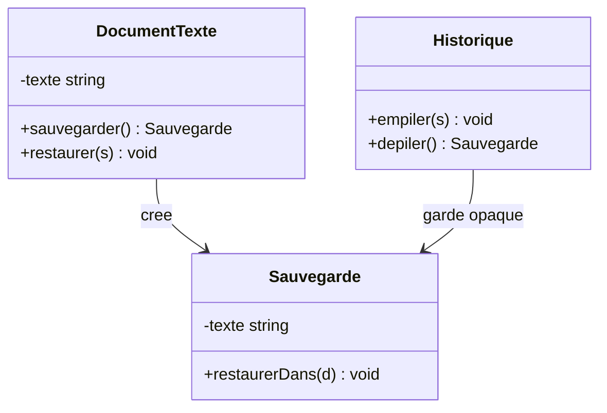

# Memento — mémento

## Intention et problème

Sauvegarder puis restaurer l’état interne d’un objet sans obliger son gardien à connaître sa représentation. Un éditeur de texte doit pouvoir revenir à une version antérieure ; confier à l’historique la copie de tous les champs du document violerait l’encapsulation et rendrait chaque évolution du modèle fragile. L’objet concerné produit lui-même un instantané opaque que l’historique conserve et lui rend lors d’une restauration.

## Participants et mécanisme

L’**originator** possède l’état et sait créer/restaurer un **memento**. Le **caretaker** conserve les instantanés et choisit lequel restituer, mais ne doit pas pouvoir lire ou modifier leur contenu. Ici, un objet `Sauvegarde` expose uniquement `restaurerDans` ; son texte demeure privé et le document crée la sauvegarde. Une limite pratique : TypeScript n’a pas d’amitié de classes et l’exemple laisse la méthode de restauration publique ; une API de production peut renforcer la frontière avec un module, des closures ou des capacités non exportées. Un snapshot cohérent doit capturer ensemble les champs interdépendants ; restaurer uniquement le texte d’un document dont la sélection et le curseur ont changé peut créer un état impossible.



Cet exemple restitue une chaîne immuable ; pour des objets mutables, une simple référence ne suffirait pas à figer l’état.

```ts
class DocumentTexte {
  private texte = "";
  remplacer(t: string): void { this.texte = t; }
  lire(): string { return this.texte; }
  sauvegarder(): Sauvegarde { return new Sauvegarde(this.texte); }
  restaurer(s: Sauvegarde): void { s.restaurerDans(this); }
}
class Sauvegarde {
  constructor(private readonly texte: string) {}
  restaurerDans(doc: DocumentTexte): void { doc.remplacer(this.texte); }
}
const doc = new DocumentTexte();
doc.remplacer("avant");
const historique: Sauvegarde[] = [doc.sauvegarder()];
doc.remplacer("apres");
doc.restaurer(historique.pop()!);
console.log(doc.lire()); // avant
```

## Compromis et voisinage

Les snapshots simplifient un historique local et protègent la représentation, mais peuvent coûter cher en mémoire et en temps ; une politique de rétention, des deltas ou un stockage externe peuvent être nécessaires. Leur restauration peut être incompatible avec une nouvelle version du modèle et ne compense pas des effets externes déjà produits. Éviter Memento pour un état volumineux à haute fréquence si l’on ne maîtrise ni coût ni cohérence. **Command** mémorise une action et peut implémenter une opération inverse ; Memento mémorise un état. Les deux se combinent, sans rendre l’annulation automatique. **Prototype** copie un objet pour créer un autre objet, non pour fournir au gardien une restauration opaque.

## Questions de révision

1. Pourquoi une sauvegarde contenant des références vers des objets mutables peut-elle être invalide ?
2. Comment définir une frontière de cohérence pour restaurer plusieurs champs liés ?

*Référence canonique : Gamma, Helm, Johnson et Vlissides, **Design Patterns: Elements of Reusable Object-Oriented Software**, Pearson, 1994, chapitre « Memento » ; explications et exemple reformulés.*
