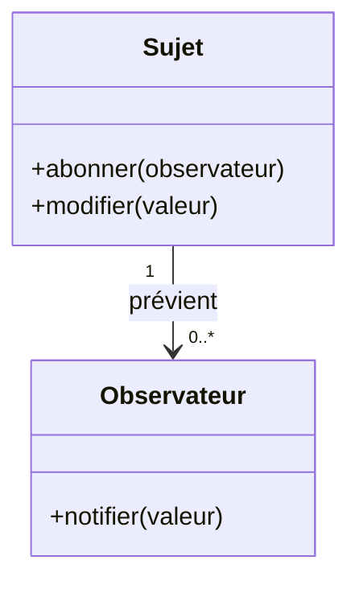

# Observer — synchroniser des vues sans les coupler

## Problème et intention

Un éditeur de document maintient un modèle et plusieurs présentations : compteur de mots, aperçu et indicateur de modification. Si le modèle appelle explicitement chaque vue, toute nouvelle présentation impose de le modifier. À l'inverse, interroger périodiquement le modèle gaspille des ressources et introduit un délai. **Observer** établit une dépendance un-à-plusieurs : quand le sujet change, il avertit les abonnés qui se sont inscrits, sans connaître leur logique métier. Il s'agit ici de notifications **en mémoire, dans le même processus**, non d'une infrastructure de messagerie.

## Rôles et mécanisme

Le **sujet** conserve un ensemble d'observateurs et expose inscription/désinscription. Un **observateur** accepte une notification ; le sujet publie après une mutation réussie. L'exemple envoie une valeur immuable plutôt qu'une référence vers l'état interne : l'abonné sait ce qui a changé sans relire un objet susceptible d'évoluer. Une fonction de désabonnement rend explicite la durée de vie de la relation. La copie de la liste avant notification évite qu'un retrait pendant la boucle modifie l'itération courante.



```ts
interface Observateur { notifier(valeur: string): void }
class DocumentModele {
  private observateurs = new Set<Observateur>();
  private contenu = "";
  abonner(o: Observateur): () => void {
    this.observateurs.add(o);
    return () => { this.observateurs.delete(o); };
  }
  modifier(texte: string): void {
    this.contenu = texte;
    for (const o of [...this.observateurs]) o.notifier(texte);
  }
}
const doc = new DocumentModele();
const compteur: Observateur = {
  notifier: texte => console.log(texte.length)
};
const retirer = doc.abonner(compteur);
doc.modifier("Bonjour");
retirer();
```

La notification est synchrone : une exception d'un observateur interrompt la boucle et remonte à l'appelant ; une politique explicite de capture et de journalisation peut être nécessaire. Les abonnements oubliés gardent des objets vivants. Si la notification déclenche une nouvelle mutation, définir si la réentrance est autorisée et dans quel ordre les événements sont traités. Un `Set` évite ici les inscriptions identiques, mais ne garantit aucune sémantique métier d'ordre.

## Choisir ou écarter

Ne pas utiliser Observer pour une simple dépendance entre deux objets fixes : un appel direct est plus lisible. Un **bus durable** résout un autre problème : livraison entre processus, persistance, reprise, accusés de réception et éventuelle duplication. Ce code ne garantit rien de cela ; remplacer le bus par un tableau de callbacks ferait perdre les événements à l'arrêt du processus. À l'inverse, installer un bus pour actualiser un compteur local ajoute une frontière et des modes de panne inutiles. Par rapport à **Mediator**, Observer diffuse un changement à des abonnés ; Mediator coordonne explicitement les interactions entre collègues.

## Questions

1. Que se passe-t-il si un observateur se désabonne pendant `modifier`, puis si un autre lève une exception ?
2. Quelles garanties supplémentaires faudrait-il pour avertir un service hors processus après un redémarrage ?

*Référence conceptuelle : Gamma, Helm, Johnson et Vlissides, **Design Patterns: Elements of Reusable Object-Oriented Software**, Addison-Wesley/Pearson, chapitre des patterns comportementaux. Exemple et formulation originaux.*
