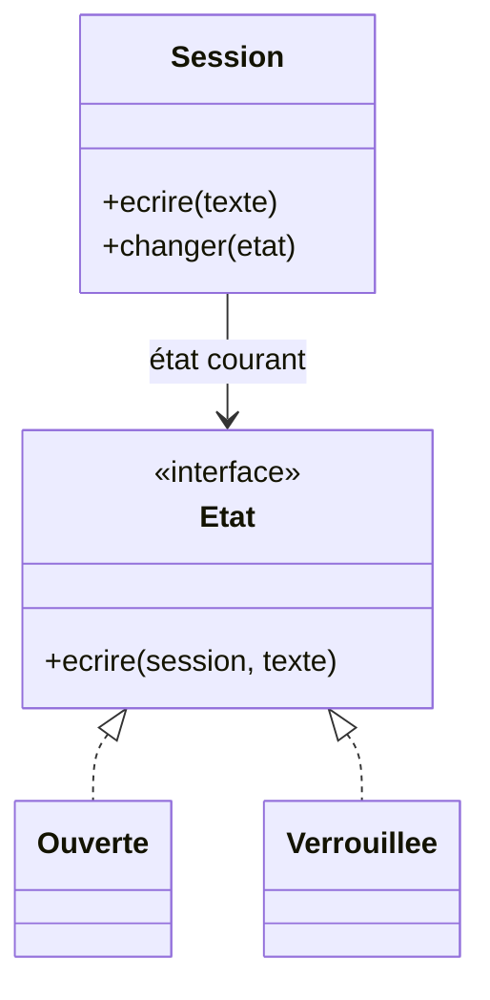

# State — faire évoluer le comportement avec l'état

## Problème et intention

Une session d'édition peut être ouverte ou verrouillée. La même commande « écrire » doit réussir dans le premier cas et être refusée dans le second ; « verrouiller » et « déverrouiller » changent les commandes possibles ensuite. Avec des conditions dispersées dans toutes les méthodes, ajouter un état comme « lecture seule » oblige à retrouver chaque branche. **State** délègue les opérations à un objet représentant l'état courant : les transitions et leurs règles deviennent explicites, plutôt que des tests sur une chaîne ou un drapeau répartis partout.

## Rôles et mécanisme

Le **contexte** expose l'API stable et détient un **état**. Chaque état concret implémente les opérations autorisées et peut demander au contexte de changer d'état. Le contexte garde le contrôle de sa référence ; l'état ne doit pas pouvoir muter arbitrairement ses autres invariants. Dans l'exemple, écrire produit une chaîne, sans persistance : on observe la politique de comportement, pas un système documentaire complet.



```ts
interface Etat {
  ecrire(s: Session, texte: string): string;
  verrouiller(s: Session): void;
}
class Session {
  private etat: Etat = new Ouverte();
  changer(etat: Etat): void { this.etat = etat; }
  ecrire(texte: string): string { return this.etat.ecrire(this, texte); }
  verrouiller(): void { this.etat.verrouiller(this); }
}
class Ouverte implements Etat {
  ecrire(_s: Session, texte: string): string { return `Ajout: ${texte}`; }
  verrouiller(s: Session): void { s.changer(new Verrouillee()); }
}
class Verrouillee implements Etat {
  ecrire(): string { throw new Error("Session verrouillée"); }
  verrouiller(): void { /* déjà verrouillée */ }
}
const session = new Session();
session.verrouiller();
```

La transition vers `Verrouillee` est déclenchée par l'état `Ouverte` ; une commande ultérieure utilise donc automatiquement le nouveau comportement. Pour une vraie écriture, il faudrait distinguer validation, effet et transaction : le pattern ne garantit ni atomicité ni persistance. La décision « verrouiller deux fois ne fait rien » est une règle de domaine, non une obligation du pattern.

## Coûts et frontière

State introduit plusieurs classes et peut disperser les transitions. Une matrice des transitions autorisées et des tests par état permettent de garder une vue d'ensemble. Si deux états n'ont qu'une différence triviale et stable, un `if` local peut être préférable. Ne pas instancier une classe par valeur d'un simple champ : il faut une **variation réelle de comportement** et, souvent, un cycle de vie.

À comparer avec [[Pattern - Strategy|Strategy]] : les deux délèguent à une interface, mais Strategy représente des **algorithmes substituables** choisis par un client ou une configuration ; State représente la **phase courante** d'un même objet et porte souvent ses transitions. Un client peut choisir une stratégie de tri sans faire « évoluer » le trieur ; une session verrouillée ne choisit pas librement sa conduite selon la préférence de l'appelant.

## Questions

1. Où placeriez-vous l'interdiction de passer directement de « verrouillée » à « archivée » ?
2. À partir de quel seuil remplaceriez-vous deux conditions locales par des classes d'état ?

*Référence conceptuelle : Gamma, Helm, Johnson et Vlissides, **Design Patterns: Elements of Reusable Object-Oriented Software**, Addison-Wesley/Pearson, chapitre des patterns comportementaux. Exemple et formulation originaux.*
